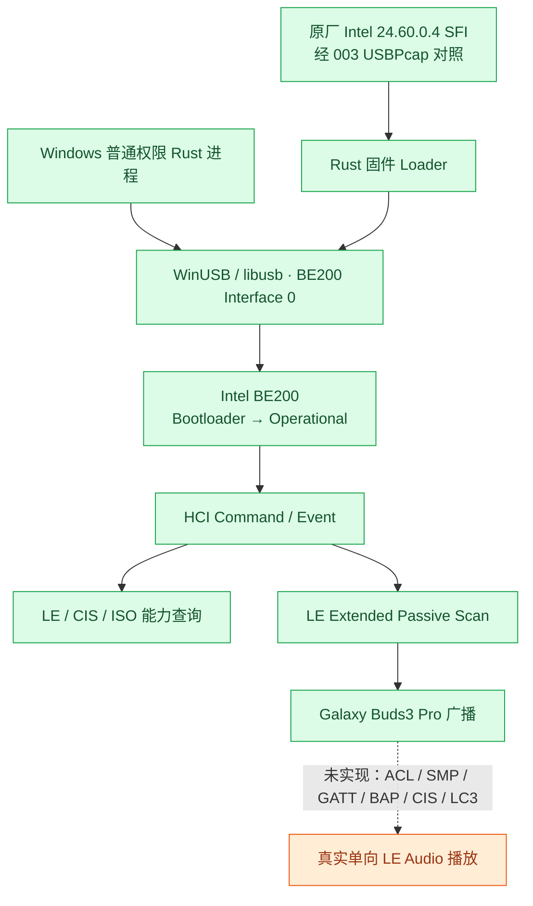
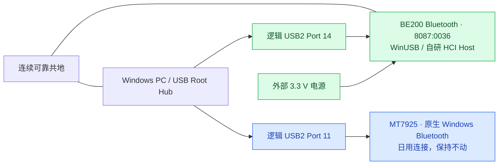
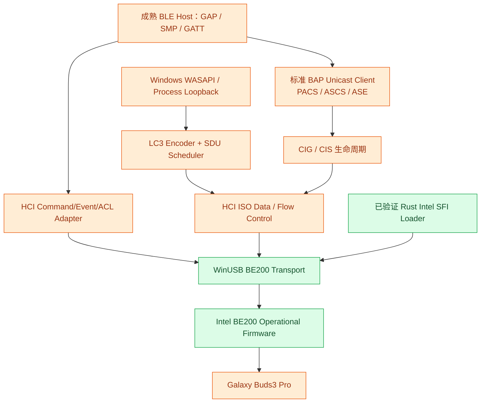
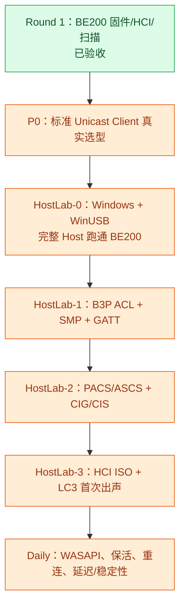

# BE200AudioHub — Round 1–4 全量合并档案

> **性质：原文汇编，不是新的技术判定。** 下方依 Round1 → Round4 按顺序收录四份经 SHA 验证的原始文档。各轮“当前状态”“下一步”仅反映其**历史截止点**，不可覆盖后续 Round 的新结果。
>
> **截至 Round4 最新已证实状态**：R5.2-B 双耳 CIS 建立、显式断开、双 ASE 回 Idle、Remove CIG、Bond 不变；R5.3 ISO Data Path / LC3 音频仍未 HIL。
>
> 速读请看 [README.md](./README.md)、[TIMELINE.md](./TIMELINE.md)；所有故障和修复见 [BUG_FIX_REGISTER.md](./BUG_FIX_REGISTER.md)。

## 原文目录

- [Round 1 — Intel BE200 固件/HCI/扫描](#round-1-原文)
- [Round 2 — Bumble-RS 接入/首次 ACL](#round-2-原文)
- [Round 3 — SMP/Bond/双 ACL/PACS/ASCS](#round-3-原文)
- [Round 4 — Codec/QoS/CIG/双 CIS](#round-4-原文)

原始四文件分别为 [Round1.md](./Round1.md)、[Round2.md](./Round2.md)、[Round3.md](./Round3.md)、[Round4.md](./Round4.md)；下文标题和正文未经过概括/改写。

## 原始输入身份

```text
Round1.md SHA256 26e07c4a68e63019ee72b126359ca682ba86d93e056c56db935a5959a794bff7
Round2.md SHA256 44c3198688a071a6427bea9988387775687da1efb34a3cbde5449d319e960be5
Round3.md SHA256 b8e3d184b79d900ccffb851217dab2c7aa6e95ca33f964a776f4492e8b77180c
Round4.md SHA256 89676bcc3eb86400fa91360fa9fb88a8edf7aa64132f79e9f8e6e471bb07c06d
```

---

## Round 1 原文

<!-- BEGIN Round1.md; original verified Git Blob cc23b3a95f0edaa596192ebbd819134e401fa9ac -->

# BE200AudioHub · Round 1：从 Windows LE Audio 故障到独立 BE200 Controller / BLE Discovery

> **性质**：Round 1 技术总结、决策记录与工程复盘（供归档、后续 Chat 接棒、团队评审）。  
> **实验主体时间**：2026-10-11（原会话记录）；**整理日期**：2026-10-14。  
> **源代码仓库**：[`STanJK/BE200AudioHub`](https://github.com/STanJK/BE200AudioHub)，私有仓库，`main`。  
> **本轮最后核实的 HEAD**：`04a089e6a3d9476350e856ea322953e3f934a087`。该 SHA 是**本轮历史快照**，不是对未来 HEAD 的保证。  
> **证据来源**：用户的 Windows PowerShell/Cargo 实测输出；`001`–`004` USBPcap；原厂 Intel Windows 驱动包与 SFI/DDC；本轮生成的固件重组/抓包报告；BTstack 源码静态审查；GitHub 提交及实验文档。  
> **文档边界**：只写本轮有据可查的事实、已作出的决定与明确的推论；**不把尚未实现的 BLE ACL、GATT、CIS 或 LC3 播放写成完成**。本文件不包含私有固件、PCAP、驱动或源码副本。

---

## 0. 一页结论

Round 1 最终证明了一条过去完全受制于 Windows Bluetooth Host 的链路，可以由我们自己的 Windows 用户态程序独立掌控到以下程度：

1. **Rust + WinUSB 直接打开、Claim/Release BE200 USB Interface 0**，不经过 Windows `BthPort`/`BTHUSB` Host 接口。
2. **从 Intel 24.60.0.4 的 `ibtusb.sys` 恢复完整 RSA+ECDSA SFI 格式固件**，并与原厂 Windows 冷启动抓包逐字节对照。
3. **自己的 Rust Loader 在真实 BE200 上完成 3,960 次 Secure Send**，收到固件接受和 Boot Complete 事件，并把 Image Type 从 `0x01`（Bootloader）带到 `0x03`（Operational）。
4. **独立查询标准 HCI/LE/ISO 控制器能力**，确认 CIS Central 可用、ISO Buffer Size V2 返回 `248 B × 8`。
5. **独立实施 LE Extended Passive Scan**，在 Buds3 Pro 佩戴和配对模式下收到真实的 `Galaxy Buds3 Pro (2F23)` 广播报告；扫描能正确终止并释放 USB 资源。

以上构成了**一个有实机证据链的 Controller Bring-up + HCI + BLE Discovery 原型**，而**不是**一个已完成的 Windows LE Audio Dongle。BLE ACL 连接、SMP/Bonding、ATT/GATT、标准 PACS/ASCS/BAP、CIG/CIS 建立、HCI ISO 实际 TX 与 LC3 音频播放仍未在本轮实现。



**Round 1 最重要的转折**：先前是在 Windows 原生 LE Audio 上围绕故障做绕行；现在已经有能力在控制器 Host 侧自行设计后续连接与 CIS 生命周期策略。成功的是**控制权和证据链**，不是音频性能或产品化指标。

---

## 1. 项目起源、目标与严格的范围边界

### 1.1 起源：为什么不继续只修 Windows Relay

既有 `LE-Audio-Relay` 方向通过 Windows WASAPI Process Loopback 捕获应用声音，渲染至 B3P，并用持续音频输出降低静音拆链、CIS 重建导致声像/相位随机异常的发生机会。其日用架构含牺牲端点（优先 NVIDIA HDMI）、`48 kHz / 32-bit Float / Stereo`、10 ms 量级 Ring Buffer、`GameEffects` 默认渲染分类和持续 Keepalive。

这条路已有实用价值，但**仍由 Windows Bluetooth Host 及其 ACX/LE Audio 策略控制底层连接**。旧实验在 Intel AX21/BE 系列和 MTK 等路径中观察到 LE Audio 功能暴露/声像行为不一致，Windows 的设备策略与控制器通过标准 HCI 声明的能力不能混为一谈。

因此 BE200AudioHub 不是简单重写一个 WASAPI 播放器，而是回答更靠下的一层问题：**能否在 Windows 用户态自己运行 Bluetooth Host，直接决定与 Galaxy Buds3 Pro 的连接、CIG/CIS 及 ISO 音频生命周期？**

### 1.2 被确认的目标

| 项目 | Round 1 的决定 |
|---|---|
| 平台 | Windows 用户态；不要为了这个 Dongle 另做 Linux 桌面开发 |
| 控制器 | Intel BE200，独立于系统日用的 MT7925 |
| 耳机 | 首先针对 Samsung Galaxy Buds3 Pro；未来考虑新型号 |
| 音频方向 | **PC → 耳机单向下行**；独立麦克风提供输入，首版不做耳机麦克风通道 |
| 固件 | **使用 Intel 签名 Operational Firmware**；自研的是 Host，不试图破解或替换 Intel Controller 微码 |
| 日用目标 | 更可控的配对、CIS 维持/重建、LC3/ISO 调度及延迟，而非单纯“能够扫描” |
| 研发方法 | 用既有成熟开源协议栈来跳过重复劳动；自研只聚焦 BE200 移植层、实时 ISO/音频与生命周期策略 |
| 发布 | 当前私有实验；如以后发布/商业化，另行审查许可证、固件分发和独立实现边界 |

### 1.3 三种“支持 LE Audio”必须分开

1. **Controller 硬件支持 CIS/ISO**：R1.6a 已由 HCI 确认。
2. **Host 能建立 LE ACL、GATT、CIG/CIS 并收发 ISO SDU**：Round 1 尚未实现/验证。
3. **B3P 实际播放声音，稳定工作且满足延迟要求**：Round 1 更未完成。

不能因为第一条成立就宣称 Windows BLE 音频链路已经打通；也不能因 Windows 设置页显示能力开关缺失，就推翻控制器 HCI 返回的真实特性。

---

## 2. 硬件、驱动与安全约束

### 2.1 实机拓扑

- 开发主机：Windows 11；VS Code 内置 PowerShell **不是管理员权限**。实际 Cargo 编译、WinUSB Open/Claim 和 HCI 操作均可在普通权限运行。
- 本地代码：`C:\STanJK\Development\LEAudioLab\BE200\BE200AudioHub`。
- Intel BE200 Bluetooth：USB VID/PID `8087:0036`，本轮 PnP Instance ID `USB\VID_8087&PID_0036\5&47B74AE&0&14`，逻辑 Hub Port 14；USB Device Address 随重新枚举改变，实测由 13 变 14，**不可写死**。
- 日用蓝牙为 **MediaTek MT7925**，另一个逻辑 USB2 端口 11。二者可共用 USBPcap1 Root Hub 捕获，但**绝不能误改 MT7925、USB Root Hub、xHCI 或共享的前置 USB2 Header**。
- 实验硬件：BE200 E-key → M-key → Breakout；USB2 D+/D− 独立拉线；外部可控稳压 3.3 V 供电，地线与 PC 共地。需要防范数据线反向供电、悬空地、短路和误触热插拔；已做成功实验不等于整个飞线 Rig 具备产品级安全性。



### 2.2 USB 实测 Endpoint

| 功能 | Endpoint / Interface | 状态说明 |
|---|---|---|
| HCI Command | Interface 0 / EP0 Class Control OUT，`bmRequestType=0x20` | R1.4/R1.5/R1.6 实际可用 |
| HCI Event | Interface 0 / Interrupt IN `0x81` | 实际可用；需要事件组帧与分片/合包处理 |
| ACL | Bulk OUT `0x02`、Bulk IN `0x82` | 描述符/参考实现表明该路径；**本轮未建立 ACL** |
| Intel Bootloader Secure Send `0xFC09` | **Bulk OUT `0x02`** | 003/004 实际验证，与一般 EP0 HCI Command 不同 |
| Interface 1 SCO Isochronous | USB 其他 altsetting/iso endpoints | **不能由此认定 LE CIS 的 HCI ISO 就走这条 Interface** |
| HCI ISO via Bulk | 待验证 | 后续与 BTstack/Zephyr/参考驱动实测 USB DATA path |

### 2.3 Windows 驱动绑定的决策

最初原厂 Intel 驱动：

- Service `BTHUSB`、Provider `Intel Corporation`。
- INF `oem31.inf`、Version `24.60.0.4`。
- `cargo run -- driver status` 输出与 PnP 属性吻合。
- `driver backup --out ...` 导出 **3 个文件**，`driverBindingChanged: false`。

随后使用 **Zadig 只对 `8087:0036`** 手动切为 WinUSB：

- Service `WinUSB`、INF `oem17.inf`、Provider `libwdi`。
- `driver verify` 返回 `winusb_binding_verified`；`usb probe` 成功 `Open → Claim Interface 0 → Release`。
- 没有在 Rust 中实现自动换驱动；管理员 PowerShell 仅用于手动变更/回滚，普通开发不提升权限。
- **原厂 Intel Driver 的真实回滚尚未演练**。导出 INF 不等于完整系统还原点；`pnputil /add-driver /install` 不保证强制选择排名较低的驱动，应在**精确设备实例**的设备管理器里执行恢复，避免批量影响其它设备。

**反思**：应先建立可恢复性和设备作用域的检查，再做高权限的驱动操作。USB Address 可以变化，但 VID/PID、Interface 和 PnP Instance/Location guard 必须明确。

---

## 3. 实验路线：001 → 004，再到 R1.6

### 3.1 R1.1/R1.2：先只读，随后逐层增加权能

第一版 Rust `be200hub` 使用 `rusb`（vendored libusb）和 `log`，提供 `doctor`、`usb list`、`usb inspect`，并参照 VibeFactory 实现异步日志、滚动写文件。源码放在私有 `STanJK/BE200AudioHub`。Windows 本机初期 `cargo test` 为 2/2 PASS；受本地设备与驱动控制限制，助手的 GitHub 提交不能代替真实 Windows 编译与硬件验证。

早期三个 USB 实验的重要区别：

| 实验 | 操作 | 发现 | 工程含义 |
|---|---|---|---|
| `001-pnp-restart.pcapng` | Windows PnP Restart | 未重放完整固件加载 | 不能把 PnP 重启等同真正冷启动 |
| `002-PortCycle-restart.pcapng` | USB Port Cycle | Controller Operational HCI 初始化可见；支持 CIS 和 ISO buffers | 端口重新枚举也不必重载签名 Firmware |
| `003-ColdBoot.pcapng` | 外部 3.3V 真正断电/重新上电 | Intel 真实 Bootloader、Secure Send、Boot 及后续 HCI 初始化 | 为独立 Loader 提供可复验协议依据 |

这些实验确认：**USB Port Cycle、PnP 重启、BE200 真实失电后的 cold boot 是不同的状态转移**。只有最后一种本轮观察到了完整固件下载流程。

### 3.2 R1.3a / R1.3b：从“枚举”到“拥有 Interface 0”

R1.3a 构建了 `driver status` / `driver backup`：严格只匹配 BE200、记录 PnP、INF、Provider、Service、USB Location 和恢复提示，避免误对普通蓝牙适配器或 Root Hub 采取操作。R1.3b 由操作员安装 WinUSB，Rust 负责验证 `WinUSB` 和 PnP OK，然后执行短时 `open/claim/release`，不发 HCI、不重启控制器。

R1.3b 本机成功输出包括 `Open: OK`、`Claim interface 0: OK`、`Release interface 0: OK`，编译时只有一个可直接去除的 `unused_mut` 警告。**至此掌握的是 USB Interface 所有权，不是 Bluetooth Link Layer。**

### 3.3 R1.4：第一条完全独立的 Intel HCI Command

在设备已 Operational 的情况下发送 Intel `Read Version (0xFC05)`，1 字节参数 `0xFF`，EP0 Class Control OUT；在 `0x81` Interrupt IN 上组装 HCI Event，匹配相应 `Command Complete`，解析 Intel TLV。为防止版本事件超过 USB 64-byte Max Packet 导致误判，实现了大包接收和事件重组。

实机输出：

```text
Intel HCI Read Version: success (status 0x00)
Image: Operational (0x03)
CNVi TOP: 0x02001910
CNVr TOP: 0x02001910
TLV records: 30
Ignored unrelated HCI events: 0
Release interface 0: OK
```

这一步的价值是**首个与 Windows Bluetooth Host 解耦的 Host↔Controller 命令往返**。但它只证明厂商 HCI 命令/事件收发，不代表 BLE RF 通信。

### 3.4 R1.5a：对 Intel `.sfi/.ddc` 的离线理解

最初拿到的 Linux Intel firmware：

| 文件 | 大小 | 本轮检验 |
|---|---:|---|
| `ibt-0291-0291.sfi` | **978,976 B** | RSA+ECDSA 头、Payload Offset 964、嵌入命令 3,959、4-byte aligned 数据分组/片段 3,950、Boot Address `0x00100800` |
| `ibt-0291-0291.ddc` | **4 B** | 合法 DDC：`03 28 01 18` → Length 3、Parameter ID `0x0128`、Value `0x18` |

Linux SFI 声明 Build **145** / 2026 Week 36；DDC 只有 4 B **并非数据截断或文件损坏**。`firmware inspect` 对完整 Payload 的 DATA span `[964, 978976)` 作结构校验，且明确输出：`cryptographic signature verification: NOT PERFORMED`、`USB/HCI activity: NONE`。

**重要区别**：SFI 存储的签名头/固件 Payload 不等于在特定 SBE 路径上全部会被下载的字节。还原 HCI `0xFC09` 必须知道 SBE 类型、签名头分支和分片规则；**合法结构不代表镜像有权限启动，也不代表适配该 BE200**。

### 3.5 R1.5b 前半：从 Windows USB 抓包恢复完整 OEM 镜像

最初疑问：“能否把抓到的 Windows 固件恢复成原始包？” 对 003 的复核确定：

- Intel `0xFC09` **3,960 条**，其中 ECDSA INIT `128 B`、PKEY `96 B`、SIGN `96 B` 和 **3,957 条 DATA**。
- ECDSA header + DATA 为 **980,196 B**，DATA 为 **979,876 B**。
- `003-ColdBoot.pcapng` 捕获的 3,960 个 USB 固件传输均可恢复为成功提交的 HCI wire blocks。
- **仅凭总线抓包不能证明有完整原始 `.sfi`**，因为 ECDSA 启动时 **644 B RSA 头未经过 USB 传输**。

随后从用户导出的 **Intel 24.60.0.4 `ibtusb.sys`** 中找到与这 `980,196 B` 一致的连续字节序列，并找到紧邻其前的 **644 B RSA 头**；CSS 头自身的声明长度也与镜像边界相符。这使得实际恢复出了完整 **980,840 B 双签名 SFI 格式镜像**：

`be200_intel_windows_24.60.0.4_usb_verified.sfi`

| 属性 | Windows OEM | Linux SFI |
|---|---:|---:|
| 文件大小 | **980,840 B** | 978,976 B |
| ECDSA + Firmware DATA | 980,196 B | 978,332 B（含 ECDSA 320B + DATA 978,012B） |
| Embedded HCI Commands | **3,967** | 3,959 |
| HCI Secure Send DATA blocks | **3,957** | 3,950 |
| 声明 Build | **176** | 145 |
| 构建周 | 2026 Week 26 | 2026 Week 36 |
| 本机实际启动 | **Intel 原厂已启动，后又由 Rust 独立启动** | 仅离线解析，未在本机冷启动 |

**注意**：Build 编号与声明周数之间并非简单递增，不能无证据声称“Linux 的 Build 145 一定比 Windows Build 176 旧/新”或功能更完整。恢复的 Windows 镜像严格说是**Windows 驱动内嵌的完整 SFI 格式镜像**，并未证明 Intel 曾用这个文件名独立发布它。`ibtusb.sys` 中还发现其它候选签名镜像，只有与 003 完全匹配的那份被选为 BE200 首次独立启动基准。

关键 SHA256（作为日后重新确认输入的身份锚）：

```text
Windows OEM SFI (980840 B)
939a9b32ad11d8962abfd10cb24d5bd90d7848218af4ea438cf6490243a618d4

Windows ECDSA + DATA (980196 B)
8ceff0ecd6b41ff25401036c1baf7c597d3d59f681c6cbc73c5812d82d65ddf0

3,960 HCI 0xFC09 完整请求拼接 (996,036 B)
55200bef2efadd869500baf58909623fbf23c8d26e6218458cbf7a1fd8923531

Linux ibt-0291-0291.sfi
ab04144f4b05dbd7baa2e3b0def81b87e27652accc35193582468f570f606018

DDC ibt-0291-0291.ddc
e0fb10fe29f60607d6507ced3f697492d9611f62c4765feaee59c4bd4101d3e7
```

**首轮固件选择改变**：最初拟先用完整的 Linux SFI，后来从 `ibtusb.sys` 恢复 Windows OEM SFI 后，改为**第一轮必须使用已在同一张 BE200 上由 Intel Windows 驱动成功加载过的 Windows 镜像**，并锁死其 SHA256，降低硬件和协议两端的不确定性。Linux 镜像保留为比较基线，不直接交给第一版实机 Loader。

### 3.6 R1.5b 后半：独立 Rust Firmware Loader 实机 PASS

Rust Loader 从离线解析/计划演进到单次启动执行入口：在写入前检查 SHA256、USB 目标、WinUSB Service、BE200 型号、当前 Image Type、Hardware Variant、Secure Boot、SBE Type、Boot Address；严格单次传输，不做自动失电/重试/泛化 Opcode 注入。新增只读 `firmware preflight` 用于事前检查。

关键的 **004 捕获 + 控制台输出** 构成了两个互相独立的验证面：

| 阶段 | HCI / Intel 协议动作 | 004 结果 |
|---|---|---|
| 启动前 | `0xFC05 FF` | `Bootloader (0x01)`，CNVi/CNVr TOP `0x02001910`，HW Variant `0x1C`，Secure Boot `1`，SBE `1`（ECDSA） |
| 固件前 DDC | `0xFC8B 03 86 01 01` | Command Complete 成功 |
| 固件传输 | **Bulk OUT `0x02`，`0xFC09`，3,960 包** | **3,960/3,960 USB 成功完成**；与 003 Intel 原厂逐包零差异 |
| 下载结束 | Intel Vendor `0xFF/0x06` | 下载被控制器接受 |
| Boot | `0xFC01`，地址 `0x00100800` | 请求正常 |
| 完成启动 | Intel Vendor `0xFF/0x02` | Boot Complete |
| DSBR | `0xFC0A 00 00` | Command Complete 成功 |
| 重新核验 | `0xFC05 FF` | **Operational (0x03)** |
| Operational DDC | `0xFC8B 03 28 01 18` | Command Complete 成功 |
| 资源释放 | `release_interface(0)` | 成功 |

具体证据：`004-R1.5b-ColdSend.pcapng` 对应固件 Wire SHA256 与 003 的 **3,960 条 `0xFC09` 按序完全相同**；每条 Bulk OUT 都有成功 USB Completion。ECDSA+DATA 也与 Windows OEM SFI 自偏移 `644` 到 EOF 精确一致；嵌入 3,967 条完整 HCI 命令、边界无残片。

启动计时（仅各一次，且**不是**从外部 3.3V 上电开始的总时间）：

| 衡量 | Intel 原厂 003 | Rust 004 |
|---|---:|---:|
| 首条 Secure Send → Boot Complete | 1,337.05 ms | **1,521.96 ms** |
| 最后一条 USB 完成 → 下载确认 | — | 18.37 ms |
| Boot 命令 → Boot Complete | — | 55.39 ms |
| 固件 Bulk 提交完成时间中位数 | 304 μs | 315 μs |

单次相差约 **184.91 ms（13.8%）**，不能推出 Rust Loader 在统计上更慢或更差，也不该在功能正确性前急着优化不到 200ms 的单次差异。

**签名边界**：

- Rust `firmware inspect/plan` 检查结构、哈希和 003 的 on-wire SHA256，**不是独立用 Intel 公钥验证原厂签名**。
- Intel 控制器的 Secure Boot Engine 负责授权并验证该签名固件；这是“使用合法签名固件独立启动”，不是“解锁/绕过/替换 Intel 微码”。
- 当前实机 Loader 锁定 Windows 24.60.0.4 Build 176，不是支持任意 Intel 适配器和 SFI 文件的万能刷写工具。
- **真实掉电后通常要重新加载 Controller Operational Firmware；进程关闭、普通 Host 重启、耳机重连并不要求每次物理冷启动。** 未来状态机应检测 Image Type：Operational 直接连接，Bootloader 才触发受控加载。

### 3.7 R1.6a：标准 HCI 能力查询 PASS

在 R1.5b 已启动的 Operational BE200 上，执行 `hci capabilities`，完全无需再操作供电。实际读取：

| 字段 | 真实控制器报告 |
|---|---|
| HCI Version / LMP Version | `0x0D` / `0x0D` |
| Revision / Subversion | `0x44B0` / `0x44B0` |
| Manufacturer | `2`（Intel） |
| LE Features | `0x000000BE3F01F9FF` |
| LE 2M PHY | `true` |
| LE Extended Advertising | `true` |
| **CIS Central** | **`true`** |
| CIS Peripheral | `true` |
| ISO Broadcaster | `false` |
| Synchronized Receiver | `false` |
| LE States | `0x000003FFFFFFFFFF` |
| Extended Scan 指令支持 | `true` |
| LE ACL Buffer Size | `251 B × 6` |
| **LE ISO Buffer Size V2** | **`248 B × 8`** |

**重要误解的纠正**：`ISO Broadcaster=false` 和 `Synchronized Receiver=false` 是 BIG/BIS **广播**角色的特性位，并不是“控制器不支持 ISO”。我们目标是 **Unicast CIS Central**，其功能位为 true，且控制器有独立 ISO Buffer；但这**仍不证明已经可发送 ISO 连接音频**，因为缺少实际 CIG/CIS/USB ISO TX 验证。

### 3.8 R1.6b：BLE RF 扫描与 Buds3 Pro 真实发现 PASS

三轮 `ble scan --seconds 10`：

| 轮次 | 用户描述的 B3P 状态 | 总报告 | 观察 |
|---|---|---:|---|
| 1 | B3P 未启动 | 0 | 正常限时结束、主动 Scan Disable + Release |
| 2 | 取出并佩戴 | 3 | 2 条具名 `Galaxy Buds3 Pro (2F23)` Extended Advertising，RSSI `-39/-42 dBm`，SID 3，另有一条截断/空数据报告；控制器报告 Extended Scan Timeout |
| 3 | 配对模式 | 7 | 2 条具名 B3P，RSSI `-49/-52 dBm`，另有其它未具名广播；Disable + Release 成功 |

扫描使用 **LE 1M Passive Extended Scan**：不发送主动 Scan Request、不连接、不配对；Host 限时与 Controller native duration 双重约束，默认以单轮临时 `#ID` 遮蔽 MAC 地址。既有实现能够解析 Legacy/Extended 广播并做 AD Name 清理。

- `event_type 0x0001` 的 Connectable 标志存在，说明有进一步尝试连接的候选广播。
- `0x0041` 除 Connectable 标志外还带 Data Status = truncated，`data=0 B` 不能解释成另一个固定耳机实体。
- `3 reports / 3 unique` 和 `7 / 7` 只是按原始地址类型、地址统计，**不是 3 或 7 台实体，也不是左右耳固定拓扑**；RPA 轮换与协调集身份仍待 SMP/CSIS 证实。
- 首轮 0 条不意味着扫描实现失败，因为随后同一系统确实收到 B3P RF 广播。
- 当前 R1.6 硬件证据是用户 CLI 输出，**没有本轮单独的 R1.6 USBPcap**；R1.6 新增全部 Unit Test 的 `cargo test` 成功日志也没有被单独提供，不能沿用 R1.5b 的 `22 passed` 假称 R1.6 新测试已经覆盖验收。

**至此 R1.6a/b 以真实 HCI 能力结果和 BLE 广播结果通过实验验收。**

---

## 4. 工程与源码架构的真正进展

### 4.1 已经有的设施

| 层次 | 所有权 | 状态 |
|---|---|---|
| 独立 3.3 V + USB2 实验 Rig | 本地硬件 | 成功运行，仍是实验级飞线 |
| PnP 状态、OEM 驱动备份/恢复文档 | Rust + PowerShell | Status/Backup 已验收；真正回滚未测 |
| WinUSB Interface 0 的受控打开/释放 | Rust + `rusb` | 实机 PASS |
| Intel Bootloader/SFI/DDC 离线解析与签名传输计划 | Rust + 抓包证据 | PASS；签名密码学独立验签不做 |
| Windows OEM Build 176 固件独立冷启动 | Rust + BE200 | **实机 PASS** |
| HCI 控制命令与 Event 重组 | Rust | `0xFC05` / capabilities 实机 PASS |
| LE Extended Passive Scan | Rust | 三轮 B3P 广播发现 PASS |
| Windows 低延迟 PCM 获取/Ring 的经验 | 旧 `LE-Audio-Relay` | 可复用设计；尚未连接新 Host |
| BTstack BLE Host / SMP/GATT / CIG/CIS 基础源码 | 开源依赖 | **源代码存在，但尚未 Windows BE200 集成实测** |
| 标准 BAP Unicast Client + ISO + LC3 全链路 | 未选定/未完成 | **Round 1 未实现** |

### 4.2 建议的可替换架构（尚未落地）



> 图中 WASAPI 部分虽然可复用已有工程经验，但**还没有接入 BE200AudioHub**。BTstack、TrouBLE、Zephyr 的既有代码不能被自动视为已完成集成。

---

## 5. 开源 Host / LE Audio 调研及最关键的一次纠偏

### 5.1 初期选型：不能从零重复实现所有 Bluetooth Host

为了达到可日用的 B3P Dongle，下一层确实需要 BLE Central、LE ACL、L2CAP、ATT/GATT、SMP/Bonding，再到 PACS、ASCS、CAP/BAP、CIG/CIS、ISO 和 LC3。但**需求层级表不等于开发任务都要由我们从零实现**。

用户明确提出“后面这些东西不是可以抄已有项目吗？”——这个问题改变了开发路线：应先复用已成熟的 Protocol Stack，把工作集中到 **Windows/BE200 HCI Transport、Bluetooth Host 进程集成、ISO 数据面、B3P 互操作、CIS Lifecycle 与实时音频**。

最初评估的候选包括：

- **BTstack**：Windows WinUSB Port、BLE Central、SMP、GATT、部分 CIG/CIS/ISO Core；快速验证候选。
- **Zephyr**：有标准 LE Audio BAP/CAP 相关 API/样例的研究方向；移植 Windows 运行模型是独立问题。
- **AOSP/Fluoride**：Android 系统级 LE Audio Host 客户端研究候选；需确认依赖与宿主移植成本。
- **BlueZ / PipeWire**：Linux 完整 LE Audio 系统集成参考；架构更偏 Linux Host/媒体层。
- **Apache NimBLE**：BLE Host 候选；是否具备足够完整的标准 BAP Unicast Client，需源码核查。
- **TrouBLE**：Rust BLE Host 候选；LE Audio/CIS/ISO 的实际完整度需核查。
- **Google liblc3**：LC3 编码器候选；它本身不替代 BAP/ASCS 客户端。

**到 Round 1 结束仍未完成上述栈的横向完整源码证据对照，不能据此宣布某一栈已经是最终技术选型。**

### 5.2 对用户上传 BTstack Master ZIP 的静态审计

用户上传完整的 `btstack-master.zip`（约 71 MB；ZIP 无 `.git`，不可只凭 `master.zip` 名称断言准确上游 Commit）。审计报告：`BE200AudioHub_BTstackLab_Source_Audit_2026-10-11.md`。

| BTstack 路径 | 发现 | 结论边界 |
|---|---|---|
| `port/windows-winusb` | 存在可在 Windows 运行的用户态 HCI/Host Port | 适合作为 **BTstackLab-0** 起点；尚未编译验证 BE200 |
| `port/windows-winusb-intel` | 带针对旧 Intel 8260/8265 的 Firmware Download 示例 | **不要**取代本轮已验证的 BE200 Rust Loader |
| `platform/windows/hci_transport_h2_winusb.c` | HCI EP0、Interrupt、ACL Bulk 路径存在 | 缺少已连通的 `HCI_ISO_DATA_PACKET` 处理；实际需改造和验证 |
| 同上 | Control Transfer 的 `Setup.Length = sizeof(size)` | 可疑的长度错误，**静态审查怀疑**，需实际审查上下文、修复测试后确认 |
| Windows config/CMake | ISO、Extended Advertising 未按目标启用；LE Audio Lite/LC3 目标并非开箱即构建 | 需要实验分支独立配置/链接 |
| `src/hci.c` | 标准 LE Central、部分 CIG/CIS/ISO 状态管理与分片机制 | 有基础轮子，但“已有核心”不等于“Windows ISO 完整可用” |
| `example/gatt_browser.c` | 示例有自动连接第一个广播者的路径 | 改成同一扫描会话、由操作员明确选择 Connectable 地址；避免随意连接附近设备 |
| `example/le_audio_unicast_gateway_lite.c` | 使用私有 Manufacturer Advertising 协商 LC3 配置，跳过标准 PACS/ASCS/BAP | **不是**能直接连接普通 Galaxy Buds3 Pro 的标准 Unicast Client |
| `src/bluetooth_gatt.h` | 包含 PACS/ASCS/CAS/CSIS UUID 常量 | **常量不是协议实现** |
| `3rd-party/lc3-google` | Codec 代码存在 | 需要移植/链接/Audio Scheduler 才能用于实时播放 |

### 5.3 本轮必须保留的纠偏

最初助手一度从“BTstack Lite 不是标准 BAP Client”推到“我们需要自己写标准 PACS/ASCS/BAP Client”。用户指出“seriously? LE 开发没有已有的开源实现吗？”后明确纠正：

**正确结论**：

- **BTstack 的该快照没有找到一条可直接在 Windows/BE200 上对商用 B3P 运行的、完整标准 Unicast Client**；这是某份源码、某个平台、某个角色的局部结论。
- **这绝不等于行业没有标准 LE Audio 的开源实现**。下一轮应对 Zephyr、AOSP、BlueZ/PipeWire、NimBLE、BTstack、TrouBLE 逐项追查 *标准 BAP Client / CAP Initiator / ISO Transport / Windows 移植性*。
- 单独区分“支持 BLE”“有 LE Audio 例子”“有标准 BAP Unicast Client”“有可在我们的 Windows 用户态/BE200 上运行的成品”，这四个问题不能用同一个勾选框表达。

这次误判暴露了一个研究方法缺陷：**只读了最容易访问的一个演示程序，就对整个开源生态下结论**。今后必须基于代码路径、功能角色、Profile 版本、运行条件和真实集成实验作出判断。

### 5.4 许可证/“净室逆向”的决策与边界

用户决定**先以私有实验求最快可用结果**，愿意复用 BTstack 等已有代码，未来如计划公开再考虑独立实现或授权。这个工程排序合理，但不代表“私有仓库自动豁免上游许可证”。

- 对 BTstack 的私有试验、再分发和潜在商业用途，应按其实际许可证要求处理并保留许可证/版权文本。
- 真正的 Clean-room Reimplementation 不是把读过的源代码改名、改写成 Rust，而应使用独立的公开规范、接口行为与外部测试，以合理的独立开发流程实现。
- 如以后要求宽松许可证公开发布，要么按上游许可证获得适当许可，要么严谨地设计独立实现流程；不要将当前 BTstack 实验分支混进声称净室的正式主线。

### 5.5 改变后的 HostLab 策略（决策方向，非已经交付的代码）

**Rust 独立主线**保持 Firmware Loader、设备生命周期、音频/调度控制；在独立 **BTstackLab** 或最终选定的其它 HostLab 中运行成熟 BLE Host；**同一时刻只能有一个进程拥有 BE200 USB Interface 0**。

- Lab-0：让成熟 Host 以 BE200 当前 Operational 固件正常初始化，读 HCI，扫到广播。
- Lab-1：**同一扫描会话**明确选定 Connectable 目标，获取 LE ACL Handle，验证断链/必要时 GATT/SMP。
- Lab-2：使用已证实完整的**标准 BAP Unicast Client**查询 PACS/ASCS、配置 ASE、CIG/CIS；需要核查左右耳拓扑和地址隐私。
- Lab-3：Windows ISO 数据通道、LC3、测试 SDU/PCM，再与既有 LEAudioRelay 音频管线整合。

**截至 Round 1 结束：BTstackLab-0 尚未运行，BLE ACL/GATT 更未通过。** 是否 BTstack 最终胜出必须依赖下一轮标准 Unicast Client 横向调研。

---

## 6. 完整的决策账本（Decision Register）

| 编号 | 决定 | 为什么 | 状态 / 回退 |
|---|---|---|---|
| D-01 | 从 Windows Keepalive Relay 分出独立 BE200AudioHub Host 项目 | Windows LE Audio 策略/CIS 重建不可控 | 已落实到独立仓库；Relay 可保留作对照 |
| D-02 | Windows 用户态 + Rust + WinUSB；不新增 Linux 日用栈 | 目标是 Windows 插入式单向 Dongle | R1.1–R1.6 实验通过 |
| D-03 | BE200 专用，MT7925 留作原生日用蓝牙 | 隔离风险和设备策略 | 硬件/逻辑端口已区分；长期回归待做 |
| D-04 | 先备份 Intel OEM Driver，再手动指定 BE200 WinUSB | 可恢复性优先，避免误作用于其它设备 | 备份 PASS、绑定 PASS；回滚流程尚未演练 |
| D-05 | 固件只用 Intel 签名镜像，Host 自研，不破解 SBE | 我们要可控的 Host，不是可修改的 Controller Firmware | 004 实机通过 |
| D-06 | 使用 PCAP+源码双证据重构 Intel Boot Protocol，不盲目重放未知 Payload | ECDSA 头/Secure Send Endpoint/Boot Event 有细节差异 | 003/004 3,960 包完全匹配 |
| D-07 | 起初考虑 Linux SFI，恢复 Windows 24.60.0.4 OEM SFI 后首启切换到后者 | 同一 BE200 上原厂启动过，未知变量更少 | Windows Build 176 首启 PASS；Linux Build 145 仅离线 |
| D-08 | 固件 Loader 设置 Bootloader/SBE/型号/哈希/单次尝试 guard | 避免误向 Operational 或错误设备重刷 | 实机 PASS；禁止自动重试 |
| D-09 | 运行软件/连接耳机时**不必每次物理断电** | Operational Firmware 可在供电保持时继续驻留 | 状态决定是否需要 Firmware Load；自动 lifecycle 尚待做 |
| D-10 | HCI ISO 运输路径先据 USB/Host 实现验证，不把 Interface 1 SCO Iso 当成 LE CIS | USB endpoint 名称和 HCI ISO 协议不是一回事 | 待真实 ISO Bulk 实验 |
| D-11 | BLE 扫描只开 Passive、限时、默认隐藏地址 | 先验证 RF 路径，减少副作用和敏感信息 | R1.6b PASS |
| D-12 | BLE Host 优先复用成熟栈，不从零写 SMP/GATT/BAP | 自研协议栈成本高且不直接创造项目核心价值 | 方向确定；具体 Host 未选定 |
| D-13 | 独立 HostLab，BE200 Interface 0 单进程独占 | 保留已验证 Rust Loader，与第三方 Host 解耦 | 提案，尚未做 HostLab 实测 |
| D-14 | 不把 BTstack Lite 的私有 LC3 协议当标准 BAP | 其演示根本不能覆盖商用 B3P 互操作 | 源码已审，下一步全生态核查 |
| D-15 | 私有原型优先；开放/商业化另行梳理许可证及净室边界 | 工程速度与未来合规可同时兼顾，但不能混淆 | 法务/授权事项尚未完成 |
| D-16 | 阶段成功必须来自真实 Windows 构建/CLI/PCAP，而非 GitHub 提交本身 | 远端写源码并不代表本地设备已运行 | 004、R1.6 有实验依据；继续贯彻 |

---

## 7. 本轮反思：技术认识与工作方法

### 7.1 真正值钱的是“可核验证据链”

从 PnP → USB Port Cycle → 真正 Cold Boot，逐步解释控制器的状态转换；从 `ibtusb.sys` 的静态镜像提取 → SFI 结构校验 → PCAP `0xFC09` 逐包比对 → Rust 实机成功启动 → 再以 R1.6 接收到真实无线广播。这比只展示一条 `PASS` 日志强得多：**每层成功都能被不同渠道重复检验**。

最强证据是 003（Intel 原厂）和 004（Rust Loader）在 3,960 包上按顺序逐字节相同，并且后续的 0xFF 下载/启动事件与 Operational 版本查询吻合。这里已经不是“对照接口写代码”的静态演示，而是**独立完成了一次由硬件验证的 Host 初始化**。

### 7.2 但必须收紧“完成”的定义

R1.5b PASS 只能说固件 Bring-up 正确，不代表完全替代 Intel Windows BT Driver；R1.6 PASS 只能说 HCI Capabilities 和 BLE Passive Scan 正确，不代表连接/配对/音频正确。BTstack 代码存在，不代表该代码在我们 Windows/BE200 上已经能运行。今后每一个里程碑都应给出：**输入条件、操作、可观察事件、量化验收、失败边界**。

### 7.3 安全工程与快速 YOLO 可以共存，但条件是失败范围被限定

曾有外部 3.3V 热接线/断电试验，但其价值来自反复确认共地、作用于单一 BE200 和采集可复现 USB 日志；这不等于能把任意电源操作标准化给所有用户。后续默认**保持供电，复用已启动的 Operational Firmware**；不为软件状态错误直接断电，不碰 MT7925/USB Hub。不需要自动循环重刷的情况下，就不要写自动恢复的高风险路径。

### 7.4 过程中的明确失误与修正

- **编译漏项**：R1.5a/1.5b 源码引用 `AppError::Firmware` 却没有在 `src/error.rs` 加变体，导致用户首轮 `cargo test`/`firmware plan` 无法编译。后由 `97a2bd8` 修复；教训是 GitHub 写入之后应有明确的本地编译关口，不能把静态审查当编译通过。
- **Cargo.lock 漂移**：增加 `sha2` 后本机 Cargo 更新锁文件，远端不一定同步。后续应在本地锁文件与测试通过后提交，而不是直接手动拼出校验和。
- **错误泛化**：只审了 BTstack Lite 就推断标准 BAP Client 需要全部自写。用户质疑后纠偏；以后要先做跨项目/跨角色的开源生态调查再选架构。
- **能力层误解**：`ISO Broadcaster=false` 被直觉解读为“ISO 还是 false”。规范上它只约束 Broadcast BIG/BIS；CIS Central/ISO Buffer 是另两项信息。
- **扫描设备计数误解**：按地址的 `unique` 可能被看成不同耳机。RPA、地址类型、协调集还未证明，输出/文档必须严谨。
- **原始 SFI 与 On-wire Byte 的混淆**：USB Capture 没有传输 RSA Header，后从 Windows `ibtusb.sys` 才补齐；以后区分“网络/总线见到什么”和“存储容器完整内容是什么”。
- **性能因果的误读**：Intel 003 与 Rust 004 单次约 185ms 差异，既可能有 Host 实现/USB 调度因素也可能是实验条件；没有多轮统计便不能下性能结论。
- **文档状态漂移**：初期 README/ROADMAP 曾落后于真实测试；每次实机 PASS 后应及时修正文档，区分“implemented / awaiting local test / verified / no longer relevant”。
- **文件跨 Chat 复用的现实约束**：历史助手生成文件未必自动进入用户定义的共享空间，且旧 ZIP 中还可能间接重新打包用户原始上传。Round 1 完结时专门制作索引、去原始副本的综合 Handoff；今后要尊重文件来源、版本和 SHA256。

### 7.5 更高层的判断：项目价值从“能跑”转向“能控制”

本轮硬件 Hack 的趣味性来自端到端的真实反馈：Rust 发出字节 → USB 总线传输 → Intel 控制器状态改变 → RF 收到 Buds3 Pro 广播。工程价值在于验证了 Windows 用户态独立 Controller Host 的可行性。

但科研创新性应更谨慎：复刻 HCI/Secure Send 和标准 BLE Scan 主要是成熟机制的工程移植。更可能出现原创贡献的部分在**可量化的 CIS 生命周期、稳定性、Host scheduling、时钟同步和低延迟策略**。这要求未来同一控制器/耳机下与 Windows 原生 Host 做可控对照，并保留完整原始数据；目前**尚未产生这种对照实验的结论**。

---

## 8. 后续工作与停止条件

### 8.1 当前缺失的模块（不要用“已有轮子”充当验收）

| 模块 | 当前状态 | 下一阶段验收 |
|---|---|---|
| 真实 LE ACL Connection | 未完成 | 同一扫描会话明确选定 B3P，LE Enhanced Connection Complete 返回 Handle，随后主动 Disconnect |
| ACL USB Bulk Framing | 未完成 | 处理 HCI ACL handle/flags/fragment，并在 BE200 上确认 Bulk IN/OUT |
| L2CAP / SMP / Bonding / RPA | 未完成 | 加密、配对与持久密钥管理；不再把 RPA 当固定身份 |
| GATT + B3P Audio Services | 未完成 | 实读 PACS、ASCS、CAS、CSIS（若存在）及权限 |
| 标准 BAP/CAP Unicast Client | **未选定完整可移植实现** | 配 Sink ASE，获得正确 Codec/QoS/Metadata 配置并建立控制面 |
| CIG / CIS | 仅 Controller Capability true | 真正建立一个或多个 CIS，验证重建与同步 |
| HCI ISO Data over USB | 未完成 | 独立确认 BE200 数据收发端点/packet format/flow control |
| LC3 + WASAPI 播放 | 未完成 | 协商帧长后播放可辨识测试音，再接系统音频 |
| Daily Driver | 未完成 | 断连恢复、保活、延迟测量、单耳/双耳处理、长时稳定性 |

### 8.2 下一轮**优先级 P0**：寻找完整的开源标准 Unicast Client

Round 1 最后一次决策纠偏是：**不要急着把 BTstack Lite 当作产品雏形，更不要先决定必须自写 PACS/ASCS/BAP**。应逐项目核对：

1. **Zephyr**：BAP Unicast Client / CAP Initiator 实际支持、API 完整度、移植到 Windows 用户态难度。
2. **Android AOSP/Fluoride**：实际 LE Audio Client Control/ISO 与 OS 依赖，是否可剥离。
3. **BlueZ + PipeWire**：BAP Client/CIS/音频调度实现的分工及 Linux 依赖边界。
4. **BTstack 最新源码**：是否已有标准 Client 更新、Windows WinUSB / HCI ISO 缺口究竟多大。
5. **Apache NimBLE / TrouBLE**：BLE Central/SMP/GATT 完整度及标准 ISO/BAP Client 的确切现状。
6. **liblc3**：作为 Codec 复用，区分 Codec 代码与协议控制面。

要求对每项分别给出：**标准 Profile 角色**、关键源码路径、HCI/ISO 接口、Windows 移植的可行性、许可证、运行级证据。筛出一条**最短可行方案**和一个备选方案，避免对单个仓库做凭印象的否定。

### 8.3 P1–P4 最短实施路径



下一阶段应避免：反复重做 R1.5b Cold Boot；重新安装 BE200 原生 Intel 驱动；任意扫描地址自动连接；在未证明 ISO Data Transport 前断言音频可用；为“实现完整 BLE”先手写庞大的 SMP/ATT/BAP 栈。

### 8.4 工程待办（与核心选型独立）

- 查本机 `git status --short` 和 `git diff -- Cargo.lock`，确认 `sha2` 依赖对应 `Cargo.lock` 是否已提交；勿手动杜撰 Cargo checksum。
- 收集 **R1.6 增量代码的完整 `cargo test`** 成功输出（本轮没有完整上传），以及未来 LE Connection/ISO 测试时的最小隔离 USBPcap。
- 抽查 WinUSB→Intel 驱动恢复演练的风险与设备范围（现有备份不等于回滚已验证）。
- 如果后续引入 BTstack，关注其 Windows WinUSB HCI Control Transfer 长度、目标 VID/PID 固定、ISO TX/RX 和 LC3 Linkage，**先做 BTstackLab-0**，不要直接尝试 B3P 音频。
- 对固件、驱动和 USBPcap 采取私有保管；PCAP 可能包含同 Root Hub 上的 HID/USB 其它设备活动和硬件身份。

---

## 9. GitHub 历史与证据入口

### 9.1 关键提交（本轮经 GitHub 读取/写入）

| Commit | 内容 |
|---|---|
| `e7cae78` | R1.3a Windows PnP status + Intel OEM backup |
| `ebe9c6f` | R1.3b WinUSB binding check 与 Open/Claim/Release |
| `7257c2b` | R1.4 Intel HCI Read Version |
| `faba5ec` | R1.5a SFI/DDC 离线结构解析 |
| `edb611f` | R1.5b 独立 Intel Signed Firmware Loader 基础 |
| `ec96876` | 锁定 Windows OEM SFI Build 176 和完整 003 wire hash |
| `97a2bd8` | 修复缺失的 `AppError::Firmware` 编译问题 |
| `807a8d9` | 004 独立 Cold Boot 抓包与结果归档 |
| `63523e8` | R1.6 标准 HCI Capabilities + Passive BLE Scan |
| `04a089e` | 005 R1.6 发现实验归档、R2 计划 |

源代码和实测历史分开核验：远端 Commit 证明已提交什么；用户 Cargo/CLI 才证明是否在本机编译、运行；PCAP 则能补充协议字节级的独立证据。

### 9.2 关键实验文件与资料（名称是线索，不代表新的 Chat 自动可见）

**用户上传的原始资料**：

- `001-pnp-restart.pcapng`、`002-PortCycle-restart.pcapng`、`003-ColdBoot.pcapng`、`004-R1.5b-ColdSend.pcapng`。
- `exported-driver.zip`（包含原厂 Intel Driver 备份文件）。
- `ibt-0291-0291.sfi`、`ibt-0291-0291.ddc`。
- `shared_resource.zip` 与 `btstack-master.zip`（依赖/源码采石场）。
- `BE200-Dump-20261011-173440.zip`、硬件图片等 PnP/硬件资料。

**本轮助手生成的资料**：

- `BE200-003-Analysis-Package.zip`、`BE200-003-ColdBoot-Analysis.md`、`BE200-003-Firmware-Chunk-Index.csv`、`BE200-003-HCI-Timeline.csv`。
- `LEAudioLab_BE200_Quarry_Full_2026-10-11.zip`、`LEAudioLab_BE200_Quarry_Index_2026-10-11.zip`（注意历史 Full 包可能包含原始上传副本；末期重新生成的 Handoff 对此做过去副本处理）。
- `BE200_Windows_Firmware_Reconstruction_2026-10-11.zip`、`BE200_Windows_Firmware_Full_Extract_2026-10-11.zip`、`be200_intel_windows_24.60.0.4_usb_verified.sfi`。
- `BE200_004_Forensic_Analysis/004-R1.5b-Capture-Review.md`。
- `BE200AudioHub_R1.6_Research_Handoff_2026-10-11.md`。
- `BE200AudioHub_BTstackLab_Source_Audit_2026-10-11.md`。
- `BE200AudioHub_AllGenerated_FullHandoff_2026-10-11.zip`（在本次归档之前，已经整理 45 条历史文件记录；其中 34 条历史生成、11 条用户上传未直接收入）。

**仓库中的公开名称、私有内容**：

- [`docs/EXPERIMENT_004_R1_5B.md`](https://github.com/STanJK/BE200AudioHub/blob/main/docs/EXPERIMENT_004_R1_5B.md)
- [`docs/EXPERIMENT_005_R1_6.md`](https://github.com/STanJK/BE200AudioHub/blob/main/docs/EXPERIMENT_005_R1_6.md)
- [`docs/ROADMAP.md`](https://github.com/STanJK/BE200AudioHub/blob/main/docs/ROADMAP.md)
- [`docs/R2_CONNECTION_PLAN.md`](https://github.com/STanJK/BE200AudioHub/blob/main/docs/R2_CONNECTION_PLAN.md)
- [`docs/R1_6_HCI_SCAN.md`](https://github.com/STanJK/BE200AudioHub/blob/main/docs/R1_6_HCI_SCAN.md)

> **文档可靠性层级**：当前 GitHub 源码 / 用户提供的测试输出 / 原始 PCAP > 经过核对的分析报告 > 先前对话的推论性文字。出现冲突时，回到一手来源，不采用较新总结自动覆盖老事实。

---

## 10. Round 1 的终局判定

**已交付、已实测**：BE200 上的独立 Windows 用户态 Controller Bring-up（包括厂商签名固件下载）、基础 HCI、标准 LE Capability/ISO Buffers 查询、Passive RF Discovery 和 B3P Advertising 接收。

**尚未交付**：可替换的成熟 BLE Host 接入、LE ACL/GATT/SMP、标准 LE Audio Unicast Client、实际 CIS、HCI ISO、LC3/Windows Audio Pipeline，以及日用化低延迟/稳定性证明。

**核心反思**：

1. 有时真正的工程门槛不是“标准协议太复杂”，而是没有对硬件和主机侧建立可控、可验证的边界；本轮已经跨越这一基础门槛。
2. 所有硬件 Hack 都应有最小作用范围、可恢复路径、明确的通过条件和原始可复验证据。
3. 下一轮应将研发重心从 Intel 固件和自写基础 BLE Protocol 移至**完整标准 Unicast Client 的开源复用/Windows 适配**，把时间花在只有我们自己的系统才能解决的 CIS 生命周期和实时音频问题上。
4. **“控制器独立启动成功”是 Round 1 的结项点；“Galaxy Buds3 Pro 真正播放出自己的 LC3 音频”才是下一阶段最重要的产品里程碑。**


<!-- END Round1.md -->

---

## Round 2 原文

<!-- BEGIN Round2.md; original verified Git Blob 30debb39e488960e7d9c67f4770d5e20011b99ac -->

# BE200AudioHub — Round 2 Engineering Record

**Project:** BE200AudioHub / LE Audio Relay  
**Round:** Round 2 — Bumble-RS integration, real LE ACL, pairing/bond architecture  
**Branch:** `r2/stack-integration-bootstrap`  
**Current implementation HEAD at the end of this round:** `e883f70315f17a605f266e90e7e5618b5a7ea02d`  
**Primary target:** Intel BE200 (`8087:0036`) + Galaxy Buds3 Pro  
**Host OS:** Windows 11, BE200 bound to WinUSB for user-space HCI ownership

---

# 0. Executive summary

Round 2 moved BE200AudioHub from “we can boot Intel firmware and issue raw HCI commands” into a real user-space Bluetooth Host stack running against physical hardware.

The important progression was:

```text
Intel Bootloader
    ↓
R1.5b Windows OEM firmware loader
    ↓
BE200 Operational
    ↓
Bumble-RS takes ownership without HCI Reset
    ↓
Bumble sees real BLE advertisements
    ↓
Bumble establishes a real LE ACL to Buds3 Pro
    ↓
stable 2 s ACL
    ↓
controlled disconnect
```

The following milestones are now hardware-validated:

```text
R1.5b  Bootloader → Operational firmware                   PASS
R1.6   Raw HCI capabilities + BLE scan                    PASS
R2.1   Bumble attach to already-Operational BE200         PASS
R2.2   Bumble passive Extended Scan → real B3P ads        PASS
R2.3   Same-process scan → real LE ACL → disconnect       PASS
```

The next major block is **R2.4: persistent SMP bonding and encrypted reconnect**, with the explicit design goal:

> Each physical Buds3 Pro member should be truly paired only once.

The desired steady state is:

```text
member A pairing count = 1
member B pairing count = 1

all later development:
scan / RPA resolve
→ reconnect
→ use stored LTK
→ encrypted ACL
→ no new SMP Pairing Request
```

---

# 1. Round 2 starting point

Before Round 2, the project had already proven the low-level Intel path:

- BE200 could be manually powered independently.
- USB interface 0 was controlled via WinUSB/libusb.
- Windows Intel cold boot was captured.
- Intel Secure Send firmware loading had been reconstructed.
- The exact Windows OEM firmware path could be reproduced independently.
- R1.6 had proven that the Operational BE200 exposed modern LE features including CIS/ISO support.
- Raw BLE Extended Advertising scanning could already see Galaxy Buds3 Pro.

The strategic change for Round 2 was:

> Stop building a complete Bluetooth Host from scratch.  
> Use Bumble-RS as the Host substrate, but keep BE200-specific ownership, lifecycle, policy, LE Audio orchestration, scheduler, recovery, and audio bridge in our own code.

---

# 2. Upstream audit and architectural decisions

## 2.1 Bumble-RS selected as the main Host substrate

Pinned upstream:

```text
chaitanyarahalkar/bumble-rs
bbac2a6803b8cab0920ab725a23aa408fc4fed85
```

Bumble-RS was found to already contain substantially more than initially expected:

- USB HCI transport
- HCI command/event parsing
- ACL
- L2CAP
- ATT
- GATT
- SMP
- PairingManager
- persistent key stores
- RPA resolution
- PACS
- ASCS
- BAP-related types
- CIG/CIS
- ISO Host primitives
- LC3 codec support

The missing piece for our product is not “Bluetooth LE Audio support” in general.

The important custom layer remains:

```text
BE200 runtime ownership / handoff
BAP Unicast Client coordinator
Buds-specific topology / QoS policy
audio bridge
ISO pacing / drift / backpressure
recovery supervisor
Windows audio capture
```

---

## 2.2 Other upstream projects and how they are used

### Google Bumble

Use as an independent behavioral oracle:

- Python user-space Bluetooth Host
- Intel controller support
- BE200 recognition
- PACS / ASCS
- CIS / ISO
- confirms HCI ISO over USB Bulk OUT behavior

### Linux `btusb`

Use as a transport behavior oracle.

Important confirmation:

```text
HCI Command  → USB Control
HCI Event    ← USB Interrupt
ACL          ↔ USB Bulk
HCI ISO      ↔ USB Bulk
```

This strongly supports the decision that LE Audio CIS HCI ISO TX uses interface 0 Bulk OUT, not the SCO-style USB isochronous interface.

### Zephyr

Use as the **BAP happy-path oracle**:

```text
codec config
→ group
→ QoS
→ enable
→ start
→ stream TX
```

### AOSP Fluoride

Use as the **failure / recovery oracle**:

- CIG creation
- CIS establishment
- ISO Data Path setup
- teardown
- retry / recovery state machine

### BlueZ / `le-audio-receiver`

Use as a lifecycle / real-world interoperability reference, not as product code.

---

# 3. R2 branch bootstrap and project layout

The Round 2 branch was created as:

```text
r2/stack-integration-bootstrap
```

Important bootstrap commits before the hardware milestones:

```text
ea0c06f9bdc9ae2256acb2ffa35abe823178a149
build(r2): scaffold stack integration boundaries

2f194aaadafc720282e2ae45d89233a1d323fd61
refactor(r2): import relay seams and pin bumble-rs

e65605768032f826a8f4782b318698c8ba609a38
fix(r2): preserve relay source verbatim

2dc70f8403d52071356c3687a203d0f27f66777c
refactor(r2): make Windows audio path Rust-only
```

The resulting workspace boundary is:

```text
crates/
├─ be200-runtime
├─ bumble-adapter
├─ audio-capture-win32
├─ audio-bridge
├─ bap-client
├─ device-policy
├─ iso-scheduler
└─ recovery-supervisor
```

The old C# LE-Audio-Relay code is reference material only:

```text
reference/le-audio-relay/
```

Final product direction:

> Rust-only runtime.  
> No mixed Rust + .NET production pipeline.

For First Sound, Windows audio capture is intentionally deferred:

```text
fixed WAV / sine
→ LC3
→ ISO
→ BE200
→ Buds
```

Only after this works do we connect WASAPI.

---

# 4. R2.1 — Bumble attach without HCI Reset

## 4.1 The critical upstream quirk

Bumble-RS normal external-controller initialization is:

```rust
ExternalHost::initialize_device()
```

The first action inside that function is:

```text
HCI Reset
```

That is unacceptable for our first handoff experiment.

R1.5b has already brought BE200 into Intel **Operational** firmware. The initial R2 requirement was:

> Attach a full Host to the already-running controller without disturbing controller firmware/lifecycle state.

Therefore we must not call normal `initialize_device()` unchanged.

---

## 4.2 Chosen solution

We deliberately did **not fork the entire Bumble Host**.

Instead, `bumble-adapter` mirrors the public command sequence of:

```text
ExternalHost::initialize_device()
```

but omits exactly:

```text
Command::Reset
```

Everything after Reset remains aligned with upstream:

```text
Read Local Supported Commands
Read Local Version
Read LE Features
Read LMP Extended Features
Set Event Mask
Set Event Mask Page 2
LE Set Event Mask
Read classic ACL buffer
Read LE ACL / ISO buffer
Read / update Suggested Default Data Length
Read advertising capacity
configure_controller_packet_pools()
```

This became:

```text
initialize_existing_operational()
```

Commit:

```text
c8ed60e1abd8f36a737c94c9acc3a0d48febdc5e
feat(r2.1): attach Bumble host without resetting BE200
```

---

## 4.3 Cold-power quirk discovered during testing

The user had physically removed power from BE200.

Running:

```powershell
be200hub hci version
```

returned:

```text
Image: Bootloader (0x01)
```

This is expected.

Important lifecycle rule:

```text
BE200 physical power loss
→ Intel Bootloader
→ user-space firmware loader required again
```

Because BE200 is bound to WinUSB, Windows is not automatically performing the Intel Bluetooth firmware boot for this experimental device.

Current development sequence after every real power loss is therefore:

```text
firmware boot
→ hci version / Operational confirmation
→ R2 attach / scan / connect
```

Long-term product behavior should automate this:

```text
open controller
→ check image
→ Bootloader ? load firmware : attach immediately
```

But this remains deliberately separated during R2 to avoid debugging loader and Host attach simultaneously.

---

## 4.4 Verified firmware used

Use the recovered Windows OEM firmware:

```text
be200_intel_windows_24.60.0.4_usb_verified.sfi
size: 980,840 bytes
```

Not the other SFI:

```text
ibt-0291-0291.sfi
size: 978,976 bytes
```

Known DDC:

```text
ibt-0291-0291.ddc
size: 4 bytes
```

The validated firmware boot sequence again produced:

```text
Windows preboot DDC 0x0186 accepted
Secure Send 3960 / 3960
Intel 0xFF/0x06 firmware result accepted
Boot address 0x00100800
Intel 0xFF/0x02 Operational event
Intel DSBR defaults 0xFC0A
Operational confirmed by Intel 0xFC05
Intel 0xFC8B DDC record applied
```

---

## 4.5 R2.1 HIL result

Command:

```powershell
.\target\debug\be200hub.exe r2 attach-probe
```

Result:

```text
Attach: PASS
Bumble upstream:
bbac2a6803b8cab0920ab725a23aa408fc4fed85

Host state: Running

Controller version:
HCI          = 0x0D
subversion   = 0x44B0
manufacturer = 2

LE ACL buffer:
251 B × 6

ISO buffer:
248 B × 8

Max extended advertising data:
200 B
```

This matched the independently measured R1.6 controller capabilities.

Therefore R2.1 proved:

```text
R1 loader releases USB interface 0
→ Bumble reclaims the same live controller
→ no firmware reload
→ no HCI Reset
→ correct Host capability state
→ correct ACL / ISO flow-control pools
```

---

# 5. R2.2 — Bumble passive Extended Scan

## 5.1 Goal

Prove that after R2.1 attach, actual asynchronous radio events can flow through:

```text
BE200
→ Bumble USB transport
→ ExternalHost
→ Device event path
→ Bumble advertisement journal
```

The acceptance target was the real:

```text
Galaxy Buds3 Pro (2F23)
```

---

## 5.2 Scan design

The R2.2 path intentionally kept the R1.6 scan policy:

```text
own address type     = public
filter policy        = accept all
PHY                  = LE 1M
scan type            = passive
scan interval        = 0x0060
scan window          = 0x0030
```

The scan uses Extended Advertising.

Important decision:

> Use Bumble’s merged `take_advertisements()` journal rather than manually combining raw legacy and extended report fragments.

This avoids duplicating Bumble’s advertisement assembly logic.

---

## 5.3 R2.2 commits

```text
ddb46d518eaa5ca34a2b8c49011851ac3ed48e66
feat(r2.2): scan through Bumble host event path

9f20aedbb17b47217628159f037ce569b820d37d
fix(r2.2): render qualified Bumble addresses
```

The second commit fixed address rendering.

Bumble address strings can carry a type qualifier for public addresses:

```text
AA:BB:CC:DD:EE:FF/P
```

Random addresses do not get the `/P` qualifier.

Later, for R2.3, string rendering was judged insufficient and `address_type` was preserved explicitly in `ScanObservation`.

---

## 5.4 R2.2 HIL result

Command:

```powershell
.\target\debug\be200hub.exe r2 scan --seconds 10 --show-addresses
```

Result:

```text
Scan: PASS
8 Bumble advertisements
8 unique advertisers
```

Two named Buds3 Pro advertisers appeared:

```text
Galaxy Buds3 Pro (2F23)
addr=4F:3C:58:3E:C4:AF
RSSI=-59 dBm
PHY=1/2
SID=3
legacy=false
connectable=true
scannable=false
data=135 B

Galaxy Buds3 Pro (2F23)
addr=7D:70:34:6B:E4:22
RSSI=-59 dBm
PHY=1/2
SID=3
legacy=false
connectable=true
scannable=false
data=135 B
```

Several additional unnamed connectable advertisements were visible with zero assembled payload.

---

## 5.5 Important interpretation rule

Do **not** call the two B3P addresses “left” and “right” yet.

At this point they are only:

```text
member A
member B
```

The addresses are random (`address_type = 1`) and change between runs.

Later R2.3 observed completely different B3P addresses:

```text
50:C1:13:44:E0:45
58:D6:96:86:1F:DB
```

This confirms that raw advertisement address strings are not stable identities.

Final left/right assignment should come later from:

```text
PACS Audio Locations
```

CSIS rank is not equivalent to audio channel side.

---

# 6. R2 hot-path latency / blue PowerShell progress bug

## 6.1 Symptom

Every R2 command initially appeared to “hang” for roughly 10–15 seconds before doing useful work.

PowerShell showed flashing blue progress bars.

This happened even before the requested scan duration.

---

## 6.2 Root cause

R2 commands still called the old R1 safety guard:

```rust
driver::verify()?;
```

`driver::verify()` launched:

```text
powershell.exe
```

and ran:

```text
Get-PnpDevice -PresentOnly
→ enumerate machine-wide PnP devices
→ find USB\VID_8087&PID_0036
→ query many DEVPKEY properties
→ confirm WinUSB binding
```

The PowerShell PnP/CIM path emitted progress records through the console host, causing the blue progress UI.

The delay was therefore not:

- Bumble initialization
- Bluetooth scan
- USB latency
- HCI processing

It was a heavyweight Windows PnP preflight inherited from R1.

---

## 6.3 Fix

Keep the heavyweight commands available explicitly:

```text
driver status
driver verify
driver backup
```

but remove them from every R2 hot path.

New R2 fast preflight:

```text
pure Rust / rusb
→ enumerate USB
→ exactly one 8087:0036
→ verify Bluetooth HCI class e0/01/01
→ do not open handle
→ do not claim
→ do not send HCI
```

Then Bumble itself proves whether WinUSB can actually open/claim the interface.

Commit:

```text
bb8331f9e4358ef656299ae73a54bf8b5e4b0625
perf(r2): replace PowerShell preflight with Rust USB check
```

User retested and confirmed the long pre-delay / blue progress behavior was gone.

---

# 7. R2.3 — real LE ACL connect / disconnect

## 7.1 Goal

Cross the boundary from:

```text
advertising-only world
```

into:

```text
connected LE world
```

without adding any higher-level protocol.

R2.3 explicitly excludes:

```text
SMP
pairing
GATT
PACS
ASCS
CIG
CIS
ISO
```

---

## 7.2 Same-process target selection decision

A critical design rule was established:

> Scan and connect must happen in the same process / same Host lifetime.

Do not:

```text
process A scans
→ user copies RPA
→ process exits
→ process B connects later
```

Because the peer is advertising with RPAs.

Instead:

```text
same process
→ scan
→ preserve address + address type
→ select candidate
→ immediately connect
```

If multiple B3P advertisers are seen, the CLI asks the user to select a temporary candidate index.

---

## 7.3 Bumble convenience API quirk

Bumble’s high-level:

```text
Device::connect_le_extended()
```

hardcodes:

```text
own_address_type = random
```

This is unsafe for our no-reset path.

Our current R2 controller path had not run Bumble `power_on()`, therefore it had not necessarily programmed a Bumble random address.

R2.1 / R2.2 had consistently used the controller public address.

Decision:

> Do not use the convenience function for the first physical ACL experiment.

R2.3 directly sends:

```text
LE Extended Create Connection
```

through `ExternalHost` with:

```text
own_address_type = public
```

while still letting Bumble `Device::poll()` consume:

```text
LE Enhanced Connection Complete
```

and maintain connection state.

---

## 7.4 R2.3 implementation

Commit:

```text
e883f70315f17a605f266e90e7e5618b5a7ea02d
feat(r2.3): probe real LE ACL connect and disconnect
```

CLI:

```powershell
.\target\debug\be200hub.exe r2 connect-probe `
  --seconds 5 `
  --name "Galaxy Buds3 Pro (2F23)"
```

Flow:

```text
attach
→ passive scan
→ filter exact name + connectable
→ display candidates
→ user selects index
→ LE Extended Create Connection
→ wait Enhanced Connection Complete
→ obtain ACL handle
→ pump events for 2 seconds
→ HCI Disconnect
→ wait Disconnection Complete
```

---

## 7.5 R2.3 HIL result

Candidates:

```text
[0]
50:C1:13:44:E0:45
type=1
RSSI=-63 dBm

[1]
58:D6:96:86:1F:DB
type=1
RSSI=-49 dBm
```

User selected:

```text
[1]
```

Connection result:

```text
ACL: PASS

handle = 0x0800
role   = central
peer   = 58:D6:96:86:1F:DB

connection interval = 36
                    = 45 ms

peripheral latency = 0

supervision timeout = 42
                    = 420 ms
```

The ACL remained established while the Host pumped HCI for:

```text
2 seconds
```

Then a controlled disconnect was submitted.

Requested HCI Disconnect reason:

```text
0x13
Remote User Terminated Connection
```

Observed local Disconnection Complete reason:

```text
0x16
Connection Terminated by Local Host
```

This is acceptable and consistent with a host-initiated local teardown.

Final result:

```text
same-process scan
→ real LE ACL
→ stable hold
→ controlled disconnect
PASS
```

---

# 8. Meaning of the first real ACL handle

The first validated real handle was:

```text
0x0800
```

This is the anchor for everything above HCI:

```text
LE ACL handle
│
├─ L2CAP
│   ├─ SMP
│   └─ ATT
│       └─ GATT
│           ├─ CSIS
│           ├─ PACS
│           └─ ASCS
│
└─ later:
    CIS association / LE Audio control
```

R2.3 is therefore the point where the project stopped being a scanner and became a real connected Bluetooth Host.

---

# 9. R2.4 design goal — minimize pairing count

The user explicitly does not want development to devolve into:

```text
delete Buds
re-enter pairing mode
pair again
repeat forever
```

The target invariant is:

```text
member A: one true SMP bond
member B: one true SMP bond

normal later development:
zero new pairings
```

Ideally the user places Buds3 Pro into pairing mode only once while both physical members are onboarded sequentially.

---

# 10. Why both members need their own bond

Do not confuse:

```text
LTK / IRK
```

with:

```text
SIRK
```

Per-member security state:

```text
member A
├─ identity address A
├─ IRK A
└─ LTK A

member B
├─ identity address B
├─ IRK B
└─ LTK B
```

Set membership:

```text
SIRK X
```

Both devices can belong to the same Coordinated Set:

```text
A ─┐
   ├─ SIRK X
B ─┘
```

but SIRK is not a replacement for either member’s LTK.

Therefore the safe assumption is:

> Two physical LE members require two SMP bonding transactions.

The optimization target is not “one SMP transaction total”.

It is:

> One pairing transaction per physical member, ever.

---

# 11. Planned dual-member onboarding transaction

Ideal first onboarding:

```text
Buds enters pairing/discoverable mode once
        ↓
scan
        ↓
discover member A + member B
        ↓
connect member A
        ↓
SMP Secure Connections + bonding
        ↓
persist A immediately
        ↓
encrypted ACL
        ↓
minimal GATT
        ↓
read CSIS:
SIRK
set size
rank
        ↓
disconnect A
        ↓
scan again in same onboarding flow
        ↓
identify member B
        ↓
connect B
        ↓
SMP Secure Connections + bonding
        ↓
persist B immediately
        ↓
read CSIS
        ↓
verify:
same SIRK
expected set size
different rank
        ↓
disconnect B
        ↓
BondSet = COMPLETE
```

---

# 12. Partial-success rule

If member A succeeds and member B fails:

```text
A = BONDED
B = MISSING / INCOMPLETE
```

Next run must:

```text
reuse A bond
→ do not pair A again
→ continue B onboarding
```

Never restart the entire set onboarding just because the second member failed.

This is central to minimizing pair count.

---

# 13. Bond deletion policy

Strong invariant:

```text
PAIRING FAILURE != DELETE BOND
```

The program must not automatically remove stored keys because of:

- connect failure
- encryption failure
- RPA resolution failure
- GATT failure
- PACS failure
- ASCS failure
- CIS failure
- application crash

Bond deletion must be an explicit user operation.

Planned surfaces:

```text
bond list
bond forget <member>
bond forget-set <set>
```

`forget-set` should require explicit confirmation.

---

# 14. Host identity decision

The current V1 design should use:

```text
BE200 public BD_ADDR
```

as the stable Host identity.

Startup invariant:

```text
Read BD_ADDR
→ compare to bond database controller_identity
```

If equal:

```text
load and reuse bonds
```

If different:

```text
refuse to silently reuse those bonds
```

Do not silently create a new logical Host identity, otherwise the Buds may accumulate stale “ghost host” bonds.

Current Host privacy is intentionally deferred.

V1 first goal:

```text
Host:
stable public identity

Peer:
RPA + IRK resolution
```

This keeps privacy complexity off the critical path while still allowing B3P RPA rotation.

---

# 15. Important R2.4 source-audit findings

The following findings were confirmed directly from the uploaded Bumble-RS source.

---

## 15.1 `PairingConfig::default()` has a dangerous default for our use case

Bumble-RS defaults:

```text
secure_connections = true
bonding            = true
mitm               = true
```

`PairingCapabilities::default()` is:

```text
NoInputNoOutput
```

For Buds3 Pro, blindly using default pairing config would therefore request MITM while claiming no useful I/O.

Decision:

Explicitly configure:

```text
secure_connections = true
bonding            = true
mitm               = false
io                 = NoInputNoOutput
identity           = public Host identity
```

Do not rely on the default `mitm=true`.

---

## 15.2 Default key distribution is exactly what we want

Bumble-RS default SMP key distribution:

```text
ENCRYPTION_KEY
|
IDENTITY_KEY
```

Therefore the initial negotiation is already designed to obtain:

```text
LTK
IRK
peer identity address
```

when the peer supports/distributes them.

This is the desired basis for persistent reconnect and RPA resolution.

---

## 15.3 Secure Connections bond representation

For LE Secure Connections, Bumble stores the common pairing LTK in:

```text
PairingKeys.ltk
```

Legacy role-specific fields also exist:

```text
ltk_central
ltk_peripheral
```

but for our desired SC path the normal field is:

```text
ltk
```

---

## 15.4 `store_bond()` uses peer identity when available

Bumble key distribution keeps:

```text
peer_identity_address
```

If the peer distributes Identity Address Information:

```text
store key name = peer identity address
```

If no identity address was obtained:

```text
fallback = current connection peer address
```

This is an important quirk.

If the fallback address is an RPA, it is not a desirable permanent bond key.

Planned policy:

> A B3P bond is not considered fully stable unless identity information / IRK is available.

Do not quietly claim “persistent identity complete” if we only stored a transient RPA.

---

## 15.5 JsonKeyStore is already atomic enough for the experiment

Bumble-RS `JsonKeyStore` save path:

```text
serialize DB
→ write <file>.tmp
→ rename temp to final
```

This gives us a useful crash boundary.

Decision:

Persist each member immediately after successful pairing.

Do not wait until both members are complete before saving anything.

---

## 15.6 Key store merging behavior

`JsonKeyStore::update()` merges newer pairing material into an existing peer entry instead of blindly replacing the entire record.

This is useful for:

- additional keys learned later
- Classic/LE/CTKD expansion
- incremental metadata

---

## 15.7 Key store namespaces

Bumble key store supports namespaces.

Device-side namespace selection prefers:

```text
public_address if known and non-zero
else random_address
```

This reinforces the need to plumb the real BE200 public BD_ADDR into R2.4 before trusting automatic keystore configuration.

---

# 16. Critical no-reset identity quirk discovered before R2.4 implementation

Normal Bumble `Device::power_on()` performs Host identity initialization.

Our R2 path intentionally bypasses `power_on()`.

Therefore several automatic Device assumptions must not be taken for granted.

Most importantly:

```text
Device public_address
Device random_address
```

may not reflect the actual local address state in the same way as normal Bumble startup.

Before SMP, R2.4 must explicitly obtain:

```text
HCI Read BD_ADDR
```

and use the real BE200 public address as the pairing local identity.

Do not pass an arbitrary Bumble random/static config address into SMP identity calculations.

---

# 17. Device-integrated pairing manager quirk

Bumble `Device` contains an internal `pairing_manager`.

When an LE connection is registered with that manager, the current upstream code uses:

```text
self.random_address
```

as the local pairing address.

That is not automatically safe for our no-reset / public-own-address R2 path.

Therefore the apparently convenient approach:

```text
turn on Device pairing manager and let it do everything
```

may bind SMP identity semantics to the wrong local address unless we first fully repair Device identity initialization.

Current preferred R2.4 direction:

> Use `LePairingSession` explicitly with the real BE200 public address for the first implementation.

This keeps local identity under our control.

---

# 18. Device KeyStore integration — useful capabilities found

Even though the first pairing session may remain external, Bumble `Device` already has a strong persistent-key integration layer.

Confirmed APIs include:

```text
set_key_store(...)
bonds()
bond(peer)
delete_bond(peer)
delete_all_bonds()

refresh_address_resolver()
refresh_resolving_list()

enable_encryption_with_bond()
enable_encryption_with_bond_on_handle()
```

This means we do not need to invent key database semantics from scratch.

---

# 19. Stored-bond encryption behavior

Bumble can reconstruct the stored encryption parameters:

```text
LTK
EDIV
RAND
```

from the key store and call:

```text
LE Enable Encryption
```

For Secure Connections:

```text
EDIV = 0
RAND = 0
```

as expected.

The useful high-level API is:

```text
enable_encryption_with_bond_on_handle()
```

for a central connection.

---

# 20. Automatic LTK request handling

Inside `Device::poll()`, when the controller emits:

```text
LE Long Term Key Request
```

Bumble checks:

```text
1. current pairing-manager key
2. stored KeyStore key
```

If a key is found, it can automatically send:

```text
LE Long Term Key Request Reply
```

If no key exists, the request is surfaced to the application.

This confirms that the Host substrate already supports persistent-key reuse.

---

# 21. RPA resolver support

`KeyStore::get_resolving_keys()` extracts:

```text
(IRK, identity address)
```

for every stored bond that has an IRK.

Bumble provides:

```text
AddressResolver
```

and Device APIs:

```text
refresh_address_resolver()
find_peer_by_identity_address()
```

This is exactly the required basis for:

```text
stored identity
→ observe current RPA
→ resolve current advertiser
→ reconnect without pairing
```

---

# 22. Important RPA reconnect quirk still to resolve

There is a subtle upstream interaction we must handle carefully.

`stored_encryption_parameters()` looks up the bond using:

```text
connection.peer_address.to_string(false)
```

But a new physical connection may have been established to a current RPA.

If the connection metadata still contains the raw RPA while the key store is keyed by stable identity address:

```text
lookup by RPA
→ bond not found
```

Host-side address resolution by itself does not automatically rewrite the connection metadata in the code path inspected.

There are two viable approaches:

### Option A — controller resolving-list offload

Program the BE200 resolving list with:

```text
peer IRK
peer identity
local IRK
```

and let the controller report identity-resolved connection semantics.

### Option B — adapter-level manual resolution

For the first R2.4 implementation:

```text
current RPA
→ host AddressResolver
→ stable identity
→ fetch PairingKeys by identity
→ explicitly use stored LTK
```

This avoids depending on controller privacy offload during the first bond experiment.

Current preference:

> Keep the first implementation explicit and adapter-controlled; add controller offload after persistence is proven.

---

# 23. CSIS findings

Bumble-RS already includes:

```text
CoordinatedSetIdentificationProxy
```

It can discover:

```text
CSIS service
SIRK characteristic
Coordinated Set Size characteristic
Set Member Lock
Set Member Rank
```

It includes a helper:

```text
read_set_identity_resolving_key()
```

SIRK can be:

```text
plain
or
encrypted
```

If encrypted, the helper requires a 16-byte encryption key and performs the CSIS SIRK decryption operation.

For set size and rank, the exposed characteristic proxies can be read through `GattClient::read_value()`.

Therefore no custom CSIS wire parser is required.

---

# 24. GATT transport findings

Bumble-RS already provides:

```text
ExternalAttTransport
```

over a real `ExternalHost` + `Device` + LE ACL handle.

It:

```text
sends ATT over the selected ACL
pumps Device
waits for response
preserves unsolicited ATT PDUs
fails if the ACL disappears
```

This is sufficient for the first CSIS/PACS discovery path.

EATT support also exists, but R2 does not need EATT for the first CSIS proof.

---

# 25. Proposed persistent file layout

Experiment-stage persistence should live under:

```text
%LOCALAPPDATA%\BE200AudioHub\bonding\
```

Suggested split:

```text
pairing-keys.json
buds-sets.json
```

`pairing-keys.json`:

```text
cryptographic peer bond material
LTK
IRK
address type
etc.
```

`buds-sets.json`:

```text
our product-level grouping metadata:
controller_identity
SIRK
set size
member identities
rank
later audio location
onboarding state
```

Do not overload the upstream key store with all product semantics.

---

# 26. Proposed Round 2.4 state machine

The earlier R2.4 plan was refined into:

```text
R2.4a
single-member Secure Connections pairing
+ immediate persistent bond

R2.4b
process restart / reconnect
+ stored LTK encryption
+ absolutely no new pairing

R2.4c
minimal encrypted GATT
+ CSIS discovery
+ SIRK / size / rank

R2.4d
second-member onboarding
+ pair exactly once
+ immediate save
+ verify same SIRK

R2.4e
dual-member bonded reconnect
+ two encrypted ACLs
+ zero new pairings
```

Only after this is stable:

```text
R2.5
PACS / Audio Locations
```

Then later:

```text
ASCS
CIG
CIS
ISO
First Sound
```

---

# 27. Why we should verify reconnect before pairing the second member

The user wants to minimize pairing count.

Therefore we should not immediately pair both members before proving persistence works.

Safer sequence:

```text
pair A once
→ save
→ disconnect
→ process exits
→ new process
→ resolve / reconnect A
→ encrypt from stored bond
→ prove no Pairing Request occurred
```

Only after that passes:

```text
pair B once
```

If persistence is broken, this catches it after only one bond instead of corrupting two members and requiring two repairs.

---

# 28. ToolHub / Connector dogfood findings during this round

A separate local ToolHub connector was used as a bounded build executor.

Exposed MCP-level operations:

```text
list_projects
list_operations
run(project, operation)
```

Configured AudioHub operations included:

```text
git-status
git-pull
cargo-check
cargo-build
frontend-npm-build
```

This proved that ChatGPT could:

```text
Connector
→ Secure MCP Tunnel
→ local ToolHub
→ project-scoped allowlist
→ real local git / cargo operation
```

without exposing a general shell.

---

# 29. ToolHub stale operation lock bug

## Symptom

After:

```text
frontend-npm-build
```

failed with:

```text
spawn EINVAL
```

all later BE200AudioHub ToolHub operations returned:

```text
Project BE200AudioHub already has a running operation
```

## Root cause

The per-project in-flight operation lock was not released on a spawn failure path.

Conceptual broken shape:

```text
acquire project lock
→ spawn()
→ spawn returns EINVAL
→ early error return
→ lock state remains "busy"
```

## Fix decision

Use RAII/finally semantics:

```text
ProjectOperationGuard::acquire()
→ any exit path drops guard
```

Must release on:

```text
normal exit
spawn error
timeout
child crash
other execution failure
```

User fixed this and retested successfully.

The underlying `frontend-npm-build` `spawn EINVAL` is a separate Windows process-launch issue and should not be conflated with the stale-lock bug.

---

# 30. Connector approval-layer observation

An intentionally invalid operation:

```text
definitely-not-allowlisted
```

triggered a user approval UI.

The user manually denied it.

This demonstrated that the local ToolHub allowlist and the platform approval layer are separate protection boundaries.

For the AudioHub workflow, however, a stronger operational rule was adopted:

> The assistant does not directly invoke hardware HIL operations through Connector.

---

# 31. Final Assistant / HIL responsibility boundary

User decision:

```text
Assistant:
- code changes
- git sync
- cargo check
- cargo build
- static/source analysis

User:
- firmware boot
- attach-probe hardware execution
- BLE scan HIL
- LE connect HIL
- pairing
- all future physical-radio experiments
```

This keeps hardware ownership and irreversible Bluetooth state under the user’s direct control.

---

# 32. Build-status reporting rule

The user requested that Connector operations not run “blind”.

New workflow rule:

Before every local build/check:

```text
准备执行：cargo check --workspace
```

After:

```text
cargo check: PASS / FAIL
duration
error count / relevant compiler output
```

Likewise for:

```text
cargo build
git pull
git status
```

This is now part of the working protocol for this project.

---

# 33. Source-access workflow mistake and correction

During R2.2/R2.4 investigation, upstream Bumble-RS source was initially queried repeatedly through the GitHub connector.

This was unnecessary because the project already contained:

```text
shared_resources_Round2.zip
```

with the complete source archives.

Problems with repeated connector archaeology:

- slower
- noisy
- more tool calls
- caused platform “thinking” interruptions
- duplicated already-available local source

Corrected source priority:

```text
1. user/project uploaded original source
2. current repository source
3. GitHub connector only for:
   - our own repo writes
   - branch/HEAD checks
   - genuinely missing upstream/current data
```

R2.4 source auditing was then moved to the local extracted Bumble-RS source.

---

# 34. GitHub write-response quirk

During the R2.2 write, the GitHub tool returned a transient GraphQL error.

However, checking branch HEAD showed that the commit had actually succeeded.

Important workflow rule:

> After a remote write tool returns an ambiguous/transient error, check branch HEAD before retrying.

Otherwise a retry can duplicate changes.

Observed sequence:

```text
tool reports GraphQL failure
→ branch HEAD had already advanced
→ verify commit contents
→ do not repeat write
```

---

# 35. Current local Git state quirk

Throughout the round, local status repeatedly showed:

```text
M Cargo.lock
```

This originated from the Bumble-RS git dependency resolution / workspace bootstrap.

It is not a R2.3 HIL side effect.

Do not confuse it with runtime-generated files.

---

# 36. R2 milestone commits

Relevant branch progression:

```text
ea0c06f9bdc9ae2256acb2ffa35abe823178a149
build(r2): scaffold stack integration boundaries

2f194aaadafc720282e2ae45d89233a1d323fd61
refactor(r2): import relay seams and pin bumble-rs

e65605768032f826a8f4782b318698c8ba609a38
fix(r2): preserve relay source verbatim

2dc70f8403d52071356c3687a203d0f27f66777c
refactor(r2): make Windows audio path Rust-only

c8ed60e1abd8f36a737c94c9acc3a0d48febdc5e
feat(r2.1): attach Bumble host without resetting BE200

ddb46d518eaa5ca34a2b8c49011851ac3ed48e66
feat(r2.2): scan through Bumble host event path

9f20aedbb17b47217628159f037ce569b820d37d
fix(r2.2): render qualified Bumble addresses

bb8331f9e4358ef656299ae73a54bf8b5e4b0625
perf(r2): replace PowerShell preflight with Rust USB check

e883f70315f17a605f266e90e7e5618b5a7ea02d
feat(r2.3): probe real LE ACL connect and disconnect
```

---

# 37. Current validated end-to-end control path

As of the end of this round:

```text
BE200 power-on
    ↓
Bootloader
    ↓
R1.5b Intel Secure Send
    ↓
Operational firmware
    ↓
release interface 0
    ↓
R2 fast Rust USB preflight
    ↓
Bumble USB transport claim
    ↓
no-reset capability initialization
    ↓
passive Extended Scan
    ↓
B3P advertisement
    ↓
select current RPA
    ↓
LE Extended Create Connection
    ↓
LE Enhanced Connection Complete
    ↓
ACL handle
    ↓
stable connected state
    ↓
controlled HCI Disconnect
```

Everything below SMP has now been proven on real hardware.

---

# 38. What is NOT yet proven

Do not accidentally overclaim current state.

Still unvalidated on the new Bumble path:

```text
SMP pairing with real B3P
Secure Connections result
persistent LTK / IRK save
process-restart encrypted reconnect
RPA → identity bond lookup
CSIS read from real B3P
second-member bonding
dual-member simultaneous encrypted ACL
PACS
Audio Locations
ASCS
CIG
CIS
ISO TX
LC3 playback
First Sound
```

---

# 39. Immediate next implementation tasks

Before the first real pairing attempt:

### 39.1 Local Host identity

Add:

```text
HCI Read BD_ADDR
```

and establish:

```text
controller_identity = BE200 public BD_ADDR
```

Use it consistently for:

- SMP local address
- key store namespace
- bond DB ownership check

### 39.2 BondStore wrapper

Create a thin product wrapper around Bumble `JsonKeyStore`.

Requirements:

```text
explicit Windows path
stable namespace
no auto-delete
list / lookup
IRK resolver extraction
atomic updates
```

### 39.3 Pairing policy

Explicit:

```text
Secure Connections = true
Bonding            = true
MITM               = false
I/O                = NoInputNoOutput
Identity           = Public
```

### 39.4 First member pair

Reuse R2.3 same-process scan / target selection.

Then:

```text
ACL
→ LePairingSession
→ encrypted
→ pairing complete
→ inspect PairingKeys
→ require stable identity/IRK
→ atomic store
```

### 39.5 Reconnect proof

Before pairing the second member:

```text
new process
→ load store
→ build resolver
→ identify current RPA
→ connect
→ use stored LTK
→ encrypted
→ confirm zero pairing
```

### 39.6 Minimal CSIS

On encrypted ACL:

```text
ExternalAttTransport
→ GattClient
→ CoordinatedSetIdentificationProxy::discover()
→ SIRK
→ Set Size
→ Rank
```

Then member B can be onboarded with a verified set relationship.

---

# 40. Round 2 north-star invariants

These decisions should survive future refactors.

```text
1. Never HCI Reset an already Operational BE200 without a dedicated experiment.

2. Never silently reload firmware during normal R2 Host attach.

3. Keep Intel firmware loading and Host protocol logic separable.

4. Scan + RPA target selection + connection happen in one Host lifetime.

5. Preserve address type; a rendered address string is not enough.

6. Use stable BE200 public identity for initial Host identity.

7. Do not rely on PairingConfig defaults; explicitly disable MITM for B3P NoInputNoOutput.

8. Pair each physical member at most once unless its bond is genuinely lost.

9. Persist each successful member immediately.

10. Pairing failure never implies bond deletion.

11. Do not call a coordinated-set member Left/Right until Audio Locations proves it.

12. CSIS SIRK groups members; it does not replace per-member LTK / IRK.

13. Stored bond reconnect must be proven before onboarding the second member.

14. HIL remains user-controlled; assistant performs code/build/static work only.

15. Prefer uploaded source archives over repeated external-source connector reads.

16. Keep R2 hot path pure Rust; heavy PowerShell PnP inspection is explicit diagnostics only.
```

---

# 41. Recommended Round 3 handoff starting point

If a new chat starts from this file, resume at:

```text
R2.4 implementation — persistent pairing foundation
```

Do not redo:

```text
R2.1 attach
R2.2 scan
R2.3 ACL connect
```

except as regression probes.

The first code task should be:

```text
Read real BE200 public BD_ADDR
+ persistent BondStore wrapper
+ explicit B3P PairingConfig
```

Then proceed to the first real SMP pairing only after those invariants are in place.

---

# 42. One-line state

At the end of Round 2:

> **BE200AudioHub now owns a real Intel BE200 from Windows user space, hands an already-Operational controller to Bumble-RS without Reset, discovers real Buds3 Pro advertisements, and creates/tears down a stable LE ACL; the next boundary is persistent two-member SMP bonding with a hard target of exactly one pairing per physical Buds member.**

<!-- END Round2.md -->

---

## Round 3 原文

<!-- BEGIN Round3.md; original verified Git Blob e5c1b322e2d377422e9ea71c905031f8168bb8ac -->

# BE200AudioHub Round3
## 从双成员 Pairing 收束到 Bonded Audio Set Discovery 封盘：完整发现、决策、错误修复、Quirk 与后续边界

**项目：** `STanJK/BE200AudioHub`  
**硬件：** Intel BE200 USB Bluetooth Controller (`8087:0036`) + Samsung Galaxy Buds3 Pro (`Galaxy Buds3 Pro (2F23)`)  
**主开发分支：** `r2/stack-integration-bootstrap`  
**本轮时间范围：** 2026-10-13 至 2026-10-14  
**文档定位：** Round3 技术归档。记录本轮所有重要发现、走偏路线、被推翻假设、已证实根因、修复决定、架构收束和 R3 实机结果。  
**最终状态：**

```text
Controller Bootstrap       已接入，Operational 快路径已验证
R2 Pairing                 CLOSED
Stored Bond Verification   CLOSED
R3 Bonded Audio Set        CLOSED
下一阶段                   R4.1 Codec Planner → R4.2 ASCS Config Codec
```

> 这份文档不是简单的最终架构说明，而是保留“为什么会这样设计”的完整证据链。后续维护者不应只看最后代码，还应理解哪些假设已经被 HIL 推翻，以及哪些 quirk 是 BE200 / Windows WinUSB / Bumble-RS 的真实边界。

---

# 1. 本轮开始时的状态

本轮开始时，仓库已经完成：

```text
R1:
- Windows WinUSB 绑定与 BE200 识别
- Intel Read Version
- 固件重建与冷启动
- BLE 扫描

R2 初期:
- Bumble-RS 接入
- 无 HCI Reset 的 Operational attach
- LE ACL probe
- SMP Secure Connections 基础
- JSON BondStore
- CSIS 读取
- RSI 校验
- 双成员 onboarding 初版
```

开始时分支：

```text
r2/stack-integration-bootstrap
```

当时确认的远端 HEAD：

```text
6158e9a
feat(r2.4): make dual-member onboarding CSIS-safe and resumable
```

本地存在一个长期未暂存的：

```text
 M Cargo.lock
```

它在本轮始终被刻意保留，避免无关 lockfile 变动混入硬件调试提交。

---

# 2. 本轮最终完成了什么

本轮最终完成的真实链路：

```text
Controller image 检测
→ 如已 Operational，直接复用
→ 如 Bootloader，使用固定 .\firmware 资产执行一次初始化

Primary:
Swift Pair pairing transport
→ Controller FAL 建立 ACL
→ provisional LE Secure Connections
→ encrypted CSIS read
→ rank=1 / Set Size=2 / SIRK
→ 原子提交 peer keys + set metadata

Secondary:
RSI 匹配同一 SIRK
→ Controller FAL 建立 ACL
→ provisional LE Secure Connections
→ pairing-time CSIS SIRK / Set Size / Rank 验证
→ rank=2
→ 原子提交

Stored verify:
Host IRK resolve 当前 RPA
→ FAL ACL
→ stored LTK 恢复加密
→ encrypted CSIS verify
→ 无 SMP、无持久化修改

R3:
一次扫描确认两成员可见
→ Controller Resolving List 装载固定 identity + peer IRK + local IRK
→ FAL 使用固定 identity
→ Controller 实时解析当前 RPA
→ 同时持有两条 encrypted ACL
→ 两耳分别发现 PACS / ASCS / CAS / included CSIS
→ 得到左右位置、LC3 PAC、ASE topology
→ 双断开
→ Resolving List 清理
→ BondStore fingerprint 完全不变
```

最终硬件事实：

```text
Right:
identity = E8:C9:13:EF:2F:23
CSIS rank = 1
Sink Audio Location = 0x00000002
ACL handle in final R3 HIL = 0x0800

Left:
identity = E8:C9:13:F6:5C:E0
CSIS rank = 2
Sink Audio Location = 0x00000001
ACL handle in final R3 HIL = 0x0801
```

---

# 3. 工作流决定

本轮中途明确修订了开发工作流。

## 3.1 外部参考源码不再反复读 ZIP

用户指出重复读取压缩包容易触发系统限制，因此将 6 个分卷和嵌套包全部展开到：

```text
/mnt/data/resources
```

主要源码：

```text
AOSP-Bluetooth
zephyr-main
bumble-main
bumble-rs-main
btstack-master
bt-hci-main
burble-main
trouble-main
le-audio-receiver-main
liblc3-main
libusb-master
rusb-master
```

后续规则：

```text
源码研究：读取展开目录
项目代码读取：GitHub 或本地项目
项目代码写入：GitHub connector
构建验证：ToolHub
不在 assistant sandbox 内编辑仓库
```

## 3.2 不再用 GitHub API 代替本地大规模源码阅读

曾出现过大量 GitHub connector 调用，导致系统长时间思考或被中断。根因不是代码安全问题，而是：

```text
- 过量远程源码读取
- 大量长工具调用
- 大文件/多调用链
```

之后改为：

```text
外部库：本地展开源码
仓库写入：GitHub
本地编译：ToolHub
```

## 3.3 每个正在搭建的模块默认输出 verbose log

用户明确要求：

> 当前模块在搭建时，每一步都输出 verbose log，后续继续接时不依赖额外调试参数。

因此新增或保留的关键日志域：

```text
[R2/USB]
[R2/RAW-HCI]
[R2/ACL]
[R2/CONN-MGR]
[R2/BOND-MGR]
[R2/SECURITY]
[R2/SET-VERIFY]
[R2/BOND-COMMIT]
[R2/BOOTSTRAP]
[R3/PRIVACY]
[R2/HCI-RX]
```

这条决定直接帮助定位了后续三个隐藏问题：

```text
- SMP Encryption Change / Key Distribution 端点顺序
- Bumble-RS peer address type 丢失
- R3 旧 RPA 缓存失效
```

---

# 4. Pairing 前期：为什么一直连不上

## 4.1 初始错误：把同名 LE Audio advertiser 当第一次 SMP transport

最初扫描可见多个：

```text
Galaxy Buds3 Pro (2F23)
E8:C9:13:EF:2F:23/P
E8:C9:13:F6:5C:E0/P
以及若干 RPA
```

旧逻辑直接从同名 candidate 选择一个连接。

典型结果：

```text
HCI 0x2043 Command Status SUCCESS
→ 等待 LE Enhanced Connection Complete
→ 10 秒 timeout
→ cancel status=Some(12)
```

一开始容易误判为：

```text
地址错
耳机不允许连接
盒子 pairing mode 退出
第二成员需要 RPA
```

实际根因后来分成两层：

```text
第一次 Pairing：
应使用 pairing-only Microsoft Swift Pair transport

Set Member direct connection：
应使用成熟 Host 的 Filter Accept List initiating，而非 explicit peer
```

---

# 5. Advertiser 取证与三星/Buds3 Pro 广播面

## 5.1 观察到的广播类别

Buds3 Pro 在不同状态下会出现：

```text
1. Microsoft Swift Pair pairing-only RPA
2. 两个固定 public identity-looking LE Audio advertiser
3. 两耳各自轮换的 RPA
4. 盒子/无名称/厂商 beacon
5. 一批形如 xx:xx:37:23:18:46 的异常 public-looking advertiser
```

## 5.2 “18:46”异常 public advertiser

Raw HCI 中观察到：

```text
event_type=0x0041
connectable=true
data_status=2 (incomplete-truncated)
address_type=public
SID=3
data_len=0
```

地址如：

```text
13:14:37:23:18:46
27:1C:37:23:18:46
1D:1B:3F:14:18:46
```

该现象并非 Bumble 独有：用户此前在 Fedora + AX210 也见过类似 unnamed public-address 广播。

本轮结论：

```text
[UNRESOLVED QUIRK]
- 它可能与 Samsung OEM 广播面、扩展广播分片或控制器/固件报告有关。
- Raw HCI 证明 Host 收到的完整 HCI report 中已经存在这些值。
- data_status=2 且 data_len=0，说明它们并非完整有效业务广告。
- 与 Pairing 主路径无直接必要关系。
- 本轮在修好 HCI framing 后停止继续深挖。
```

不应把这些 advertiser 当成成员身份或 pairing transport。

---

# 6. USB/HCI framing 类问题

## 6.1 一个 USB transfer 内包含多个 HCI frame

曾出现：

```text
[R2/USB] one interrupt transfer contained 11 complete HCI frame(s)
```

旧 transport 假设：

```text
一次 USB interrupt read = 一个 HCI Event
```

但 BE200/WinUSB 实际会：

```text
一个 transfer 内拼接多个 HCI Event
Event 和 ACL 都可能需要 native-header reassembly
```

修复：

```text
- Event+ACL native-header reassembly
- 一次 read 可拆多个完整 frame
- incomplete frame 保留到下一次 read
```

## 6.2 `invalid HCI packet type 0x00`

Raw HCI trace 初版直接在不正确的 packet boundary 上 tap，导致：

```text
invalid HCI packet type 0x00
```

来源：

```text
USB framing / H4 packet boundary错误
而非耳机发送非法 HCI
```

修复后 trace 放在：

```text
post USB framing/HCI packet parse
pre ExternalHost/Device
```

## 6.3 partial timeout preservation

最终 R3 GATT discovery 期间出现：

```text
[R2/USB] interrupt-IN partial read preserved:
endpoint=0x81
libusb_status=-7
bytes=7
forwarding received bytes
```

`-7` 是 libusb timeout，但 transfer 超时前已经收到 7 字节。

错误实现会：

```text
看到 timeout
→ 丢弃已经收到的 bytes
```

当前决定：

```text
若 timeout 同时有 partial bytes：
→ 保存并送入 HCI reassembler
```

后续 PACS/ASCS discovery 成功，证明这是必要的 Windows/WinUSB quirk 处理，不是错误告警。

## 6.4 控制器切错导致 `Operation not supported`

曾出现：

```text
Bumble attach failed:
USB transport error:
Operation not supported or unimplemented on this platform
```

最终不是代码问题，而是用户打电话时把 Bluetooth 切到了 MTK 控制器，忘记切回 BE200。

决定：

```text
- fast preflight 必须验证唯一 8087:0036
- 不把该错误归因于 Bumble 或 BE200
```

---

# 7. 首次 Pairing transport：Swift Pair

增加 Swift Pair probe 后找到：

```text
Microsoft company ID
beacon = 0x03
subscenario = 0x02
display_name = Galaxy Buds3 Pro (2F23)
```

Swift Pair RPA 可以立即建 ACL：

```text
HCI 0x2043 Command Status SUCCESS
LE Enhanced Connection Complete SUCCESS
ACL hold 2s PASS
```

第一次正式 SMP 也走通：

```text
WaitPairingResponse
→ WaitPublicKey
→ WaitPairingConfirm
→ WaitPairingRandom
→ WaitDhKeyCheck
→ WaitEncryption
→ KeyDistribution
→ Complete
```

Primary 最终分发：

```text
identity = E8:C9:13:EF:2F:23
address_type = public
LTK = present
IRK = present
CSIS rank = 1
Set Size = 2
```

这证明：

```text
[CONFIRMED]
首次 Pairing 入口是 Swift Pair pairing transport，
不是两个 public LE Audio identity advertisement。
```

---

# 8. 第二成员发现：RSI 是候选证据，不是最终信任

Primary 完成后获得 SIRK，扫描第二成员。

日志证明：

```text
E8:C9:13:F6:5C:E0/P
RSI = MATCH
```

本轮最终确定的证据层级：

```text
RSI MATCH:
- 说明 advertiser 很可能属于目标 coordinated set
- 用于创建 ExpectedSetMember
- 不足以永久信任或提交 bond

Encrypted CSIS SIRK read:
- authoritative membership proof
- SIRK 必须与已存 set 完全一致
- Set Size 必须一致
- rank 必须合法
```

最终决策：

```text
SMP 只产生 ProvisionalBond
→ CSIS gate PASS
→ commit

SIRK mismatch / read failure
→ discard provisional keys
→ disconnect
→ 恢复 discovery
```

---

# 9. 被推翻的第二成员假设

本轮曾提出并随后撤回的假设：

## 9.1 “第二只必须用 RPA”

被推翻。

实际第二成员成功 Pairing 使用：

```text
E8:C9:13:F6:5C:E0/P
address_type = public
```

## 9.2 “public advertiser 只是 identity，不可连接”

被推翻。

它通过 Controller Filter Accept List 可在约 15–46 ms 内建链。

## 9.3 “第二只必须再次出现 Swift Pair anchor”

被推翻。

Swift Pair pairing-only transport用于 primary ceremony。Set member 由 RSI + 通用 Bond Manager 进入。

## 9.4 “第二只 timeout 是因为 local IRK 丢失”

这是一个合理但未证实的中间假设。

稳定 local identity / local IRK 确实是成熟 Host 的必要基础，因此最终保留并持久化。但 HIL 最终证明第二只 ACL timeout 的直接原因是：

```text
explicit-peer initiating 错误
```

只切换到 FAL，未变更 local identity，第二成员立即连接。

因此：

```text
[DECISION]
稳定 local IRK：保留，作为正确 Host 基础设施。
“它是 ACL timeout 根因”：撤回。
```

---

# 10. 成熟栈源码研究带来的架构转向

在反复 HIL 后，正式阅读：

```text
AOSP Fluoride CSIS / LE Audio / Security / ACL
Zephyr CSIP Set Coordinator / Host connection
Bumble-RS
```

得到核心结论：

```text
CSIS Client 不应自己决定 HCI initiating、privacy、SMP 或持久化。
```

AOSP 逻辑：

```text
连接 primary
→ 读取 SIRK
→ RSI 搜索 expected member
→ 暂停扫描
→ 通知上层
→ 上层 generic LE bond
→ pairing-time SIRK verify
→ connect profile
→ 继续找剩余成员
```

Zephyr 逻辑同样是：

```text
Coordinator 只识别 RSI 和 set membership
连接、privacy、bond 交给通用 Host
```

本轮架构决定：

```text
Bumble-RS 提供 protocol primitives
AOSP / Zephyr 提供 control-plane 结构
BE200AudioHub 只实现薄 orchestration 和 BE200/Windows transport quirks
```

---

# 11. Filter Accept List：第二成员 ACL 的真正根因

旧连接：

```text
LeExtendedCreateConnection
initiator_filter_policy = 0
peer_address = E8:C9:13:F6:5C:E0
```

结果：

```text
Command Status SUCCESS
无 Connection Complete
10s timeout
cancel status=0x0C / Some(12)
```

新 generic connection manager：

```text
LeClearFilterAcceptList
→ LeAddDeviceToFilterAcceptList
→ LeExtendedCreateConnection
   initiator_filter_policy = 1
   peer_fields = ANY
```

结果：

```text
Command Status SUCCESS ~15 ms
Connection Complete SUCCESS ~15–46 ms
```

结论：

```text
[CONFIRMED ROOT CAUSE]
第二成员地址、RSI、connectable 属性均正确。
失败来自 Host 绕过通用 LE Connection Manager，
错误使用 explicit peer initiating。
```

`cancel=status=0x0C` 的解释：

```text
Command Disallowed
```

通常发生在 timeout 边界，控制器 initiator 已经不处于可取消状态或状态机没有按 Host 假设 settle。它是错误 initiating 生命周期的伴随症状，不是对端拒绝码。

---

# 12. Pairing 事务化重构

新增/收束的主要概念：

```text
LeConnectionManager
LeBondManager
ProvisionalBond
SetMemberVerifier
commit_primary_bond
commit_verified_set_member
BondStore
```

最终 Pairing 主线：

```text
ACL
→ provisional SMP
→ encrypted GATT CSIS
→ trust gate
→ atomic commit
```

Primary 与 member 的差异：

```text
Primary:
- CSIS 建立 set 的初始 SIRK / Set Size / Rank
- 读取成功后才 commit

Member:
- 必须与已有 SIRK / Set Size 完全匹配
- PASS 后 commit
```

持久化边界：

```text
commit.rs 是唯一 peer keys + set metadata 写入口
```

若 metadata 写入失败：

```text
- 尝试恢复旧 keys
- 报告 rollback 结果
```

---

# 13. SMP Bug 1：BE200 USB endpoint delivery order

第一次 transactional primary SMP 失败在：

```text
WaitDhKeyCheck
→ LE Start Encryption
→ WaitEncryption
→ RX IdentityInformation
→ local PairingFailed UnspecifiedReason
```

关键证据：

```text
IdentityInformation 是 Key Distribution PDU。
它合理出现的前提是链路加密已生效。
```

但 Host 内部：

```text
Bulk-IN 0x82:
加密后的 SMP IdentityInformation 先到

Interrupt-IN 0x81:
HCI Encryption Change 后到
```

旧 Bond Manager 顺序：

```text
Device::poll
→ 先处理 queued SMP PDU
→ 后检查 encrypted state
```

导致：

```text
ScPairingSession 仍为 WaitEncryption
→ 把合法 Key Distribution 判为乱序
→ 本地主动发送 PairingFailed
```

修复决定：

```text
正常路径：
Encryption Change
→ mark_encrypted
→ KeyDistribution

BE200 endpoint-order path：
LE Start Encryption 已提交
+ 收到合法 Key Distribution PDU
→ 推断链路实际上已加密
→ mark_encrypted
→ 处理该 PDU
→ 仍必须等待 HCI Encryption Change 作 controller confirmation
→ confirmation 后才允许进入 GATT verifier
```

这不是降低安全标准：

```text
PDU 只用于修正 Host 状态机时序
HCI Encryption Change 仍是 GATT 前必要确认
SIRK gate 仍是持久化前信任边界
```

---

# 14. SMP Bug 2：Bumble-RS 丢失 LE public peer address type

第二成员在 DHKey Check 阶段收到：

```text
Pairing Failed reason=0x0B
```

0x0B：

```text
DHKey Check Failed
```

源码审计发现：

```text
Bumble-RS 的 LE Meta Event address parser
先把 peer address 构造成 RANDOM_DEVICE

虽然 HCI Enhanced Connection Complete
另有正确 peer_address_type 字段，
Host metadata 路径没有保留/使用它。
```

Primary 是 RPA：

```text
真实 random
错误标 random
碰巧一致
```

Secondary 是 public：

```text
真实 public = 0
Host metadata random = 1
```

Secure Connections f5/f6 输入包含：

```text
address bytes + address type bit
```

因此双方只差一个 bit：

```text
本机计算 responder type=random
耳机计算 responder type=public
→ DHKey Check mismatch
→ peer PairingFailed 0x0B
```

修复：

```text
仅当：
- caller 提供 expected public identity
- Host peer address bytes 与 expected identity 完全一致
- 只有 type 不同

才把 SC link address type 修正为 public。
```

严禁：

```text
把所有 random 地址强制改 public
把 RPA 冒充 identity
```

修复后：

```text
RX PairingDhKeyCheck
→ Encryption
→ Key Distribution
→ ProvisionalBond READY
→ CSIS PASS
→ commit
```

---

# 15. Pairing 完整成功

最终第二成员成功日志核心：

```text
SC address context:
initiator=44:A3:BB:36:94:1B type=0
responder=E8:C9:13:F6:5C:E0 type=0
host_metadata_responder=... type=1

corrected pinned Bumble-RS LE address-type loss

RX PairingDhKeyCheck
LE Start Encryption
Encryption Change status=0
IdentityInformation
IdentityAddressInformation

provisional transaction READY
persistent store unchanged

SET-VERIFY PASS:
set_size=2
rank=2

BOND-COMMIT PASS
```

最终 set：

```text
E8:C9:13:EF:2F:23 rank=1 verified=true
E8:C9:13:F6:5C:E0 rank=2 verified=true
```

---

# 16. Stored Bond Verification

Pairing 完成后新增只读 verify：

```text
IRK resolve
→ FAL ACL
→ stored-LTK encryption
→ encrypted CSIS read
→ SIRK / Set Size / Rank exact compare
```

严格不执行：

```text
SMP Pairing Request
新 bond
key update
set metadata update
local identity update
```

最终实机：

```text
Member 1:
RPA resolve PASS
ACL PASS
stored LTK PASS
CSIS rank=1 PASS

Member 2:
RPA resolve PASS
ACL PASS
stored LTK PASS
CSIS rank=2 PASS
```

文件 fingerprint：

```text
pairing-keys.json unchanged
bond-sets.json unchanged
local-identity.json unchanged
```

因此 Pairing 正式封盘。

---

# 17. Windows PowerShell mojibake

日志中的：

```text
ΓÇö
```

原文是：

```text
—
```

UTF-8 字节：

```text
E2 80 94
```

Windows PowerShell 5.1 native pipeline / `Tee-Object` 用错误代码页解释，显示为：

```text
Γ Ç ö
```

决定：

```text
CLI 不依赖 Unicode 标点。
统一在输出边界转换：
— / – → -
→ → ->
… → ...
```

新增：

```text
src/console_ascii.rs
crates/bumble-adapter/src/console_ascii.rs
```

避免逐字符串清理。

---

# 18. ACL 以上静态审计与路线收束

Pairing 成功后，活动树中仍存在：

```text
- 旧 bond-onboard / bond-verify
- 独立 FAL probe
- pairing-v2 onboarding / verify
- bond_manager v1/v2/v3/v4
- explicit-peer connection
- local-RPA connection experiment
- 未接真实 HIL 的 pairing-orchestrator
- primary/member 两套重复 commit
```

正式静态审计后：

```text
新增/重写约 677 行
删除约 5,367 行
净减少约 4,690 行
```

活动模块收束为：

```text
connection_manager.rs
    唯一 ACL 创建入口

acl_session.rs
    linger / disconnect

security.rs
    provisional Secure Connections

stored_security.rs
    stored LTK 恢复

csis.rs
    RSI 和 CSIS

set_member_verifier.rs
    SIRK / Set Size / Rank gate

commit.rs
    唯一持久写入口

bond.rs
    BondStore / local identity / set metadata / Host IRK resolve

gatt_session.rs
    encrypted ATT ownership bridge

src/pairing/onboard.rs
    write-capable pairing orchestration

src/pairing/verify.rs
    read-only verify
```

删除/弃用：

```text
bond_manager.rs
bond_manager_v2.rs
bond_manager_v3.rs
旧 connect.rs
旧 pairing.rs
primary_commit.rs
pairing-orchestrator crate
r2_pairing_refactor.rs
legacy pairing CLI
```

归档：

```text
deprecated/r2-pairing-experiments/
```

---

# 19. 自动固件初始化

用户希望：

```text
如果 BE200 断电后仍在 Bootloader，
运行 R2/R3 命令时自动初始化。
```

新增统一 gate：

```text
controller_bootstrap::ensure_operational()
```

固定 firmware 路径：

```text
.\firmware\
be200_intel_windows_24.60.0.4_usb_verified.sfi
ibt-0291-0291.ddc
```

状态判断：

```text
image_type=0x03:
- 已 Operational
- 不读固件文件
- 不下载
- 继续原命令

image_type=0x01:
- 读取固定资产
- SHA-256 校验
- 硬件/SBE 校验
- 单次 boot
- 确认 0x03
- 继续原命令

其他:
- 拒绝
```

安全约束：

```text
无 retry
无 USB reset
无 power cycle
无 reset-to-bootloader
不搜索其他 SFI
不联网下载
```

已验证：

```text
Operational fast path
```

尚待单独回归：

```text
真正断 3.3V 后，
直接运行 R2/R3 命令，
验证自动 Bootloader → Operational。
```

这是 bootstrap HIL，不是 Pairing reopen。

固件资产由用户手动添加/推送；本轮没有对 Intel firmware redistribution 作法律结论。

---

# 20. R3 初版：直接接已有 PACS/ASCS/CAP 实现

用户要求：

> 先读已有代码库，只往里面接东西，不重写协议。

读取 Bumble-RS：

```text
pacs.rs
ascs.rs
cap.rs
bap.rs
gatt client
```

确认已有：

```text
PublishedAudioCapabilitiesServiceProxy
AudioStreamControlServiceProxy
CommonAudioServiceProxy
PacRecord
CodecSpecificCapabilities
AudioLocation
AudioContexts
AseStatus
AseStatusDetails
AseOperation
```

因此决定：

```text
BE200AudioHub 不重写：
- PAC parser
- ASE parser
- Audio Location
- Context
- Metadata
- GATT Read Blob
- CAS include discovery
```

只新增：

```text
gatt_session.rs
bap-client snapshot.rs
bap-client discovery.rs
src/audio_set.rs
```

---

# 21. R3 初版失败：扫描时 RPA 到连接时已失效

第一次 R3：

```text
共享扫描 8 秒
→ resolve 两只 RPA
→ 选择 rank 1 RPA
→ FAL 放该 RPA
→ 10 秒 timeout
```

这不是 FAL 本身回归，因为 Pair verify 曾成功。

差异：

```text
Pair verify:
每只临连接前重新扫描
→ 立即用刚看到的 RPA

R3 初版:
一次共享扫描
→ 后续连接两个缓存 RPA
→ 时间窗口更长
```

结论：

```text
[CONFIRMED]
缓存 RPA 不是 bonded long-lived connection target。
RPA 或 Samsung 广告面可能在 scan→connect 间变化。
```

---

# 22. Controller Resolving List：R3 正确 privacy 路线

最终 R3 privacy：

```text
Host scan + IRK resolve：
用于确认两只成员当前可见

Controller Resolving List：
- peer identity
- peer IRK
- local IRK

FAL：
放固定 public identity

Controller：
实时解析当前空口 RPA
→ 与 FAL identity 匹配
```

配置：

```text
LeSetAddressResolutionEnable(0)
LeClearResolvingList
LeReadResolvingListSize
LeAddDeviceToResolvingList × 2
LeSetResolvablePrivateAddressTimeout
LeSetAddressResolutionEnable(1)
```

连接目标：

```text
E8:C9:13:EF:2F:23 type=public
E8:C9:13:F6:5C:E0 type=public
```

最终 HCI Enhanced Connection Complete 同时报告：

```text
resolved identity
peer RPA
```

rank 1：

```text
identity = E8:C9:13:EF:2F:23
RPA = 62:3C:EE:E4:EB:24
handle = 0x0800
```

rank 2：

```text
identity = E8:C9:13:F6:5C:E0
RPA = 50:35:66:2B:A4:96
handle = 0x0801
```

这是一条硬证据：

```text
Controller-side address resolution 正常工作。
```

退出时：

```text
disable address resolution
clear resolving list
```

---

# 23. R3 双 ACL 与 Profile Discovery 最终结果

## 23.1 两条 ACL 同时存在

```text
rank 1 handle=0x0800 encrypted
rank 2 handle=0x0801 encrypted
```

第二只连接和加密期间第一只没有断开。

结论：

```text
BE200 + 当前 Host + USB event pump
可以同时维持双成员 encrypted ACL。
```

## 23.2 PACS

两耳对称：

```text
Sink PAC records = 1
Source PAC records = 1
```

Sink PAC：

```text
Coding Format = 6 (LC3)
Company ID = 0
Vendor Codec ID = 0
SupportedSamplingFrequency = 180
SupportedFrameDuration = 3
SupportedAudioChannelCount = [1]
MinOctetsPerCodecFrame = 26
MaxOctetsPerCodecFrame = 155
MaxCodecFramesPerSdu = 1
```

按本轮解释：

```text
Sampling:
16 / 24 / 32 / 48 kHz

Frame duration:
7.5 / 10 ms

Channel:
mono

Octets:
26..155

Frames/SDU:
1
```

## 23.3 ASCS

每耳：

```text
Sink ASE = 2
Source ASE = 1

Sink ASE 1:
value_handle = 0x0046
state = Idle

Sink ASE 2:
value_handle = 0x0049
state = Idle

ASCS Control Point:
0x0043
```

第一版播放只需：

```text
每耳选择一个 Idle Sink ASE
```

当前最小 deterministic policy：

```text
每耳选择最低 ASE ID：
ASE ID 1
```

## 23.4 CAS / included CSIS

两耳：

```text
CAS = 0x007D..0x007E
included CSIS = 0x006E..0x0079
```

证明：

```text
两成员是 CAP coordinated audio set，
不再依赖名称启发式证明属于同一音频集合。
```

## 23.5 Context

两耳：

```text
Supported Sink   = 0x0F7F
Available Sink   = 0x0F7F
Supported Source = 0x026F
Available Source = 0x026F
```

Supported = Available，当前无上下文被临时屏蔽。

---

# 24. 左右耳映射的重要决定

实际：

```text
rank 1 = Right
rank 2 = Left
```

因此：

```text
CSIS Rank 只用于 set 内序号/排序。
Audio Location 才是 Left/Right 的唯一真相源。
```

严格禁止：

```text
rank 1 = left
rank 2 = right
```

后续 Stream Planner：

```text
Right:
E8:C9:13:EF:2F:23
rank 1
location 0x2

Left:
E8:C9:13:F6:5C:E0
rank 2
location 0x1
```

---

# 25. R3 Snapshot 与 ownership 决定

新增：

```text
AudioSetSnapshot
AudioMemberSnapshot
PacsSnapshot
AscsSnapshot
CapSnapshot
AseSnapshot
```

保留的关键 handles：

```text
PACS service range
Sink/Source PAC handles
Sink/Source Audio Location handles
Supported/Available Context handles

ASCS service range
Sink/Source ASE value handles
ASCS Control Point handle

CAS service range
included CSIS range
```

新增 encrypted GATT bridge：

```text
AttachedController::with_encrypted_gatt()
```

职责：

```text
确认 ACL connected
确认 ACL encrypted
创建 ExternalAttTransport
创建 GattClient
把一次 GATT 操作交给 bap-client
```

`bap-client` 不直接拥有：

```text
ExternalHost
Device
USB transport
HCI
```

保持 adapter 边界。

---

# 26. 已知上游限制

Bumble-RS PACS Proxy 当前模型：

```text
sink_pac: Option<CharacteristicProxy>
source_pac: Option<CharacteristicProxy>
```

每方向只保留一个 PAC characteristic instance。

但一个 PAC characteristic 内可包含多个 `PacRecord`。

Buds3 Pro 当前：

```text
每方向一个 PAC characteristic
```

因此本轮无影响。

决定：

```text
不提前修未来通用设备问题。
出现多同方向 PAC characteristic 的真实设备时再扩展 upstream/proxy。
```

---

# 27. R3 封盘条件全部满足

最终 R3：

```text
- 两成员可见
- Controller Resolving List 配置成功
- 两 identity FAL 连接成功
- 两 ACL 同时 encrypted
- PACS mandatory PASS
- ASCS mandatory PASS
- CAS present
- included CSIS present
- Sink PAC LC3 PASS
- 每耳至少一个 Sink ASE
- 左右 Audio Location 唯一明确
- 双断开成功
- Controller Resolving List 清理
- Pairing state fingerprint unchanged
```

结束：

```text
R3 AUDIO-SET INSPECT PASS
```

R3 正式封盘。

---

# 28. 本轮 Quirk / Bug 总表

| 编号 | 现象 | 来源 | 最终处理 |
|---|---|---|---|
| Q1 | `Operation not supported` | 实际切到了 MTK 控制器 | 强化 BE200 fast preflight |
| Q2 | HCI packet type `0x00` | USB/HCI framing boundary 错 | Event+ACL reassembly |
| Q3 | 单次 interrupt transfer 有多个 frame | BE200/WinUSB batching | 拆分多 HCI frame |
| Q4 | timeout 同时有 partial bytes | WinUSB/libusb completion 语义 | 保留 partial bytes |
| Q5 | `ΓÇö` | PowerShell 5.1 native pipe 编码 | 输出边界 ASCII sanitizer |
| Q6 | 第一次同名 public adv 无法 Pair | pairing ceremony transport 选错 | Swift Pair primary |
| Q7 | explicit peer 0x2043 timeout | 绕过通用 connection manager | FAL direct connect |
| Q8 | cancel `0x0C` | initiator 生命周期/状态不匹配 | 通用 cancel + settle；根因移除 |
| Q9 | 第二只被要求 RPA | 错误上层策略 | 删除；CSIS 不决定地址类型 |
| Q10 | 第二只被要求 Swift Pair anchor | 错误 ceremony 假设 | 删除；RSI → generic bond |
| Q11 | Key Distribution 先于 Encryption Change | BE200 Bulk-IN/Interrupt-IN delivery order | infer handoff + 后续 controller confirm |
| Q12 | public peer 被 Bumble 当 random | pinned Bumble-RS address type 丢失 | 有条件修正 SC address type |
| Q13 | 共享扫描 RPA 稍后失效 | RPA/广告面轮换 | Controller Resolving List + identity FAL |
| Q14 | 盒灯熄灭后成员不可见 | pairing mode/广告状态变化 | 不破坏已有 bond；提示重新进入 formal mode |
| Q15 | 某些 RPA 广告无 RSI | 扩展广播片段/广告状态并非每包含 RSI | 只在完整 RSI 可见时建候选 |
| Q16 | `18:46` unnamed public advertisers | Samsung/扩展广播/控制器行为未完全解释 | 归档为 unresolved forensic quirk |
| Q17 | local IRK 被怀疑是 ACL timeout 根因 | 合理但未证实的 privacy 假设 | 保留稳定 local identity，撤回直接根因判断 |
| Q18 | 多代 BondManager 同时存在 | 快速 HIL 演化遗留 | 静态审计后只保留 `security.rs` |
| Q19 | Pairing 和 Profile discovery 混杂风险 | 单体 orchestration | Pairing / GATT / BAP 分层 |
| Q20 | `Cargo.lock` 长期 dirty | 本地依赖锁变动 | 始终不随无关提交 staged |

---

# 29. 最终决策清单

## 29.1 已锁死

```text
- Pairing CLOSED
- R3 discovery CLOSED
- Filter Accept List 是唯一 generic direct-connect 路线
- Bonded privacy 使用 Controller Resolving List
- Stored verify 不发送 SMP
- SMP keys 在 CSIS gate 前始终 provisional
- commit.rs 是唯一持久写边界
- Left/Right 只看 PACS Audio Location
- 外部协议优先复用 Bumble-RS
- 不在产品层重写 PACS/ASCS/CAP parser
```

## 29.2 明确禁止回归

```text
- explicit-peer connection 作为默认路线
- 缓存 RPA 后延迟直连
- 第二成员必须 RPA
- 第二成员必须 Swift Pair
- Pairing 完成即持久化
- rank 推导左右
- CSIS 层决定 HCI privacy
- 一个大函数同时做 scan/connect/SMP/GATT/persistence
```

## 29.3 暂缓

```text
- 麦克风上行
- 通话双向
- MCP/TBS/MICS
- Broadcast/Auracast
- 多品牌泛化
- GUI
- 自适应码率
- 空间音频
```

---

# 30. 当前固件与持久化路径

固件：

```text
C:\STanJK\Development\LEAudioLab\BE200\BE200AudioHub\firmware\
```

BondStore：

```text
%LOCALAPPDATA%\BE200AudioHub\bonding\
├─ controller-identity.txt
├─ local-identity.json
├─ pairing-keys.json
├─ bond-sets.json
└─ archive\
```

当前 bond 是有价值状态，不应随意 reset。

---

# 31. 当前 CLI

```powershell
# Pairing
.\target\debug\be200hub.exe r2 pair onboard `
    --seconds 5 `
    --name "Galaxy Buds3 Pro (2F23)"

.\target\debug\be200hub.exe r2 pair verify `
    --seconds 8 `
    --name "Galaxy Buds3 Pro (2F23)"

# R3
.\target\debug\be200hub.exe r3 audio-set inspect `
    --seconds 8 `
    --name "Galaxy Buds3 Pro (2F23)"
```

`r2 pair reset --confirm` 只用于明确的重新配对迁移，不能作为普通修复手段。

---

# 32. 重要 commit 里程碑

本轮选择性里程碑：

```text
6158e9a  初始 R2.4 resumable dual-member onboarding
ffca729  matching RSI second-member candidate
f224488  FAL generic connection manager
046d74f  endpoint-order encryption handoff
4fa415c  public address type correction for SC
cd7f1f3  stored dual-member verification
81f62f5  ASCII console cleanup
7ddc554  above-ACL route consolidation
7db8078  remove redundant public APIs
b307cc3  automatic controller bootstrap
5391134  initial R3 integration
a80cf1e  controller-resolved identity connection for R3
```

用户后续可能另有 firmware asset commit；`a80cf1e` 是本轮 assistant 明确完成 HIL 验证的 R3 integration commit。

---

# 33. 下一步：R4.1 Codec Configuration Planner

输入：

```text
AudioSetSnapshot
```

输出：

```text
CodecConfigurationPlan
```

当前 first-sound candidate：

```text
LC3
48 kHz
10 ms
mono per ear
100 octets/frame
1 frame/SDU
Media context
每耳最低编号 Idle Sink ASE
```

为什么可行：

```text
48 kHz supported
10 ms supported
mono supported
100 ∈ [26, 155]
1 frame/SDU supported
```

Planner 必须：

```text
- 纯计算
- 验证两耳 capability intersection
- 用 Audio Location 分左右
- 选择 Idle Sink ASE
- 输出 deterministic plan
- 单元测试覆盖 capability rejection
```

不得：

```text
- GATT
- ASCS write
- HCI
- persistence
```

---

# 34. R4.2 ASCS Config Codec

R4.1 后：

```text
两耳保持 encrypted ACL
→ 复用 ASCS Proxy
→ 订阅 chosen ASE
→ 订阅 ASCS Control Point
→ Config Codec
→ 等待两耳 ASE 进入 Codec Configured
→ 读取 peer preferred QoS / presentation delay
```

此阶段不做：

```text
CIG
CIS
ISO Data Path
LC3 发送
```

成功输出：

```text
CodecConfiguredSetSnapshot
```

作为 R5 QoS Planner 输入。

---

# 35. 未完成但需要记住的事项

## 35.1 自动冷启动 gate 实机回归

代码已接，Operational fast path 已过。

仍需：

```text
真正断 BE200 3.3V
→ 重新上电至 Bootloader
→ 直接运行 R2/R3 命令
→ 验证自动固件初始化后继续业务
```

## 35.2 固件 redistribution

用户决定将固件提交仓库。

技术层已有：

```text
固定路径
固定 hash
固定硬件/SBE 校验
```

但正式公开发布前应单独处理：

```text
Intel license / attribution / redistribution
```

本轮不作法律结论。

## 35.3 upstream bug 处理

本地修复了：

```text
- Bumble-RS LE public peer address type 丢失
- Windows USB partial timeout
- BE200 endpoint-order handoff
```

后续可考虑：

```text
- 提交最小 upstream issue/patch
- 或保留 pinned adapter patch seam
```

当前不应为了 upstream 清洁度牺牲已验证 HIL。

---

# 36. 本轮最终一句话总结

> Round3 将 BE200AudioHub 从“能看到并尝试配对 Buds3 Pro”的实验性 Host，收束为一条经过真实硬件验证的完整控制平面：自动启动 BE200、事务化 Pair 两个 CSIS 成员、持久恢复两条加密 ACL、由控制器处理 RPA privacy，并在不修改 bond 的情况下读取两耳完整 PACS/ASCS/CAS 音频拓扑；Pairing 与 R3 均已封盘，下一阶段只应向 Codec Config 与 QoS/CIS/ISO 前进。

<!-- END Round3.md -->

---

## Round 4 原文

<!-- BEGIN Round4.md; original verified Git Blob 352b1f6160af7623dc6f26c1c16595d7b6c93719 -->

# BE200AudioHub — Round 4 完整工程纪要

> **范围**：从上一份 R2/R3 交接的 R4.1 Codec Planner 起步，到 R5.2-B 双耳 CIS 建立及完整清理成功为止。  
> **时间**：2026-10-13—2026-10-14（本回合）；记录生成：2026-10-14。  
> **性质**：工程事实记录 + 设计决定账本 + Bug/Quirk 溯源 + HIL 证据索引；不是宣传性进度汇报。  
> **主仓库**：私有 `STanJK/BE200AudioHub`；**工作分支**：`r2/stack-integration-bootstrap`。  
> **最后核对 HEAD**：`eac486691fd4d7181d36bb09a620e942d0026936`。  
> **本地工作区**：`C:\STanJK\Development\LEAudioLab\BE200\BE200AudioHub`。  
> **Git 状态**：与远端分支同步，仅 `M Cargo.lock`（此前已经存在的本地未暂存变更；本回合未主动覆盖）。  
> **核心结论**：R4.1、R4.2、R5.1、R5.2-A、**R5.2-B 全部达到真实设备 HIL PASS**。双耳控制面已经打通；**尚无 ISO Data Path / LC3 音频发送 / First Sound**。

---

## 0. 一页摘要：当前进度和不能混淆的边界

| 里程碑 | 最后状态 | 证据类型 | 本回合完成的最重要事情 |
| --- | --- | --- | --- |
| R1 | 继承基线 | 既有 HIL；本回合首次 R5.2-B 中又观测到成功冷启动 | Intel BE200 WinUSB / Operational 固件 / HCI |
| R2 | 继承 CLOSED | 上回合交接 + 本回合所有 HIL 重连 | 两耳已有 Bond、IRK/LTK、CSIS，可无 SMP 恢复加密 ACL |
| R3 | 继承 CLOSED | 本回合所有 HIL | 双耳同时 ACL+加密、PACS/ASCS/CAS 探测、左右音频位置 |
| **R4.1** | **完成** | Planner + 双耳真实数据 | 选择 LC3、1 条 Sink ASE/耳、生成合法 Codec Config 参数 |
| **R4.2** | **HIL PASS** | 左耳和双耳 Config Codec/Release | CP 成功 + ASE 通知 + GATT Readback + 全部回 Idle |
| **R5.1** | **HIL PASS** | 双耳 QoS Planner Dry Run | 读取真实 QoS Preferences，生成 CIG/CIS 与 ASCS QoS 字节（不发送） |
| **R5.2-A** | **HIL PASS** | BE200/双耳真实控制面 | Set CIG、两个 CIS Handle 分配、双耳 QoS Configured、Release、Remove CIG |
| **R5.2-B** | **HIL PASS** | 最终 `r5-establish-cis-3.log` | 两条真实 CIS Established，双耳 Streaming 状态、CIS Disconnect、Release、Remove CIG、Bond 不变 |
| **R5.3** | **未开始 HIL** | 无 | 下一步：HCI ISO Data Path + LC3 编码与 ISO 发送 + First Sound |
| R6 | 未来 | 无 | 常驻、异常恢复、重复切换、同步和稳定性测试 |

**不要误报**：

- `HCI LE Set CIG Parameters` 返回 CIS Handle，不等于 `LE CIS Established`；这一差别由 R5.2-A / R5.2-B 两个门槛刻意验证。
- R5.2-B 中 ASE 返回 `STREAMING (0x04)`、两条 CIS Established，**不等于有音频**；没有执行 ISO Data Path 配置或发送任何 LC3 帧。
- HCI 控制器报告 C→P `transport_latency=63,210 µs`，耳机支持/首选 `presentation_delay=40,000 µs`；这两个值并非可以直接相加或简单比较的端到端延迟测量。
- R5.2-B 第一次与第二次 HIL **不是**完整成功；只有第三次 `r5-establish-cis-3.log` 满足清理门槛。


## 1. 输入基线：本回合没有重新解决 R2/R3

### 1.1 硬件与控制器

| 项目 | 数据或决策 |
| --- | --- |
| 控制器 | Intel BE200；USB VID:PID `8087:0036`；WinUSB / libusb |
| 控制器 public address | `44:A3:BB:36:94:1B` |
| 固件模式 | Intel `Operational (image=0x03)` 优先直接复用；若真实为 `Bootloader (0x01)`，只允许已有 Guarded Bootstrap 执行一次受 PIN/Hash 约束的固件初始化 |
| 本回合冷启复测 | R5.2-B 第一次日志：Bootloader→一次 Secure Send 3960 fragments→Operational，成功且未发控制器 Reset / 未无限重试 |
| 固件文件 | `firmware\be200_intel_windows_24.60.0.4_usb_verified.sfi`；DDC `ibt-0291-0291.ddc`（文件名来自实测输出，不是要求下次重新刷新） |
| SFI SHA256（冷启日志） | `939a9b32ad11d8962abfd10cb24d5bd90d7848218af4ea438cf6490243a618d4` |
| HCI/USB 设计 | Interrupt-IN `0x81`；Bulk-IN `0x82`；Bulk-OUT `0x02`；Event/ACL 按 native header 重组，读超时若带有效 partial bytes 就保留 |
| LE ISO Buffer（真实能力报告） | **248 B × 8 packets**；LE CIS Central = true；LE 2M = true |
| 是否走 Linux | 否。目标 Windows 原生插入式自有 Host 栈。Linux/AOSP/Zephyr 只作为源码参考。 |

### 1.2 设备身份、CSIS 与物理声道

设备名称：`Galaxy Buds3 Pro (2F23)`。

| 物理耳朵 | Bonded identity | CSIS rank | PACS Sink Audio Location | 本回合使用的 ASE |
| --- | --- | --- | --- | --- |
| **右** | `E8:C9:13:EF:2F:23` | **1** | `0x00000002` | Sink ASE **1**, GATT value `0x0046` |
| **左** | `E8:C9:13:F6:5C:E0` | **2** | `0x00000001` | Sink ASE **1**, GATT value `0x0046` |

**设计决策**：左/右声道来自 **PACS Sink Audio Location**，不是 CSIS Rank；Rank 只是协调组标识。两个耳朵的 ASE ID 可以相同（都是 1），因为它们位于不同的 ACL/GATT 连接上。物理身份由已存 IRK 解析 RPA；LTK 恢复加密。避免频繁删除设备重配对；R4/R5 **没有新增 SMP 配对**，所有成功/失败路径均审计持久状态指纹。

本回合常见分配：右 ACL `0x0800`；左 ACL `0x0801`；R5.2-A/B CIG ID `1`，左 CIS ID `1`、右 CIS ID `2`，在这些 HIL 里控制器对应分配 CIS Connection Handle `0x0900` 与 `0x0901`。**这些 Handle 都是瞬时值，程序退出/资源移除后不可复用。**

### 1.3 双耳声学能力发现

- PACS：每耳 Sink PAC=1、Source PAC=1；ASCS Sink ASE=2、Source ASE=1；CAS 存在且包括 CSIS。
- Sink LC3 Coding Format = `0x06`，Company ID / Vendor Codec ID 均 0。
- 支持采样频率字段为 `0x00B4`（日志 Debug 表示为 `180`）；支持 10 ms 帧长度；单声道通道数 `[1]`。
- 支持每 LC3 帧 **26..155 octets**，每 SDU 最多 **1 codec frame**。
- Sink Audio Context supported/available = `0x0F7F`，Media `0x0004` 可用。
- ASCS Control Point handle `0x0043`，Sink ASE1 value `0x0046`、ASE2 `0x0049`。

详细 R2/R3 历史（包括 Pairing Transaction、身份解析、f5/f6、USB race 等）在交接包内附带的**上一份 R2-R3 handoff**；本文件不把旧结论冒充本回合新发明。

---

## 2. 本回合架构与职责分界

```text
Windows CLI: be200hub.exe
  src/main.rs                 -- CLI 解析；不同写入阶段独立确认开关
  src/audio_set.rs            -- 扫描、双加密 ACL、Bond 指纹、HIL 生命周期编排
  src/controller_bootstrap.rs -- Operational 复用 / guarded cold boot
        |
        +--> crates/bumble-adapter/
        |    init.rs / usb_fixed.rs       控制器与 HCI USB 接入
        |    gatt_session.rs             GATT 同步请求与 CP/ASE 异步通知泵
        |    iso_capabilities.rs         LE CIS/ISO 能力门槛
        |    cig_control.rs              HCI Set CIG / Remove CIG；解析 Raw Completion
        |    cis_host_feature.rs         bit32 Host Support（ACL 建立之前）
        |    cis_control.rs              HCI Create CIS / Established / Disconnect
        |
        +--> crates/bap-client/
        |    discovery.rs                PACS/ASCS/CAS 发现
        |    codec_plan.rs               纯 LC3 Codec Planner
        |    ase_read.rs                 AOSP 风格 Idle 容错，其他状态严格
        |    codec_config.rs             Codec/Config QoS/CP gate/Release 事务
        |    qos_plan.rs                 双耳 CIG/CIS/ASCS QoS 纯规划器
        |    cis_session.rs              Enable/dual CIS/Disable/Release 全事务
        |
        +--> crates/device-policy/      产品拓扑模型（双单声道）
        +--> crates/iso-scheduler/      目前仅 frame quantum 的最小骨架
        +--> pinned upstream Bumble-RS  不重造 HCI/GATT/PACS/ASCS/BAP 模型
```

固定上游：`chaitanyarahalkar/bumble-rs` commit `bbac2a6803b8cab0920ab725a23aa408fc4fed85`。重要原则：**协议类型、序列化、解析尽量使用已固定 Bumble-RS**；产品层只补充控制器桥接、状态机不变量、设备兼容层与组合事务。不在每一轮更新依赖；跨域兼容修复尽量放在 `bumble-adapter` 或 `bap-client`，不直接分叉改写第三方大库。

Bumble-RS `Device::configure_cig_with_parameters`/`create_cis_pairs` 的一些 API 专用于 `LocalLink` 模拟链路，不能不经适配直接套在自有 `ExternalHost` 控制器上。本回合使用了 `ExternalHost::send_command`、`Device::take_cis_control_events()` 等通道，并沿用上游 `Command`、`AseOperation`、`AseStatus`、`CigParameters`、`CisParameters`。

---

## 3. R4.1 — 确定性 LC3 Codec Planner

### 目标和决定

从 **真实** `AudioSetSnapshot` 生成纯数据 `CodecConfigurationPlan`：

- 双耳、双单声道（`StereoDualMonoAse`），各选一个 Idle Sink ASE（本机为 ASE1）。
- LC3，48,000 Hz，10,000 µs 帧，每耳每帧 100 octets，`1 frame/SDU`。
- Media Context `0x0004`，左右 LTV 分别设置 Front Left `0x00000001` / Front Right `0x00000002`。
- 对耳机 PAC、音频位置、可用 Context、ASE ID/Identity 冲突进行验证；计划不能凭 rank 猜左右。
- R4.1 本身只读：扫描/加密/发现后生成计划，不发送 ASCS Codec/GATT 控制写入。

对应代码：`crates/bap-client/src/codec_plan.rs`；CLI：

```powershell
.\target\debug\be200hub.exe r4 codec-plan `
    --seconds 8 `
    --name "Galaxy Buds3 Pro (2F23)"
```

**源头 Bug（命令解析）**：最初的 CLI 匹配曾把 `codec-plan` 六 token 的实际参数数组与错误的 arity 分支混淆，出现帮助列出了命令但无法正确执行的风险。解决：`src/main.rs` 的 `parse_r4_invocation` 纯解析和 CLI 参数回归测试，要求**硬件 Bootstrap 之前**决定命令是否合法。后续 R5.1、R5.2-A、R5.2-B 延续这个结构，避免“已写好却无法进入分支”的错误。

---

## 4. R4.2 — ASCS Config Codec、事件泵与 Release

### 4.1 实际事务设计

```text
R3 同时持有两个 encrypted ACL
  → MTU Exchange (请求 247，确保 Config Codec CP payload 可发送)
  → ASCS re-discovery，确认 attribute handles 未变化
  → CP CCCD + 每个 ASE CCCD 全部订阅
  → 严格确认 selected ASE Idle
  → Config Codec（两耳逐个，可选 left/right/both）
  → 每个 ASE 同时要求 Control Point SUCCESS + ASE status notification
  → 独立 GATT Readback 确认 CodecConfigured 和实际 codec + QoS Preferences
  → 在当前加密 ACL 有效时反向顺序 Release
  → CP SUCCESS + Idle Notification + Idle Readback
  → ACL Disconnect + Resolving List 清理 + Bond 指纹不变
```

事务保留 `--side left|right|both` 与 `--confirm-ascs-write` 显式确认；单耳故障可能导致远端状态不确定，rollback 包含**所有尝试写入**的 ASE，不只包含已经收到成功响应的 ASE。

**GATT 事件泵选择**：固定 Bumble-RS 的 `ExternalAttTransport` 在执行同步 ATT 请求时会把 unsolicited PDU 放到临时队列；若临时 transport 结束时未提取，CP/ASE 通知可能丢失。于是新增 `with_encrypted_gatt_events`、`drain_att_value_events`、`wait_for_att_value_events`，按 ACL Handle 保持事件关联，对 Handle Value Indication 发送 Confirmation，拒绝意外 ATT PDU。CP 与状态通知顺序不固定；两者都收到、ASE ID/opcode/code 匹配且 Readback 成功才计 PASS。

上游 `AudioStreamControlServiceProxy::write_operation` 使用 ATT Write Command，而非 Write Request；**不能**把本地 write 返回当作设备已经接受配置。真正的协议证据是 CP Response + ASE Notification + Readback。

### 4.2 首次单耳成功与初次双耳失败

左耳 `r4-config-codec-left-1.log`（交接包日志 01）：`Config Codec`、`Release→Idle` 均成功，真实 QoS Preferences 首次拿到。

初次双耳：右耳 Discovery 成功，左耳 `ASCS Sink ASE read` 报 `ASE status has 3 trailing bytes`；尚未进入 `[R4.2/PREP]`，所以不是 LC3 编码参数被拒绝。初始观测的异常为：

```text
LE ACL=0x0801, ASE Value Handle=0x0046
raw = [01, 00, 01, 00, 00]
       ASE=1, State=Idle, 后三字节剩余
Bumble-RS: invalid profile value: ASE status has 3 trailing bytes
```

第一轮改动：新增 `ase_read.rs`，对格式错误**有限重读三次**，且记录 ACL、Attribute Handle、长度、raw Hex；真实日志连续三次相同，表明这是稳定返回，而非随机 USB 丢包。不能把“重试通过”当成解决问题。

### 4.3 AOSP 对照 + 两次策略迭代

- Bumble-RS `AseStatus::from_bytes` 解析完 `ASE_ID + State=Idle` 后执行“全部输入必须读完”的严格长度校验。标准 Idle 不需要额外 state-specific 字段；上游保守做法拒绝残余字节。
- 对照 AOSP Fluoride 的 LE Audio `ParseAseStatusHeader` / `ProcessGattNotifEvent` / Idle state machine：只要能读取 ASE ID 与 Idle State，就会分派 Idle，不要求残余 payload 长度严格等于 0。**这是一个兼容策略，不意味着设备额外 3 字节一定符合规范。**
- 第一版 compat 为了过度保守，只接受 `ASE_ID,00,01,00,00`；双耳一次确实 HIL PASS（日志 02）。
- **真实回归**：下一轮 R5.1 又出现 `ASE_ID,00,00,00,00`（第三字节变化），三次重读仍一致，狭义白名单再次失败；说明不能根据第一次数据为尾部字节建立恒定语义。
- **最终决定**：**当且仅当 State 为 Idle 且 ASE ID 非零，至少先正确解析前 2 字节，忽略任何多余 Idle 尾部，但保留原始值日志**；Codec Configured / QoS Configured / Enabling / Streaming 等全部继续使用 Bumble-RS 严格解析。不无条件截掉所有状态的尾部。
- 新策略在后续日志覆盖了如下真实样本：

```text
右/左： [01, 00, 00, 00, 00]
右/左： [01, 00, 01, 00, 00]
左：    [01, 00, 01, 01, 00]
右：    [01, 00, 01, 02, 00]
ASE 2: [02, 00, 01, 00, 00]
ASE 3: [03, 00, 01, 00, 00]
```

**根因判定强度**：确定是固定上游的 Idle 全长度解析与本次 GATT 读值不兼容；额外字节最终来自**耳机固件还是更低层栈封装**，尚无专门 HCI/ATT byte-for-byte 双端对照，不能绝对断言厂商违例。兼容层位于 `bap-client/src/ase_read.rs`，readback 与选中 ASE 通知共用。日志关键字 `[R4/ASE-COMPAT]`。

### 4.4 R4.2 最终硬件证明

`r4-config-codec-both-3.log`（交接日志 02）：双耳 CP + Notification + Readback 均 PASS；两耳 Release→Idle；Bond 指纹 `UNCHANGED`。该文件还包含 `cargo test -p bap-client` 输出：**17 tests passed**（这是当时版本，不等于最终 HEAD 的完整测试覆盖报告）。

首轮 R4.2 合入后的 Commit：`ef4167291637d9444a0ab6cb797dd1382e5c5460`。随后出现并修复 Idle 解析问题；关键提交包括 `31670d3`（有限重读和诊断）、`4f0d9f9`（最早窄白名单）、`59c4a58`（通用 Idle 头部兼容）、`7e36dca`（确保非零 ASE ID）。

---

## 5. R5.1 — 真实 QoS Preferences → 两耳 CIG/CIS 计划

### 5.1 真正的输入与参数

来自 R4.2 两耳 Configured 读回：

| QoS Preferred / Supported | 左耳 | 右耳 |
| --- | ---: | ---: |
| Preferred Framing | 0 | 0 |
| Preferred PHY（比特掩码） | 2 | 2 |
| Preferred Retransmission Number | 13 | 13 |
| Preferred Max Transport Latency | 95 ms | 95 ms |
| Supported Presentation Delay | **40000..40000 µs** | **40000..40000 µs** |
| Preferred Presentation Delay | **40000..40000 µs** | **40000..40000 µs** |

**这些是设备返回的配置信息，不是端到端测量**。R5.2-A 在真实 BE200 上成功配置后，才知道其控制器接受了该 CIG；R5.2-B Established 后才拿到实际链路时延。

### 5.2 Planner policy（与上游协议职责划分）

- 输入：`CodecConfigurationPlan`、`CodecConfiguredSetSnapshot`、`IsoControllerCapabilities`。
- Controller Gate：必须 CIS Central、HCI Set CIG/Create CIS/Remove CIG、Setup ISO Data Path 指令标志、ISO Buffers；对于 R5 首次声音的单 packet ISO 路径，100-byte SDU 还需考虑 HCI ISO SDU Info **4-byte header**，不能仅以 100 与 248 比较。
- 单一 CIG ID `1`；左 CIS ID `1`，右 CIS ID `2`；C→P 每 CIS 100-byte SDU、10ms Interval、2M PHY（设备首选且 BE200 支持），每 CIS RTN 13。
- P→C 不发送麦克风音频：`max_sdu_p_to_c=0`、`rtn_p_to_c=0`；反方向 PHY/Interval/Latency 填入合法非零的控制器参数，避免不兼容。
- 两耳必须拥有共同的**有效** Presentation Delay 交集；首台实测为固定 40ms。若 preferred 区间不交但 hard supported 区间有交集，则允许从支持交集中选，不因偏好冲突拒绝合法方案。
- 源 LTV（LC3）与两耳身份必须匹配 Configured Readback；拒绝重复/混合 Identity、非法 PHY/SDU/时间范围等。
- 复用上游 `CigParameters`、`CisParameters`、`ConfigQosParameters` 与 `Command::LeSetCigParameters`，验证 ASCS encode/decode roundtrip 和 HCI 完整 wire packet。
- **R5.1 不发送 CIG/QoS**，只是为了获得实时 QoS Preferences 复用 R4.2 的 Config Codec→Release，随后打印 Dry Run 字节。

真实计划（日志 03）说明如下：

```text
StereoQosPlan: CIG=1 CIS=2 interval=10000us
PHY_C_to_P=2 framing=0 max_SDU=100
transport_latency=95ms presentation_delay=40000us
left  CIS=1 ASE=1 RTN=13
right CIS=2 ASE=1 RTN=13
HCI LE Set CIG Parameters wire (NOT SENT):
  [01,62,20,21,01,10,27,00,10,27,00,00,00,00,5F,00,5F,00,
   02,01,64,00,00,00,02,01,0D,00,02,64,00,00,00,02,01,0D,00]
```

ASCS Config QoS 对两耳各为 18 字节，因 CIS_ID 左 1 / 右 2 不同而对应不同 payload。Real HIL `R5.1 QOS PLAN PASS`，无 CIG/QoS/CIS/ISO 发送，ASE 返回 Idle，Bond 不变。

### 5.3 本轮构建/测试 Bug

`cargo-check` / `cargo-build` 通过后，首次 `cargo test -p bumble-adapter -p bap-client -p be200audiohub` 在 `qos_plan.rs:379` 遇到 `E0282`：测试 Fixture 闭包 `let sink = |side, id, acl, rank|` 里 `id.into()` 缺乏具体类型，Rust 无法推断。修复为显式闭包参数类型（`side: StereoSide, id: &str, acl: u16, rank: u8`），提交 `f69eff1`；**生产 QoS 逻辑未因此改变**。必须记住：`cargo check` 默认不编译 `#[cfg(test)]`；不能把 Build PASS 写成 Unit Tests PASS。

---

## 6. R5.2-A — 首次真实 HCI Set CIG + 双耳 ASCS Config QoS

### 6.1 为什么先分开 A/B

旧 roadmap 把 CIG/Config QoS/Create CIS 放在同一大阶段；本回合将 R5.2 拆为：

- **R5.2-A**：`Config Codec → HCI Set CIG Parameters → 两耳 ASCS Config QoS → 读回 QoS Configured → Release → Remove CIG`。**不执行 Enable/Create CIS**。
- **R5.2-B**：承接 A 成功的路径，留在 QoS Configured → `Enable → HCI Create CIS → 两条 Established → 显式 Disconnect → Release → Remove CIG`。

拆分的好处：将 Codec 配置有效性、Controller CIG 可调度性、耳机 Config QoS 接受性、空口 CIS 建立/清理分成独立的真实门槛。R4.2 原先会完成一次配置后立即 Release，进入 R5.2 时重构为**可保持 Live Codec Configured**的事务，最终在统一 cleanup 中释放，不复用已关闭 ACL 的旧 snapshot 伪装 live 状态。

### 6.2 上游缺口：CIG Command Complete 的 Raw 返回值

固定版本 Bumble-RS 支持 `Command::LeSetCigParameters` 序列化，但 Set CIG 的 Command Complete 参数并没有独立的 typed `ReturnParameters::LeSetCigParameters` 分支，而是 `ReturnParameters::Raw`。产品层在 `bumble-adapter/src/cig_control.rs` 按规范解析：

```text
Status [1 byte] | CIG_ID [1] | CIS_Count [1] | CIS_Handle[N × u16 little-endian]
```

要求 Status SUCCESS、CIG ID 与请求一致、CIS 个数与两个请求一致、CIS ID 不重复、返回 CIS Handle 合法且互不相同，并按命令中 CIS ID 顺序映射，而不是想象 Handle 一定连续或永恒不变。

### 6.3 R5.2-A 的 HIL 事实

`r5-config-qos-1.log`（交接日志 04）：

```text
[R5.2/CIG] HCI Set CIG PASS: CIG=1 CIS_count=2
[R5.2/CIG] allocation: CIS ID=1 handle=0x0900 (not established)
[R5.2/CIG] allocation: CIS ID=2 handle=0x0901 (not established)
[R5.2/QOS] left  ASE=1 CIS=1 QoSConfigured PASS
[R5.2/QOS] right ASE=1 CIS=2 QoSConfigured PASS
[R4.2/RELEASE] right ... Idle PASS
[R4.2/RELEASE] left  ... Idle PASS
[R5.2/CIG] Remove CIG=1 PASS
Persistent-state fingerprint: UNCHANGED
R5.2-A CONFIG QOS PASS
```

从这里开始，可以严谨地说 **BE200 接受了这一次 RTN=13、latency=95ms、双 CIS 规划**，且 Galaxy Buds3 Pro 两耳均接受并返回了匹配的 Config QoS。**仍无等时空口连接或音频。**

---

## 7. R5.2-B — 三次硬件探针与两个根因级修复

### 7.1 实施决定

- 已建立两个 encrypted ACL；Selected Sink ASE 各走 Codec Configured → QoS Configured。
- `ASCS Enable` 使用 pinned Bumble-RS `Metadata`，Streaming Audio Context `0x0004`（Media），要求 CP SUCCESS + ASE 状态通知 + Readback。
- **一个 HCI LE Create CIS 命令同时提交两对 `(CIS_Handle, ACL_Handle)`**：左 `(0x0900,0x0801)`、右 `(0x0901,0x0800)`。Command Status 0 **不是 Established 成功**，必须分别收到 `LE CIS Established` 异步事件 status=0 且 `Device::cis_link(handle)` 存在。
- 对 **Audio Sink** ASE 不人为调用 Source 端专用的 Receiver Start Ready。实际设备在建立 CIS 后两耳可自行进入 `STREAMING (0x04)`。
- 不调用 Setup ISO Data Path、不发 LC3 帧。建完立即进入受控 teardown；本轮目标是控制链与资源清理，而不是可听见声音。
- 控制器可能已建立一条而另一条失败：必须逐条检查已建立 CIS 并按逆序断开、验证 `Disconnection Complete`；后续才能 Disable（若仍 Enabling/Streaming）、Release→Idle、Remove CIG、断 ACL / 清 Privacy。

### 7.2 第一次 HIL：Create CIS Command Status `0x0C`

日志 05：两耳都已经成功 `Config Codec`、`Config QoS`、`Enable`，`HCI Set CIG` 成功；执行 `HCI LE Create CIS` 时，BE200 直接返回：

```text
HCI LE Create CIS rejected: Command Status=0x0C
```

`0x0C = Command Disallowed`。没有 LE CIS Established 事件，耳机没有走真实 CIS 建立；两耳 Disable/Release、Remove CIG、Bond 指纹仍全部清理成功。

**查明的遗漏**：项目 `initialize_existing_operational()` 只读取 LE Features，并未像 Linux `net/bluetooth/hci_sync.c` 那样在 LE ACL 建立前配置 **LE CIS (Host Support) Feature bit 32**。Bluetooth Core 对 Create CIS 在 Host Support bit 不启用时允许/要求返回 Command Disallowed；这与现场现象吻合。

**修复/决定**：新增 `bumble-adapter/src/cis_host_feature.rs`，只在 R5.2-B 及未来 ISO 路线的专用 Preflight 调用：

```text
Before ANY ACL:
  Read cached LE Features: bit32 false
  HCI LE Set Host Feature, opcode 0x2074, bit_number=32, bit_value=1
  Require successful Command Complete
  Independently read Local LE Features
  Confirm bit32 = true
  THEN begin bonded RPA scan / dual encrypted ACL
```

真实第二次 HIL 验证 `bit32=false → Set Host Feature PASS → Readback PASS → Create CIS Command Status 0 → 两条 CIS Established PASS`；因此本问题在本设备上不再仅是假设，而有**干预前后对照**。bit32 是 controller-local 的 Host Feature，不需要碰 Bond，也不能等到两耳已经连上才设置。

### 7.3 第二次 HIL：两条 CIS 成功，但 teardown 多重失败

日志 06（**失败测试，严禁记成完整 PASS**）：

```text
[R5.2/CIS] CIS=1 ... Established PASS
[R5.2/CIS] CIS=2 ... Established PASS
两耳随后 ASE state=0x04 (Streaming)
HCI Disconnect CIS1/CIS2 Command Status = 0x12
两耳 Disable → QoSConfigured PASS
两耳 Release: CP=true, Idle status notification=false → timeout
HCI Remove CIG=1 status=0x0C
最终 ACL 断开；伴随 0x0900/0x0901 Disconnection Complete
Persistent-state fingerprint: UNCHANGED (failure path)
cleanup UNCONFIRMED
```

**核心根因**：`bumble-adapter/src/cis_control.rs` 错把本地主机最终收到的 `Disconnection Complete` **事件** Reason `0x16` 填到了 `HCI_Disconnect` **命令**里的 `Reason` 参数。按 Bluetooth Core 的 Disconnect Command 参数约束，`0x16` 不属于此处可用值；所以 Controller 返回 `0x12 = Invalid HCI Command Parameters`。这是我们桥接层的 HCI 编码语义错误，**不是耳机音频兼容性问题**。

**修复决定**：`Command::Disconnect { reason: 0x13 }`（命令侧允许的 Remote User Terminated Connection），仍然期望接收的本地 `Disconnection Complete` Reason 可以为 `0x16`。代码里改成明确的 `cis_disconnect_command(handle)` 与字节级回归测试（`01 06 04 03 00 09 13`）。

Release CP 成功但没有最终 Idle Notification 与 Remove CIG `0x0C` 是**前述 CIS 未真正断开的后续症状**；不应该用忽略缺失通知、跳过 Controller 资源清理的方式掩盖。正确做法是先修 HCI Disconnect 并确认 CIS 不再活动，然后执行 ASE Release 和 Remove CIG。

**重要现场**：程序末端 ACL 断开造成两个 CIS 的 `Disconnection Complete`，证明 BLE 生命周期会随 ACL 终止隐式关闭 CIS；但 **没有证明 CIG 已移除**，并且上一轮 Remove CIG 已明确返回 `0x0C`。所以必须保存 `cleanup UNCONFIRMED` 的错误语义，不能改成 PASS。

### 7.4 为避免历史资源污染而引入的 Pre-ACL CIG Reconciliation

因为第二次 HIL 没能证明 Remove CIG 成功，第三次运行前增加**针对本程序独占 CIG ID=1 的无 ACL 前置检查**：

- 执行 `HCI LE Remove CIG(1)`；若成功（`Status=0` 且 `CIG_ID=1`），说明成功清理一个 inactive CIG；如果标准 `Unknown Connection Identifier (0x02)`，则说明 CIG 不存在，二者都允许进入新事务。
- 若为 `0x0C`（CIG 仍 active/Command Disallowed）、状态/返回值不符或超时，则**拒绝继续建立新的 ACL/CIS**，保留诊断；不复位控制器、不盲目重连、不重新配对。
- 这个 Preflight 只作用于 R5.2-B（及之后合理演化的 ISO 路径），不破坏已通过的 R5.2-A，也不能在控制器仍有别的 Owner 时滥用。

第三次日志实际出现：`[R5.2/RECOVERY] removed leftover inactive CIG=1 before ACL PASS`，确认第二次留下的资源确实需要且已能清理。这一点同时印证“ACL 隐式断 CIS ≠ Remove CIG”。

### 7.5 第三次 HIL：完整 R5.2-B PASS（本回合最终里程碑）

`r5-establish-cis-3.log`（交接日志 07）：

```text
[R5.2/HOST] bit32 already enabled; READBACK PASS
[R5.2/RECOVERY] removed leftover inactive CIG=1 before ACL PASS
[R4.2/CONFIG] left + right CodecConfigured PASS
[R5.2/CIG] HCI Set CIG PASS, 2 CIS Handle assigned
[R5.2/QOS] left + right QoSConfigured PASS
[R5.2/ENABLE] left + right Enabling PASS
[R5.2/CIS] LE Create CIS Command Status: SUCCESS
[R5.2/CIS] CIS=1 ACL=0x0801 handle=0x0900 Established event PASS
[R5.2/CIS] CIS=2 ACL=0x0800 handle=0x0901 Established event PASS
[R5.2-B/CIS] DUAL CIS ESTABLISHED: 2/2
[R5.2/STATE] left + right state=0x04 CIG/CIS mapping PASS
[R5.2/CIS] CIS=2 handle=0x0901 disconnected PASS
[R5.2/CIS] CIS=1 handle=0x0900 disconnected PASS
[R4.2/RELEASE] right + left Idle PASS (CP + notify + readback)
[R5.2/CIG] Remove CIG=1 PASS
Dual ACL Disconnection Complete PASS; Resolving List cleared
Persistent-state fingerprint: UNCHANGED
R5.2-B DUAL CIS PASS
```

两耳真实 CIS Established 事件回报（这里是**建立时的 Controller 实测**，而不是规划器预测）：

| 参数 | Left CIS 1 | Right CIS 2 |
| --- | ---: | ---: |
| Established CIS Handle（仅此次运行） | `0x0900` | `0x0901` |
| Assigned ACL Handle（仅此次运行） | `0x0801` | `0x0800` |
| PHY C→P / P→C | 2M / 1M | 2M / 1M |
| C→P Transport Latency | **63,210 µs** | **63,210 µs** |
| NSE | 2 | 2 |
| BN C→P / P→C | 1 / 0 | 1 / 0 |
| FT C→P / P→C | 7 / 0 | 7 / 0 |
| Max PDU C→P | 100 B | 100 B |
| ISO Interval | `8 × 1.25 ms = 10 ms` | `8 × 1.25 ms = 10 ms` |

**另一个设备行为 Quirk**：两耳 CIS 建立之后均可自行进 `STREAMING (0x04)`，即便我们没有 `Receiver Start Ready` 或任何 ISO 音频发送。第三次测试在 CIS 显式断开后，两耳直接能 Release→Idle（未必需要先执行 Disable），这要成为未来 R6 生命周期状态机的输入条件。

---

## 8. Bug 与 Quirk 根因账本（本回合必读）

| ID | 层级与症状 | 根因 / 源头 | 处理决定 | 最终证据 / 限制 |
| --- | --- | --- | --- | --- |
| B01 | CLI `codec-plan` 指令 token 个数错误 | Rust `match` 分支 arity 设计错误 | 纯 CLI 解析器 + 参数测试，Bootstrap 前校验 | R4.1 命令路径已投入使用 |
| B02 | ASCS ASE Idle `has 3 trailing bytes` | Bumble-RS 严格 `reader.finish()` 与实际 GATT Idle 多字节不兼容 | 有限重读并抓 raw；最终仅 Idle 解前 2 byte，其他状态严格 | 两耳 ASE1/2/3 多种尾部成功；**不证明额外字节根因来自固件** |
| B03 | 第一次兼容仅接纳 `[01,00,01,00,00]` 后复发 | 假设尾部有固定值，实际 `00`/`01`/`02` 等会变化 | 转成基于 State 的兼容，而非按字节白名单 | R5.1/5.2-A/5.2-B 真实 HIL PASS |
| B04 | GATT CP/ASE Notification 易丢失 | 同步 ATT 临时 transport 的 unsolicited PDU 队列被生命周期吞掉 | ATT Value Event pump，处理 CC/ASE 两种事件；必要时 Indication Confirmation | R4.2、R5.2-A/B 均能完成 CP+Notify+Readback |
| B05 | `cargo test` E0282，`id.into()` 不知道类型 | 测试 Fixture 闭包参数未标注；`cargo check` 未编译 `#[cfg(test)]` | 显式闭包参数类型；新增 CLI 回归测试 | R5.1 代码编译通过，测试问题在日志中有报错；最终 HEAD 仍需完整本地测试日志 |
| B06 | Set CIG 结果不能用 typed 返回直接取得 CIS Handles | 固定 Bumble-RS 将 LE Set CIG Complete 留作 `ReturnParameters::Raw` | 本地仅解析固定规范字段 + 强制 Handle 一致性检查 | R5.2-A/B HIL 返回 CIG1/CIS1/2 |
| B07 | 第一次 `LE Create CIS → 0x0C` | 自有 Host 初始化漏设 LE CIS Host Support feature bit32 | `HCI LE Set Host Feature (0x2074)` 必须 **双 ACL 建立前**执行，且读回验证 | 第二次 bit32 false→true、Create CIS 成功，第三次保持 true |
| B08 | 第二次 CIS Disconnect → `0x12` | 把 `Disconnection Complete` 事件 Reason `0x16` 错作为 `HCI_Disconnect` 命令 Reason | 命令 Reason 改 `0x13`；增字节级回归测试 | 第三次 2/2 CIS Disconnection Complete PASS |
| B09 | Release CP 成功但无 Idle 通知；Remove CIG `0x0C` | 上游 CIS 未真正断开导致状态/资源无法释放 | **不**忽略通知，不**假装** Remove 成功；先修 Disconnect 与关闭 CIS | 第三次先双 CIS Disconnect 再 Release/Remove，全 PASS |
| B10 | 隔次运行 CIG 1 残留 | 前轮 ACL 断开隐式终止 CIS，但 CIG 未 Remove | 无 ACL 前置 Reconcile，仅认可 Status 0 或 0x02，遇 0x0C 拒绝开新连接 | 第三次捕获“removed leftover inactive CIG=1” |
| Q01 | `interrupt-IN ... libusb_status=-7 bytes=N` | USB interrupt timeout 仍带部分已收到字节 | 保留字节并交给 HCI reassembler；不能当成整包丢弃 | 本回合各 HIL 均有该诊断，链路照常完成 |
| Q02 | RPA 地址变动、CSIS Rank 与声道不等同 | BLE privacy 与 CSIS 语义各自独立 | 先 IRK 解析，FAL 控制器身份连接；左右基于 PACS Location | 多轮 RPA 变化，固定 Identity 与音频声道 |
| Q03 | 冷启时 BE200 image=0x01 | Controller 可在 Bootloader，不能假设永远 Operational | PIN/hash 校验，一次固件初始化，无循环 Retry/Reset | 第一次 R5.2-B 完整冷启成功 |
| Q04 | `ASE STREAMING (0x04)` 但没有声音 | ASCS 状态机与 HCI ISO Data Path 是两层概念 | 不把 Streaming state 解释成音频数据已传输 | R5.2-B 双耳 0x04；R5.3 仍未开始 |
| Q05 | `transport_latency=63210us` 与 `presentation_delay=40000us` | 不同规范时间参考、与 SDU 调度关联 | 保留各自原始定义；以后 ISO/audio HIL 分析，不能武断相加或称“不兼容” | 目前只有控制器 HCI 链路时序，无播放时刻测量 |
| Q06 | PowerShell `Tee-Object` 输出 `NativeCommandError` | EXE 非零退出时 PowerShell 把 native 失败展示为外层报错 | 读取最终 `Error:` 和先前 HCI/ASCS 证据；不把其误判为 Git/Windows 运行时崩溃 | R4.2/R5.1/5.2-B 失败记录均可复现 |

**关于 5 字节“直接丢弃”的措辞**：对于观察到的 *总长 5 字节* Idle 状态，**保留 2 字节 ASE_ID+State、忽略后 3 字节**；绝不可把“后面五个字节全丢了”理解为丢弃数据本身，或对 Codec/QoS/Streaming 状态作同样处理。

---

## 9. 所有工程决策及原因（未来不要默默推翻）

1. **先 BAP 控制面、后 ISO 数据面**：R4.1→R4.2→R5.1→R5.2-A→R5.2-B→R5.3。每个门槛需要真正 HIL 证据，而不是纯 Build。
2. **优先现成协议实现**：ASCS/GATT/HCI/CIG/CIS 等复用 pinned Bumble-RS；对照 AOSP/Zephyr/Linux 查调用顺序、策略和 Host 初始化；仅针对 ExternalHost/BE200 补产品适配。
3. **配对次数最少**：沿用 R2 已有 LTK/IRK，禁止无理由重新 Bond、清空本地 Identity 或重配对。持久状态变更只有 R2 Pairing Transaction 允许。
4. **严格身份隔离**：控制器 FAL/Resolving List 使用已验证 Identity，Handle 只在单轮连接中有意义。所有 R4/R5 应审计 Bond/Set/Local Identity 指纹。
5. **Topology**：两个分立 Sink ASE，下行左/右单声道、一个 CIG 两个 CIS。Audio Location 是通道依据，CSIS Rank 不作为 Left/Right。
6. **LC3 首声优先策略**：48 kHz、10ms、100B、1 Frame/SDU，Media，先求可听验证，不提前讨论复杂多码率优化。
7. **QoS 来自真实 Config Codec 回执**：40ms delay 是硬支持范围；RTN13/95ms 是偏好/候选，BE200 成功 Set CIG 后证明这一次可接受，但实际时延需 CIS Established 数据。
8. **双耳统一建链**：HCI LE Create CIS 一条命令包含左右 `(CIS Handle, ACL Handle)`，分别等待完整异步 Established。
9. **CP / Status / Readback 三门槛**：GATT Write Command 本身不证明耳机状态转移成功；任何一步缺一不可。
10. **Idle 特例，其他状态严格**：AOSP 风格仅限 Idle 头部容错，同时保留 Raw Hex；严格保留 Codec/QoS/Enable 状态的字节完整性。
11. **隐式断链不是清理证明**：不接受通过简单断 ACL 掩盖 CIS/CIG 泄漏。先合法 Reason `0x13` 显式断 CIS、Release ASE、Remove CIG，再断 ACL。
12. **所有不确定事务回滚有声**：CP 写入后即使缺 Response，也视为可能改过远端状态；清理失败输出 `UNCONFIRMED` 而非继续报 PASS。
13. **Host Feature 设置时机**：CIS Host Support bit32 必须在创建双 ACL 之前检查/设置，并独立读回；只在确需 ISO 的命令路径执行，不改变老路径。
14. **控制器资源恢复**：已知独占 CIG 1 在下一次 R5.2-B 前做幂等 Reconciliation，成功/不存在才继续；不做全局 Reset、不假设系统其它 CIG 属于我们。
15. **明确 Stage 的写入权限**：R4.1 只读；R4.2 Config Codec/Release 须 `--confirm-ascs-write`；R5.1 只做 QoS dry-run 但为得到偏好允许同样 Codec/Release；R5.2-A 另外用 `--confirm-cig-qos-write`；R5.2-B 再用不同的 `--confirm-cis-create`。
16. **不因便利混入额外 Scope**：R5.2-B 不 setup ISO Path、不发送 LC3、不引入新的 Source ASE、无 Receiver Start Ready，不耦合其他 Windows Relay 产品；第一次声音是 R5.3。
17. **同时保留 CLI、可自动化与日志**：PowerShell + `Tee-Object` 作为回归入口；Rust test 测 pure parsers、source invariants 和 HCI bytes。ToolHub 用于 Git Pull/Check/Build；无 cargo-test allowlist 就在用户 Windows 本地执行。
18. **Branch Isolation**：本回合一直写 `r2/stack-integration-bootstrap`，工具输出曾显示独立 `experiment/win11-quick-settings` 分支更新；该实验分支未纳入本 Round4 成果，不应误操作。

---

## 10. 关键仓库文件、所参考上游与提交锚点

### 10.1 本项目核心文件

| 相对路径 | 作用 / 要防止的回归 |
| --- | --- |
| `src/main.rs` | R4/R5 CLI arity、确认开关，不允许不明命令触发硬件写入 |
| `src/audio_set.rs` | Dual ACL、Live transaction、R5.2-B 前 ACL 的 Host bit32 + CIG 恢复、最终持久指纹 |
| `crates/bap-client/src/codec_plan.rs` | 依据 PACS 而非 Rank 选择 LC3 Sink ASE |
| `crates/bap-client/src/ase_read.rs` | 仅 Idle 的多字节特例和原始值诊断 |
| `crates/bap-client/src/codec_config.rs` | GATT CP/ASE 双事件 gate + 独立状态 Readback、统一 Release |
| `crates/bap-client/src/qos_plan.rs` | QoS 参数与 HCI CIG/ASCS 配置的一致性 |
| `crates/bap-client/src/cis_session.rs` | Enable + Dual CIS + Disable/Release/Remove 的短生命周期 |
| `crates/bumble-adapter/src/gatt_session.rs` | 同步 ATT 请求期间保留 unsolicited PDU，防漏 CP/ASE |
| `crates/bumble-adapter/src/iso_capabilities.rs` | BE200 CIS/ISO Feature、buffer、命令能力前置检查 |
| `crates/bumble-adapter/src/cig_control.rs` | HCI Set CIG Raw completion 解析、Remove CIG、前 ACL Recovery |
| `crates/bumble-adapter/src/cis_host_feature.rs` | **CIS Host Support bit32** 必须在 ACL 前设置 |
| `crates/bumble-adapter/src/cis_control.rs` | Create CIS 事件映射及**合法 Disconnect Reason 0x13** |
| `crates/bumble-adapter/src/usb_fixed.rs` | BE200 原生 USB HCI 分帧、partial timeout，已有 ISO Bulk-Out 分支**尚未 HIL** |
| `crates/iso-scheduler/src/lib.rs` | 当前只有 48k×10ms→480 frames 的 minimal quantum，**不是完整 ISO scheduler** |
| `docs/r4-ascs-config-codec.md`、`docs/r5-qos-plan.md`、`docs/r5-config-qos.md`、`docs/r5-dual-cis.md` | 每阶段安全边界和 HIL 命令 |

### 10.2 上游来源（定位用；不是要求更新依赖）

- Bumble-RS pinned: [`chaitanyarahalkar/bumble-rs@bbac2a6`](https://github.com/chaitanyarahalkar/bumble-rs/tree/bbac2a6803b8cab0920ab725a23aa408fc4fed85)，重点 `bumble-profiles/src/ascs.rs`、`bumble-profiles/src/bap.rs`、`bumble-gatt/src/client.rs`、`bumble-transport/src/host.rs`、`bumble-hci/src/{command,event,return_parameters}.rs`、`bumble-host/src/lib.rs`。
- AOSP Fluoride：`packages/modules/Bluetooth/system/bta/le_audio/client_parser.cc` 与 `state_machine.cc`，用于 Idle 解析与 Audio Sink 状态机实践；引用的是本回合源码对照结论，项目实际代码无需移植整套 Android。
- Zephyr：`subsys/bluetooth/audio/bap_unicast_client.c` 相关 QoS 校验、BAP→CIG/CIS 映射、单向音频策略；仅作比较。
- Linux：[`net/bluetooth/hci_sync.c`](https://codebrowser.dev/linux/linux/net/bluetooth/hci_sync.c.html) 中 CIS Host Feature 初始化路径。
- Bluetooth Core HCI 规范：LE Set Host Feature `0x2074`（bit32）；LE Set CIG Parameters `0x2062`、LE Create CIS `0x2064`、LE Remove CIG `0x2065`；HCI Disconnect `0x0406` Reason 参数及 Disconnection Complete 事件 Reason 的区别。**以上 HCI opcode 基于本次源码/日志和规范对照；不要根据本文推测其它供应商行为。**

### 10.3 关键 Commit 与版本锚点（精选；不是 68 次提交的逐条清单）

| Commit | 内容 |
| --- | --- |
| `a80cf1e8fe7d07078ae158e0f18aefcc73e80aed` | 上一份 R2/R3 交接的已验证起点 |
| `ef4167291637d9444a0ab6cb797dd1382e5c5460` | R4.2 Config Codec/Release 代码集成（初始 Build PASS） |
| `31670d3` | ASE 格式异常的有限重读和 Hex 诊断 |
| `4f0d9f9` / `f8aa89e` | 第一版窄 Idle 尾部兼容及构建类型修正 |
| `59c4a58` / `7e36dca` | 修为通用 Idle 前两字节解析；拒绝 ASE ID=0 |
| `15c68dcd4b5364fce81366d8c07ce72f50ba1579` | R5.1 QoS Planner + 文档构建里程碑 |
| `f69eff1e3961af586a0f25f5b3d62f43b12d987a` | 测试 Fixture 闭包 `E0282` 修复 |
| `7ef216eecb937f5e60e5c645c3d40b3928ef40cc` | R5.2-A CIG + ASCS Config QoS 完整实现 |
| `c31c7f76588870a61c0ca76a10d76170817d53e8` | R5.2-B 初版 Enable + Dual CIS + Teardown 实现 |
| `61851a01141fc586b0b27b9abc1425cb0d337d1b` | Host Feature bit32 修复（解决 Create CIS 0x0C） |
| `5848597` / `2ef6ccf` | CIS Disconnect Reason 0x13 与残留 CIG 的前置恢复门槛 |
| **`eac486691fd4d7181d36bb09a620e942d0026936`** | 本回合最终核对 HEAD；R5.2-B 第三次 HIL PASS 采用的基线 |

GitHub Compare：自 `a80cf1e8` 到本回合 HEAD **ahead 68 commits、22 个文件发生变更**（比较统计，不代表 68 个全部都是本次新功能的独立里程碑）。

---

## 11. HIL 证据：七份用户原始日志的定位

交接包 `evidence/hil/` 中存放所有七份上传日志，**不修改原文**（仅做有意义的文件重命名）；若需要逐字追溯，以日志内容为准。

| 日志索引 | 原始文件 | 这份日志证明什么 |
| --- | --- | --- |
| 01 | `Pasted text(1).txt` | R4.2 左耳 Codec Configured+Release HIL PASS；第一份 QoS Preferences |
| 02 | `Pasted text(2).txt` | 当时 `bap-client` **17/17 test PASS**；R4.2 双耳 Config Codec/Release HIL PASS；第一版窄 Idle 兼容 |
| 03 | `Pasted text(3).txt` | R5.1 双耳 QoS Planner Dry Run HIL PASS；可变 Idle 尾部已兼容 |
| 04 | `Pasted text(4).txt` | R5.2-A Set CIG + 2× Config QoS + Remove CIG HIL PASS |
| 05 | `Pasted text(5).txt` | R5.2-B 第一次 Create CIS `0x0C` Command Disallowed，Rollback CONFIRMED |
| 06 | `Pasted text(6).txt` | Host bit32 修复后 **2/2 CIS Established PASS**，但 Disconnect Reason `0x16` 导致 0x12、Release/Remove 失败，Cleanup UNCONFIRMED |
| 07 | `Pasted text(7).txt` | **R5.2-B 第三次端到端控制面 HIL PASS**，成功恢复历史 CIG、成功断开双 CIS，Bond UNCHANGED |

额外来自本回合对话但不在这七份附件里的中间失败：R4.2 最早的双耳 ASCS trailing bytes Discovery Error、R5.1 窄白名单导致 `[01,00,00,00,00]` 三次重试失败、以及测试 Fixture `E0282`。本文件已依据当时对话原文保留错误文本和修复决策；若新 Chat 需要逐字完整命令输出，可返回本项目旧会话查询，不把此处重述当成独立完整原始附件。

---

## 12. 可复现实验命令与风险等级

**先运行测试**（ToolHub 不保证允许 `cargo-test`；须用户本地 Windows 执行）：

```powershell
cargo test -p bumble-adapter -p bap-client -p be200audiohub
```

**只读 R4.1**：

```powershell
.\target\debug\be200hub.exe r4 codec-plan --seconds 8 --name "Galaxy Buds3 Pro (2F23)"
```

**R4.2：仅 Codec 配置并 Release，需同意写入**：

```powershell
.\target\debug\be200hub.exe r4 config-codec --seconds 8 --name "Galaxy Buds3 Pro (2F23)" --side both --confirm-ascs-write
```

**R5.1：需短暂 Codec 写入以取得实时 Preferences；不发 QoS/CIG**：

```powershell
.\target\debug\be200hub.exe r5 qos-plan --seconds 8 --name "Galaxy Buds3 Pro (2F23)" --confirm-ascs-write
```

**R5.2-A：会真实写 CIG + ASCS QoS，但不 Create CIS**：

```powershell
.\target\debug\be200hub.exe r5 config-qos --seconds 8 --name "Galaxy Buds3 Pro (2F23)" --confirm-cig-qos-write
```

**R5.2-B：会真实建立双 CIS；不是读-only；需先确保没有其它进程占用 BE200**：

```powershell
.\target\debug\be200hub.exe r5 establish-cis `
    --seconds 8 `
    --name "Galaxy Buds3 Pro (2F23)" `
    --confirm-cis-create `
    2>&1 | Tee-Object ".\r5-establish-cis-repeat.log"
```

R5.2-B 的通过门槛：bit32 pre-ACL Readback、双 Codec、双 QoS、双 Enable、**2× CIS Established**，之后 **2× HCI Disconnect、2× ASE Idle、Remove CIG、双 ACL Disconnection、Bond 指纹未变**。一旦出现 `cleanup UNCONFIRMED`，保留日志、停止复跑，先查资源状态。所有 HIL 由用户在 Windows 本地显式运行，本回合助手只远程提交源码并调用 `git-pull`/`cargo-check`/`cargo-build`，**未远程向耳机执行上述危险写操作**。

---

## 13. R5.3 First Sound：新 Chat 该做什么，不该做什么

当前接口准备度：**GATT/BAP 控制面及双 CIS 已 HIL 证明；数据面尚未实施。** R5.3 建议继续按小门槛：

### R5.3-A：确认 HCI ISO Data Path 边界和数据链路

1. 读取 pinned Bumble-RS `Command::LeSetupIsoDataPath` / `LeRemoveIsoDataPath`、`IsoDataPacket` / ISO transport buffer 与 `Number Of Completed Packets` 流控实现；不从零发明格式。
2. 阅读项目 `usb_fixed.rs`：`HCI_ISO_DATA_PACKET` 已有 Bulk-Out 发包分支，但**从未证明 BE200 HCI ISO 发送实际可用**；需要检查 H4 到 USB native wire 的 Header 去除、最大单包与短写行为、Controller-credit 节奏。避免把这当成既成能力。
3. 从当前已验证 R5.2-B 的 live 双 CIS 流程中抽出可持有 Session 的 Stage；在两个 Established 后执行 Host→Controller (downlink) 的 ISO Data Path 设置（明确 Direction、Data_Path_ID、Codec_ID/Codec Configuration、Controller Delay 的真实上游定义），回读 HCI Command Complete。
4. 首先单做 **Setup → Remove ISO Data Path** 的受控实验；不急着发音频，沿用完整 Disconnect/Release/Remove CIG cleanup。

### R5.3-B：第一次 LC3 100-byte SDU

1. 复用稳定 LC3 实现，先调研 `bumble-codecs` 及可用 Encoder 对 Windows/MSVC 的要求，确认实际产生 **100 B、48k/10ms 单声道**帧；禁止把裸 PCM 当 LC3。
2. 纯合成 source（例如双耳不同频率或先分别单侧验证），每耳 480 PCM frames → 100 B LC3 frame → 1 SDU/10ms。**先不整合 WASAPI/桌面音频链**；这属于后续产品化。
3. 按正确 CIS Handle 分配独立 ISO Packet Sequence Number、调度和 HCI Number Of Completed Packets 信用；验证左右立体声映射与送包统计，不能简单假设 `write_bulk` 返回就代表空口/耳机收到了音频。
4. 实际聆听/可选外部麦克风回录，确认左/右分离、持续 1–3 秒的稳定输出；再拓展失败回滚、静默保活和时延测量。

### R5.3-C：时序与稳定性

- 以 Controller Established 的 `transport_latency_c_to_p=63.210ms`、`ISO_Interval=10ms` 和耳机 `presentation_delay=40ms` 为数据入口，查清协议的时间参考点；别直接相加成“103.21ms 端到端”，也别用 `40 < 63.21` 推断必然不可用。
- 排查 CIS 建立后 Idle/Streaming/Disable/Release 的竞态、ACL 异常终止时 CIG 残留，以及重复 10+ 次 HIL 的幂等性；R6 单独系统化。
- 不动 Bond，不把 BE200 原生 Host 产品和单独的 Windows LE-Audio-Relay 软件渲染项目混成一个程序；后者可以以后作为音频源模块。

### 当前尚未解决或没有测试证据的事项

| 风险 | 现状 | 下一步 |
| --- | --- | --- |
| HCI ISO Data Path Setup/Remove | 尚无 HIL | R5.3-A 首先证明 |
| USB HCI ISO native Packet 发送 | 存在代码入口，无 HIL | 独立发包 / credit / header / buffer 验证 |
| LC3 Encoder 与同步 PCM 产生 | 尚无真实 100B 音频编码 HIL | R5.3-B |
| 实际可听的左右独立声音 | 尚无任何声学证据 | First Sound |
| 硬件长稳 / 连续复现 | 当前仅一次完整 R5.2-B Cleanup PASS | R5.3 后重复 / R6 |
| 最终 HEAD 完整 `cargo test` | 仅部分先前测试有真实输出，最后 HEAD 没附独立完整日志 | 新 Chat 开工先跑一次测试并存档 |
| Idle 多余字节来源（耳机/传输） | 倾向设备/栈兼容差异，但未做双端逐字节对照 | 后期抓 ATT/HCI；目前保留 Hex 证据和特例 |

---

## 14. 交接原则 / 冻结现状

1. **当前工作应直接从 `eac4866` 的 R5.2-B HIL PASS 启动**，不要把 `r5-establish-cis-2.log` 的失败结论当成最终状态。
2. 除非有回归，**不要重新解 R2 Pairing、R3 双 ACL/PACS、R4 Codec、R5 QoS/CIG/CIS 的已验证问题**；所有改动应受回归测试与真机状态门槛约束。
3. 最终一次测试确证：Controller Host feature bit32 true、Pre-ACL 残留 CIG 清除、2/2 CIS Established、2/2 CIS Disconnected、两耳 Idle、Remove CIG、Bond unchanged。下一步**只剩 R5.3 First Sound 的数据面关键路径**，不是把整个 LE Audio 从头再学一遍。
4. 代码变更原则：GitHub Connector 写入 `r2/stack-integration-bootstrap`，ToolHub 只做有 allowlist 的 Pull/Check/Build，用户手工完成 Windows/HIL；不可宣称 Build 等于 Test、Test 等于 HIL、HIL 等于真正可听声音。
5. **不清 Bond、不频繁重配对、不直接硬复位控制器**。新 Chat 如果面对 Cleanup UNCONFIRMED 必须优先排查/恢复 CIG/CIS/ASE 状态，而不是建议一股脑删除设备。

**一句话总结**：这回合真正完成的是 BE200 与 Galaxy Buds3 Pro 的**双耳 LE Audio Unicast 全套控制面**（Codec→QoS→CIG→Enable→2×CIS Established→规范回滚），并把协议不兼容、Host 初始化遗漏和 HCI Disconnect 参数错误三个真正会阻断推进的源头问题逐一查清和修好；**First Sound 尚未发生，下一轮进入 R5.3。**

<!-- END Round4.md -->

