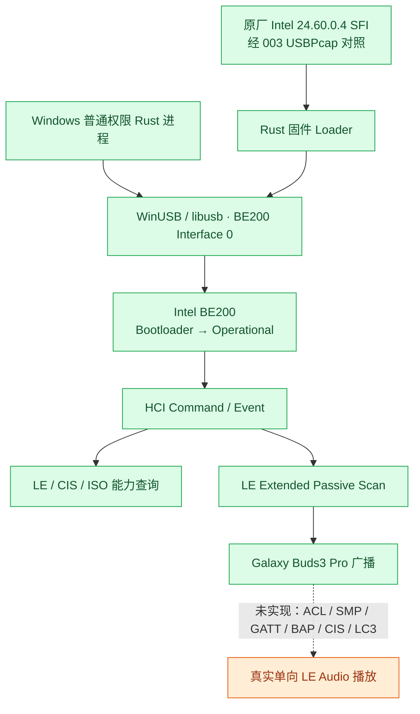
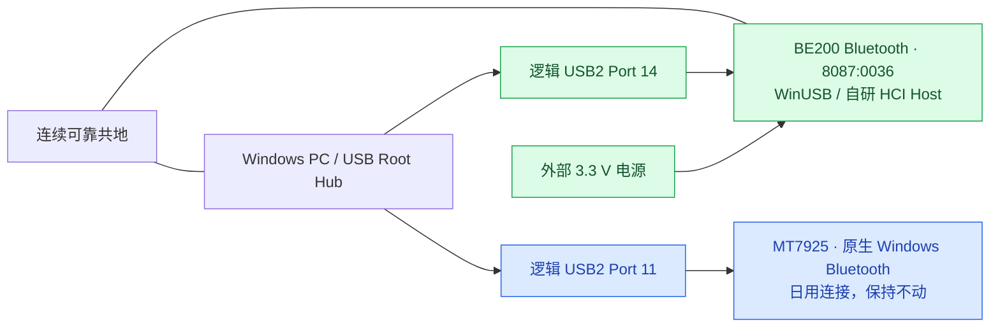
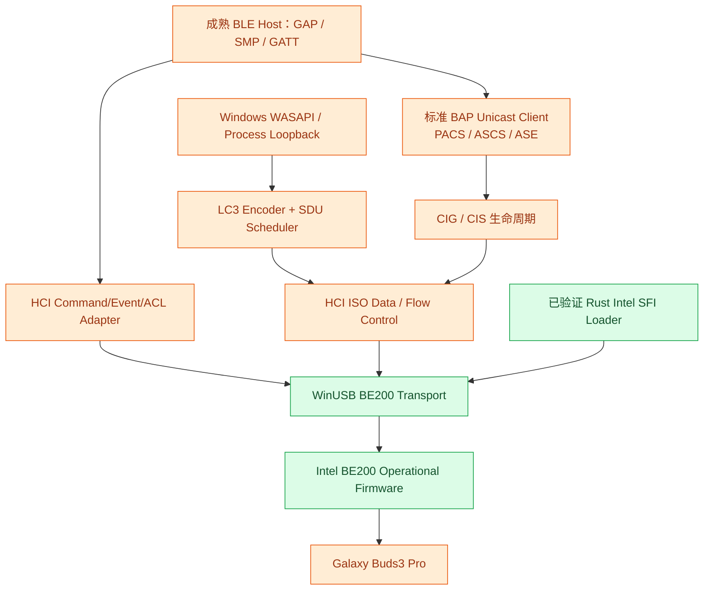
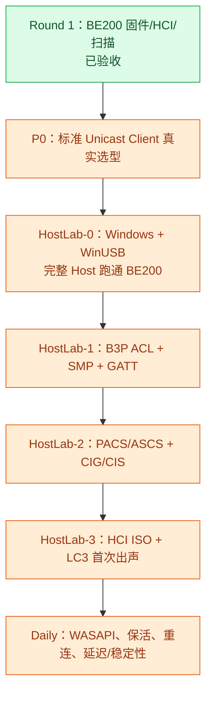

# BE200AudioHub · Round 1：从 Windows LE Audio 故障到独立 BE200 Controller / BLE Discovery

> **性质**：Round 1 技术总结、决策记录与工程复盘（供归档、后续 Chat 接棒、团队评审）。  
> **实验主体时间**：2026-10-11（原会话记录）；**整理日期**：2026-10-14。  
> **源代码仓库**：[`STanJK/BE200AudioHub`](https://github.com/STanJK/BE200AudioHub)，私有仓库，`main`。  
> **本轮最后核实的 HEAD**：`04a089e6a3d9476350e856ea322953e3f934a087`。该 SHA 是**本轮历史快照**，不是对未来 HEAD 的保证。  
> **证据来源**：用户的 Windows PowerShell/Cargo 实测输出；`001`–`004` USBPcap；原厂 Intel Windows 驱动包与 SFI/DDC；本轮生成的固件重组/抓包报告；BTstack 源码静态审查；GitHub 提交及实验文档。  
> **文档边界**：只写本轮有据可查的事实、已作出的决定与明确的推论；**不把尚未实现的 BLE ACL、GATT、CIS 或 LC3 播放写成完成**。本文件不包含私有固件、PCAP、驱动或源码副本。

---

## 0. 一页结论

Round 1 最终证明了一条过去完全受制于 Windows Bluetooth Host 的链路，可以由我们自己的 Windows 用户态程序独立掌控到以下程度：

1. **Rust + WinUSB 直接打开、Claim/Release BE200 USB Interface 0**，不经过 Windows `BthPort`/`BTHUSB` Host 接口。
2. **从 Intel 24.60.0.4 的 `ibtusb.sys` 恢复完整 RSA+ECDSA SFI 格式固件**，并与原厂 Windows 冷启动抓包逐字节对照。
3. **自己的 Rust Loader 在真实 BE200 上完成 3,960 次 Secure Send**，收到固件接受和 Boot Complete 事件，并把 Image Type 从 `0x01`（Bootloader）带到 `0x03`（Operational）。
4. **独立查询标准 HCI/LE/ISO 控制器能力**，确认 CIS Central 可用、ISO Buffer Size V2 返回 `248 B × 8`。
5. **独立实施 LE Extended Passive Scan**，在 Buds3 Pro 佩戴和配对模式下收到真实的 `Galaxy Buds3 Pro (2F23)` 广播报告；扫描能正确终止并释放 USB 资源。

以上构成了**一个有实机证据链的 Controller Bring-up + HCI + BLE Discovery 原型**，而**不是**一个已完成的 Windows LE Audio Dongle。BLE ACL 连接、SMP/Bonding、ATT/GATT、标准 PACS/ASCS/BAP、CIG/CIS 建立、HCI ISO 实际 TX 与 LC3 音频播放仍未在本轮实现。



**Round 1 最重要的转折**：先前是在 Windows 原生 LE Audio 上围绕故障做绕行；现在已经有能力在控制器 Host 侧自行设计后续连接与 CIS 生命周期策略。成功的是**控制权和证据链**，不是音频性能或产品化指标。

---

## 1. 项目起源、目标与严格的范围边界

### 1.1 起源：为什么不继续只修 Windows Relay

既有 `LE-Audio-Relay` 方向通过 Windows WASAPI Process Loopback 捕获应用声音，渲染至 B3P，并用持续音频输出降低静音拆链、CIS 重建导致声像/相位随机异常的发生机会。其日用架构含牺牲端点（优先 NVIDIA HDMI）、`48 kHz / 32-bit Float / Stereo`、10 ms 量级 Ring Buffer、`GameEffects` 默认渲染分类和持续 Keepalive。

这条路已有实用价值，但**仍由 Windows Bluetooth Host 及其 ACX/LE Audio 策略控制底层连接**。旧实验在 Intel AX21/BE 系列和 MTK 等路径中观察到 LE Audio 功能暴露/声像行为不一致，Windows 的设备策略与控制器通过标准 HCI 声明的能力不能混为一谈。

因此 BE200AudioHub 不是简单重写一个 WASAPI 播放器，而是回答更靠下的一层问题：**能否在 Windows 用户态自己运行 Bluetooth Host，直接决定与 Galaxy Buds3 Pro 的连接、CIG/CIS 及 ISO 音频生命周期？**

### 1.2 被确认的目标

| 项目 | Round 1 的决定 |
|---|---|
| 平台 | Windows 用户态；不要为了这个 Dongle 另做 Linux 桌面开发 |
| 控制器 | Intel BE200，独立于系统日用的 MT7925 |
| 耳机 | 首先针对 Samsung Galaxy Buds3 Pro；未来考虑新型号 |
| 音频方向 | **PC → 耳机单向下行**；独立麦克风提供输入，首版不做耳机麦克风通道 |
| 固件 | **使用 Intel 签名 Operational Firmware**；自研的是 Host，不试图破解或替换 Intel Controller 微码 |
| 日用目标 | 更可控的配对、CIS 维持/重建、LC3/ISO 调度及延迟，而非单纯“能够扫描” |
| 研发方法 | 用既有成熟开源协议栈来跳过重复劳动；自研只聚焦 BE200 移植层、实时 ISO/音频与生命周期策略 |
| 发布 | 当前私有实验；如以后发布/商业化，另行审查许可证、固件分发和独立实现边界 |

### 1.3 三种“支持 LE Audio”必须分开

1. **Controller 硬件支持 CIS/ISO**：R1.6a 已由 HCI 确认。
2. **Host 能建立 LE ACL、GATT、CIG/CIS 并收发 ISO SDU**：Round 1 尚未实现/验证。
3. **B3P 实际播放声音，稳定工作且满足延迟要求**：Round 1 更未完成。

不能因为第一条成立就宣称 Windows BLE 音频链路已经打通；也不能因 Windows 设置页显示能力开关缺失，就推翻控制器 HCI 返回的真实特性。

---

## 2. 硬件、驱动与安全约束

### 2.1 实机拓扑

- 开发主机：Windows 11；VS Code 内置 PowerShell **不是管理员权限**。实际 Cargo 编译、WinUSB Open/Claim 和 HCI 操作均可在普通权限运行。
- 本地代码：`C:\STanJK\Development\LEAudioLab\BE200\BE200AudioHub`。
- Intel BE200 Bluetooth：USB VID/PID `8087:0036`，本轮 PnP Instance ID `USB\VID_8087&PID_0036\5&47B74AE&0&14`，逻辑 Hub Port 14；USB Device Address 随重新枚举改变，实测由 13 变 14，**不可写死**。
- 日用蓝牙为 **MediaTek MT7925**，另一个逻辑 USB2 端口 11。二者可共用 USBPcap1 Root Hub 捕获，但**绝不能误改 MT7925、USB Root Hub、xHCI 或共享的前置 USB2 Header**。
- 实验硬件：BE200 E-key → M-key → Breakout；USB2 D+/D− 独立拉线；外部可控稳压 3.3 V 供电，地线与 PC 共地。需要防范数据线反向供电、悬空地、短路和误触热插拔；已做成功实验不等于整个飞线 Rig 具备产品级安全性。



### 2.2 USB 实测 Endpoint

| 功能 | Endpoint / Interface | 状态说明 |
|---|---|---|
| HCI Command | Interface 0 / EP0 Class Control OUT，`bmRequestType=0x20` | R1.4/R1.5/R1.6 实际可用 |
| HCI Event | Interface 0 / Interrupt IN `0x81` | 实际可用；需要事件组帧与分片/合包处理 |
| ACL | Bulk OUT `0x02`、Bulk IN `0x82` | 描述符/参考实现表明该路径；**本轮未建立 ACL** |
| Intel Bootloader Secure Send `0xFC09` | **Bulk OUT `0x02`** | 003/004 实际验证，与一般 EP0 HCI Command 不同 |
| Interface 1 SCO Isochronous | USB 其他 altsetting/iso endpoints | **不能由此认定 LE CIS 的 HCI ISO 就走这条 Interface** |
| HCI ISO via Bulk | 待验证 | 后续与 BTstack/Zephyr/参考驱动实测 USB DATA path |

### 2.3 Windows 驱动绑定的决策

最初原厂 Intel 驱动：

- Service `BTHUSB`、Provider `Intel Corporation`。
- INF `oem31.inf`、Version `24.60.0.4`。
- `cargo run -- driver status` 输出与 PnP 属性吻合。
- `driver backup --out ...` 导出 **3 个文件**，`driverBindingChanged: false`。

随后使用 **Zadig 只对 `8087:0036`** 手动切为 WinUSB：

- Service `WinUSB`、INF `oem17.inf`、Provider `libwdi`。
- `driver verify` 返回 `winusb_binding_verified`；`usb probe` 成功 `Open → Claim Interface 0 → Release`。
- 没有在 Rust 中实现自动换驱动；管理员 PowerShell 仅用于手动变更/回滚，普通开发不提升权限。
- **原厂 Intel Driver 的真实回滚尚未演练**。导出 INF 不等于完整系统还原点；`pnputil /add-driver /install` 不保证强制选择排名较低的驱动，应在**精确设备实例**的设备管理器里执行恢复，避免批量影响其它设备。

**反思**：应先建立可恢复性和设备作用域的检查，再做高权限的驱动操作。USB Address 可以变化，但 VID/PID、Interface 和 PnP Instance/Location guard 必须明确。

---

## 3. 实验路线：001 → 004，再到 R1.6

### 3.1 R1.1/R1.2：先只读，随后逐层增加权能

第一版 Rust `be200hub` 使用 `rusb`（vendored libusb）和 `log`，提供 `doctor`、`usb list`、`usb inspect`，并参照 VibeFactory 实现异步日志、滚动写文件。源码放在私有 `STanJK/BE200AudioHub`。Windows 本机初期 `cargo test` 为 2/2 PASS；受本地设备与驱动控制限制，助手的 GitHub 提交不能代替真实 Windows 编译与硬件验证。

早期三个 USB 实验的重要区别：

| 实验 | 操作 | 发现 | 工程含义 |
|---|---|---|---|
| `001-pnp-restart.pcapng` | Windows PnP Restart | 未重放完整固件加载 | 不能把 PnP 重启等同真正冷启动 |
| `002-PortCycle-restart.pcapng` | USB Port Cycle | Controller Operational HCI 初始化可见；支持 CIS 和 ISO buffers | 端口重新枚举也不必重载签名 Firmware |
| `003-ColdBoot.pcapng` | 外部 3.3V 真正断电/重新上电 | Intel 真实 Bootloader、Secure Send、Boot 及后续 HCI 初始化 | 为独立 Loader 提供可复验协议依据 |

这些实验确认：**USB Port Cycle、PnP 重启、BE200 真实失电后的 cold boot 是不同的状态转移**。只有最后一种本轮观察到了完整固件下载流程。

### 3.2 R1.3a / R1.3b：从“枚举”到“拥有 Interface 0”

R1.3a 构建了 `driver status` / `driver backup`：严格只匹配 BE200、记录 PnP、INF、Provider、Service、USB Location 和恢复提示，避免误对普通蓝牙适配器或 Root Hub 采取操作。R1.3b 由操作员安装 WinUSB，Rust 负责验证 `WinUSB` 和 PnP OK，然后执行短时 `open/claim/release`，不发 HCI、不重启控制器。

R1.3b 本机成功输出包括 `Open: OK`、`Claim interface 0: OK`、`Release interface 0: OK`，编译时只有一个可直接去除的 `unused_mut` 警告。**至此掌握的是 USB Interface 所有权，不是 Bluetooth Link Layer。**

### 3.3 R1.4：第一条完全独立的 Intel HCI Command

在设备已 Operational 的情况下发送 Intel `Read Version (0xFC05)`，1 字节参数 `0xFF`，EP0 Class Control OUT；在 `0x81` Interrupt IN 上组装 HCI Event，匹配相应 `Command Complete`，解析 Intel TLV。为防止版本事件超过 USB 64-byte Max Packet 导致误判，实现了大包接收和事件重组。

实机输出：

```text
Intel HCI Read Version: success (status 0x00)
Image: Operational (0x03)
CNVi TOP: 0x02001910
CNVr TOP: 0x02001910
TLV records: 30
Ignored unrelated HCI events: 0
Release interface 0: OK
```

这一步的价值是**首个与 Windows Bluetooth Host 解耦的 Host↔Controller 命令往返**。但它只证明厂商 HCI 命令/事件收发，不代表 BLE RF 通信。

### 3.4 R1.5a：对 Intel `.sfi/.ddc` 的离线理解

最初拿到的 Linux Intel firmware：

| 文件 | 大小 | 本轮检验 |
|---|---:|---|
| `ibt-0291-0291.sfi` | **978,976 B** | RSA+ECDSA 头、Payload Offset 964、嵌入命令 3,959、4-byte aligned 数据分组/片段 3,950、Boot Address `0x00100800` |
| `ibt-0291-0291.ddc` | **4 B** | 合法 DDC：`03 28 01 18` → Length 3、Parameter ID `0x0128`、Value `0x18` |

Linux SFI 声明 Build **145** / 2026 Week 36；DDC 只有 4 B **并非数据截断或文件损坏**。`firmware inspect` 对完整 Payload 的 DATA span `[964, 978976)` 作结构校验，且明确输出：`cryptographic signature verification: NOT PERFORMED`、`USB/HCI activity: NONE`。

**重要区别**：SFI 存储的签名头/固件 Payload 不等于在特定 SBE 路径上全部会被下载的字节。还原 HCI `0xFC09` 必须知道 SBE 类型、签名头分支和分片规则；**合法结构不代表镜像有权限启动，也不代表适配该 BE200**。

### 3.5 R1.5b 前半：从 Windows USB 抓包恢复完整 OEM 镜像

最初疑问：“能否把抓到的 Windows 固件恢复成原始包？” 对 003 的复核确定：

- Intel `0xFC09` **3,960 条**，其中 ECDSA INIT `128 B`、PKEY `96 B`、SIGN `96 B` 和 **3,957 条 DATA**。
- ECDSA header + DATA 为 **980,196 B**，DATA 为 **979,876 B**。
- `003-ColdBoot.pcapng` 捕获的 3,960 个 USB 固件传输均可恢复为成功提交的 HCI wire blocks。
- **仅凭总线抓包不能证明有完整原始 `.sfi`**，因为 ECDSA 启动时 **644 B RSA 头未经过 USB 传输**。

随后从用户导出的 **Intel 24.60.0.4 `ibtusb.sys`** 中找到与这 `980,196 B` 一致的连续字节序列，并找到紧邻其前的 **644 B RSA 头**；CSS 头自身的声明长度也与镜像边界相符。这使得实际恢复出了完整 **980,840 B 双签名 SFI 格式镜像**：

`be200_intel_windows_24.60.0.4_usb_verified.sfi`

| 属性 | Windows OEM | Linux SFI |
|---|---:|---:|
| 文件大小 | **980,840 B** | 978,976 B |
| ECDSA + Firmware DATA | 980,196 B | 978,332 B（含 ECDSA 320B + DATA 978,012B） |
| Embedded HCI Commands | **3,967** | 3,959 |
| HCI Secure Send DATA blocks | **3,957** | 3,950 |
| 声明 Build | **176** | 145 |
| 构建周 | 2026 Week 26 | 2026 Week 36 |
| 本机实际启动 | **Intel 原厂已启动，后又由 Rust 独立启动** | 仅离线解析，未在本机冷启动 |

**注意**：Build 编号与声明周数之间并非简单递增，不能无证据声称“Linux 的 Build 145 一定比 Windows Build 176 旧/新”或功能更完整。恢复的 Windows 镜像严格说是**Windows 驱动内嵌的完整 SFI 格式镜像**，并未证明 Intel 曾用这个文件名独立发布它。`ibtusb.sys` 中还发现其它候选签名镜像，只有与 003 完全匹配的那份被选为 BE200 首次独立启动基准。

关键 SHA256（作为日后重新确认输入的身份锚）：

```text
Windows OEM SFI (980840 B)
939a9b32ad11d8962abfd10cb24d5bd90d7848218af4ea438cf6490243a618d4

Windows ECDSA + DATA (980196 B)
8ceff0ecd6b41ff25401036c1baf7c597d3d59f681c6cbc73c5812d82d65ddf0

3,960 HCI 0xFC09 完整请求拼接 (996,036 B)
55200bef2efadd869500baf58909623fbf23c8d26e6218458cbf7a1fd8923531

Linux ibt-0291-0291.sfi
ab04144f4b05dbd7baa2e3b0def81b87e27652accc35193582468f570f606018

DDC ibt-0291-0291.ddc
e0fb10fe29f60607d6507ced3f697492d9611f62c4765feaee59c4bd4101d3e7
```

**首轮固件选择改变**：最初拟先用完整的 Linux SFI，后来从 `ibtusb.sys` 恢复 Windows OEM SFI 后，改为**第一轮必须使用已在同一张 BE200 上由 Intel Windows 驱动成功加载过的 Windows 镜像**，并锁死其 SHA256，降低硬件和协议两端的不确定性。Linux 镜像保留为比较基线，不直接交给第一版实机 Loader。

### 3.6 R1.5b 后半：独立 Rust Firmware Loader 实机 PASS

Rust Loader 从离线解析/计划演进到单次启动执行入口：在写入前检查 SHA256、USB 目标、WinUSB Service、BE200 型号、当前 Image Type、Hardware Variant、Secure Boot、SBE Type、Boot Address；严格单次传输，不做自动失电/重试/泛化 Opcode 注入。新增只读 `firmware preflight` 用于事前检查。

关键的 **004 捕获 + 控制台输出** 构成了两个互相独立的验证面：

| 阶段 | HCI / Intel 协议动作 | 004 结果 |
|---|---|---|
| 启动前 | `0xFC05 FF` | `Bootloader (0x01)`，CNVi/CNVr TOP `0x02001910`，HW Variant `0x1C`，Secure Boot `1`，SBE `1`（ECDSA） |
| 固件前 DDC | `0xFC8B 03 86 01 01` | Command Complete 成功 |
| 固件传输 | **Bulk OUT `0x02`，`0xFC09`，3,960 包** | **3,960/3,960 USB 成功完成**；与 003 Intel 原厂逐包零差异 |
| 下载结束 | Intel Vendor `0xFF/0x06` | 下载被控制器接受 |
| Boot | `0xFC01`，地址 `0x00100800` | 请求正常 |
| 完成启动 | Intel Vendor `0xFF/0x02` | Boot Complete |
| DSBR | `0xFC0A 00 00` | Command Complete 成功 |
| 重新核验 | `0xFC05 FF` | **Operational (0x03)** |
| Operational DDC | `0xFC8B 03 28 01 18` | Command Complete 成功 |
| 资源释放 | `release_interface(0)` | 成功 |

具体证据：`004-R1.5b-ColdSend.pcapng` 对应固件 Wire SHA256 与 003 的 **3,960 条 `0xFC09` 按序完全相同**；每条 Bulk OUT 都有成功 USB Completion。ECDSA+DATA 也与 Windows OEM SFI 自偏移 `644` 到 EOF 精确一致；嵌入 3,967 条完整 HCI 命令、边界无残片。

启动计时（仅各一次，且**不是**从外部 3.3V 上电开始的总时间）：

| 衡量 | Intel 原厂 003 | Rust 004 |
|---|---:|---:|
| 首条 Secure Send → Boot Complete | 1,337.05 ms | **1,521.96 ms** |
| 最后一条 USB 完成 → 下载确认 | — | 18.37 ms |
| Boot 命令 → Boot Complete | — | 55.39 ms |
| 固件 Bulk 提交完成时间中位数 | 304 μs | 315 μs |

单次相差约 **184.91 ms（13.8%）**，不能推出 Rust Loader 在统计上更慢或更差，也不该在功能正确性前急着优化不到 200ms 的单次差异。

**签名边界**：

- Rust `firmware inspect/plan` 检查结构、哈希和 003 的 on-wire SHA256，**不是独立用 Intel 公钥验证原厂签名**。
- Intel 控制器的 Secure Boot Engine 负责授权并验证该签名固件；这是“使用合法签名固件独立启动”，不是“解锁/绕过/替换 Intel 微码”。
- 当前实机 Loader 锁定 Windows 24.60.0.4 Build 176，不是支持任意 Intel 适配器和 SFI 文件的万能刷写工具。
- **真实掉电后通常要重新加载 Controller Operational Firmware；进程关闭、普通 Host 重启、耳机重连并不要求每次物理冷启动。** 未来状态机应检测 Image Type：Operational 直接连接，Bootloader 才触发受控加载。

### 3.7 R1.6a：标准 HCI 能力查询 PASS

在 R1.5b 已启动的 Operational BE200 上，执行 `hci capabilities`，完全无需再操作供电。实际读取：

| 字段 | 真实控制器报告 |
|---|---|
| HCI Version / LMP Version | `0x0D` / `0x0D` |
| Revision / Subversion | `0x44B0` / `0x44B0` |
| Manufacturer | `2`（Intel） |
| LE Features | `0x000000BE3F01F9FF` |
| LE 2M PHY | `true` |
| LE Extended Advertising | `true` |
| **CIS Central** | **`true`** |
| CIS Peripheral | `true` |
| ISO Broadcaster | `false` |
| Synchronized Receiver | `false` |
| LE States | `0x000003FFFFFFFFFF` |
| Extended Scan 指令支持 | `true` |
| LE ACL Buffer Size | `251 B × 6` |
| **LE ISO Buffer Size V2** | **`248 B × 8`** |

**重要误解的纠正**：`ISO Broadcaster=false` 和 `Synchronized Receiver=false` 是 BIG/BIS **广播**角色的特性位，并不是“控制器不支持 ISO”。我们目标是 **Unicast CIS Central**，其功能位为 true，且控制器有独立 ISO Buffer；但这**仍不证明已经可发送 ISO 连接音频**，因为缺少实际 CIG/CIS/USB ISO TX 验证。

### 3.8 R1.6b：BLE RF 扫描与 Buds3 Pro 真实发现 PASS

三轮 `ble scan --seconds 10`：

| 轮次 | 用户描述的 B3P 状态 | 总报告 | 观察 |
|---|---|---:|---|
| 1 | B3P 未启动 | 0 | 正常限时结束、主动 Scan Disable + Release |
| 2 | 取出并佩戴 | 3 | 2 条具名 `Galaxy Buds3 Pro (2F23)` Extended Advertising，RSSI `-39/-42 dBm`，SID 3，另有一条截断/空数据报告；控制器报告 Extended Scan Timeout |
| 3 | 配对模式 | 7 | 2 条具名 B3P，RSSI `-49/-52 dBm`，另有其它未具名广播；Disable + Release 成功 |

扫描使用 **LE 1M Passive Extended Scan**：不发送主动 Scan Request、不连接、不配对；Host 限时与 Controller native duration 双重约束，默认以单轮临时 `#ID` 遮蔽 MAC 地址。既有实现能够解析 Legacy/Extended 广播并做 AD Name 清理。

- `event_type 0x0001` 的 Connectable 标志存在，说明有进一步尝试连接的候选广播。
- `0x0041` 除 Connectable 标志外还带 Data Status = truncated，`data=0 B` 不能解释成另一个固定耳机实体。
- `3 reports / 3 unique` 和 `7 / 7` 只是按原始地址类型、地址统计，**不是 3 或 7 台实体，也不是左右耳固定拓扑**；RPA 轮换与协调集身份仍待 SMP/CSIS 证实。
- 首轮 0 条不意味着扫描实现失败，因为随后同一系统确实收到 B3P RF 广播。
- 当前 R1.6 硬件证据是用户 CLI 输出，**没有本轮单独的 R1.6 USBPcap**；R1.6 新增全部 Unit Test 的 `cargo test` 成功日志也没有被单独提供，不能沿用 R1.5b 的 `22 passed` 假称 R1.6 新测试已经覆盖验收。

**至此 R1.6a/b 以真实 HCI 能力结果和 BLE 广播结果通过实验验收。**

---

## 4. 工程与源码架构的真正进展

### 4.1 已经有的设施

| 层次 | 所有权 | 状态 |
|---|---|---|
| 独立 3.3 V + USB2 实验 Rig | 本地硬件 | 成功运行，仍是实验级飞线 |
| PnP 状态、OEM 驱动备份/恢复文档 | Rust + PowerShell | Status/Backup 已验收；真正回滚未测 |
| WinUSB Interface 0 的受控打开/释放 | Rust + `rusb` | 实机 PASS |
| Intel Bootloader/SFI/DDC 离线解析与签名传输计划 | Rust + 抓包证据 | PASS；签名密码学独立验签不做 |
| Windows OEM Build 176 固件独立冷启动 | Rust + BE200 | **实机 PASS** |
| HCI 控制命令与 Event 重组 | Rust | `0xFC05` / capabilities 实机 PASS |
| LE Extended Passive Scan | Rust | 三轮 B3P 广播发现 PASS |
| Windows 低延迟 PCM 获取/Ring 的经验 | 旧 `LE-Audio-Relay` | 可复用设计；尚未连接新 Host |
| BTstack BLE Host / SMP/GATT / CIG/CIS 基础源码 | 开源依赖 | **源代码存在，但尚未 Windows BE200 集成实测** |
| 标准 BAP Unicast Client + ISO + LC3 全链路 | 未选定/未完成 | **Round 1 未实现** |

### 4.2 建议的可替换架构（尚未落地）



> 图中 WASAPI 部分虽然可复用已有工程经验，但**还没有接入 BE200AudioHub**。BTstack、TrouBLE、Zephyr 的既有代码不能被自动视为已完成集成。

---

## 5. 开源 Host / LE Audio 调研及最关键的一次纠偏

### 5.1 初期选型：不能从零重复实现所有 Bluetooth Host

为了达到可日用的 B3P Dongle，下一层确实需要 BLE Central、LE ACL、L2CAP、ATT/GATT、SMP/Bonding，再到 PACS、ASCS、CAP/BAP、CIG/CIS、ISO 和 LC3。但**需求层级表不等于开发任务都要由我们从零实现**。

用户明确提出“后面这些东西不是可以抄已有项目吗？”——这个问题改变了开发路线：应先复用已成熟的 Protocol Stack，把工作集中到 **Windows/BE200 HCI Transport、Bluetooth Host 进程集成、ISO 数据面、B3P 互操作、CIS Lifecycle 与实时音频**。

最初评估的候选包括：

- **BTstack**：Windows WinUSB Port、BLE Central、SMP、GATT、部分 CIG/CIS/ISO Core；快速验证候选。
- **Zephyr**：有标准 LE Audio BAP/CAP 相关 API/样例的研究方向；移植 Windows 运行模型是独立问题。
- **AOSP/Fluoride**：Android 系统级 LE Audio Host 客户端研究候选；需确认依赖与宿主移植成本。
- **BlueZ / PipeWire**：Linux 完整 LE Audio 系统集成参考；架构更偏 Linux Host/媒体层。
- **Apache NimBLE**：BLE Host 候选；是否具备足够完整的标准 BAP Unicast Client，需源码核查。
- **TrouBLE**：Rust BLE Host 候选；LE Audio/CIS/ISO 的实际完整度需核查。
- **Google liblc3**：LC3 编码器候选；它本身不替代 BAP/ASCS 客户端。

**到 Round 1 结束仍未完成上述栈的横向完整源码证据对照，不能据此宣布某一栈已经是最终技术选型。**

### 5.2 对用户上传 BTstack Master ZIP 的静态审计

用户上传完整的 `btstack-master.zip`（约 71 MB；ZIP 无 `.git`，不可只凭 `master.zip` 名称断言准确上游 Commit）。审计报告：`BE200AudioHub_BTstackLab_Source_Audit_2026-10-11.md`。

| BTstack 路径 | 发现 | 结论边界 |
|---|---|---|
| `port/windows-winusb` | 存在可在 Windows 运行的用户态 HCI/Host Port | 适合作为 **BTstackLab-0** 起点；尚未编译验证 BE200 |
| `port/windows-winusb-intel` | 带针对旧 Intel 8260/8265 的 Firmware Download 示例 | **不要**取代本轮已验证的 BE200 Rust Loader |
| `platform/windows/hci_transport_h2_winusb.c` | HCI EP0、Interrupt、ACL Bulk 路径存在 | 缺少已连通的 `HCI_ISO_DATA_PACKET` 处理；实际需改造和验证 |
| 同上 | Control Transfer 的 `Setup.Length = sizeof(size)` | 可疑的长度错误，**静态审查怀疑**，需实际审查上下文、修复测试后确认 |
| Windows config/CMake | ISO、Extended Advertising 未按目标启用；LE Audio Lite/LC3 目标并非开箱即构建 | 需要实验分支独立配置/链接 |
| `src/hci.c` | 标准 LE Central、部分 CIG/CIS/ISO 状态管理与分片机制 | 有基础轮子，但“已有核心”不等于“Windows ISO 完整可用” |
| `example/gatt_browser.c` | 示例有自动连接第一个广播者的路径 | 改成同一扫描会话、由操作员明确选择 Connectable 地址；避免随意连接附近设备 |
| `example/le_audio_unicast_gateway_lite.c` | 使用私有 Manufacturer Advertising 协商 LC3 配置，跳过标准 PACS/ASCS/BAP | **不是**能直接连接普通 Galaxy Buds3 Pro 的标准 Unicast Client |
| `src/bluetooth_gatt.h` | 包含 PACS/ASCS/CAS/CSIS UUID 常量 | **常量不是协议实现** |
| `3rd-party/lc3-google` | Codec 代码存在 | 需要移植/链接/Audio Scheduler 才能用于实时播放 |

### 5.3 本轮必须保留的纠偏

最初助手一度从“BTstack Lite 不是标准 BAP Client”推到“我们需要自己写标准 PACS/ASCS/BAP Client”。用户指出“seriously? LE 开发没有已有的开源实现吗？”后明确纠正：

**正确结论**：

- **BTstack 的该快照没有找到一条可直接在 Windows/BE200 上对商用 B3P 运行的、完整标准 Unicast Client**；这是某份源码、某个平台、某个角色的局部结论。
- **这绝不等于行业没有标准 LE Audio 的开源实现**。下一轮应对 Zephyr、AOSP、BlueZ/PipeWire、NimBLE、BTstack、TrouBLE 逐项追查 *标准 BAP Client / CAP Initiator / ISO Transport / Windows 移植性*。
- 单独区分“支持 BLE”“有 LE Audio 例子”“有标准 BAP Unicast Client”“有可在我们的 Windows 用户态/BE200 上运行的成品”，这四个问题不能用同一个勾选框表达。

这次误判暴露了一个研究方法缺陷：**只读了最容易访问的一个演示程序，就对整个开源生态下结论**。今后必须基于代码路径、功能角色、Profile 版本、运行条件和真实集成实验作出判断。

### 5.4 许可证/“净室逆向”的决策与边界

用户决定**先以私有实验求最快可用结果**，愿意复用 BTstack 等已有代码，未来如计划公开再考虑独立实现或授权。这个工程排序合理，但不代表“私有仓库自动豁免上游许可证”。

- 对 BTstack 的私有试验、再分发和潜在商业用途，应按其实际许可证要求处理并保留许可证/版权文本。
- 真正的 Clean-room Reimplementation 不是把读过的源代码改名、改写成 Rust，而应使用独立的公开规范、接口行为与外部测试，以合理的独立开发流程实现。
- 如以后要求宽松许可证公开发布，要么按上游许可证获得适当许可，要么严谨地设计独立实现流程；不要将当前 BTstack 实验分支混进声称净室的正式主线。

### 5.5 改变后的 HostLab 策略（决策方向，非已经交付的代码）

**Rust 独立主线**保持 Firmware Loader、设备生命周期、音频/调度控制；在独立 **BTstackLab** 或最终选定的其它 HostLab 中运行成熟 BLE Host；**同一时刻只能有一个进程拥有 BE200 USB Interface 0**。

- Lab-0：让成熟 Host 以 BE200 当前 Operational 固件正常初始化，读 HCI，扫到广播。
- Lab-1：**同一扫描会话**明确选定 Connectable 目标，获取 LE ACL Handle，验证断链/必要时 GATT/SMP。
- Lab-2：使用已证实完整的**标准 BAP Unicast Client**查询 PACS/ASCS、配置 ASE、CIG/CIS；需要核查左右耳拓扑和地址隐私。
- Lab-3：Windows ISO 数据通道、LC3、测试 SDU/PCM，再与既有 LEAudioRelay 音频管线整合。

**截至 Round 1 结束：BTstackLab-0 尚未运行，BLE ACL/GATT 更未通过。** 是否 BTstack 最终胜出必须依赖下一轮标准 Unicast Client 横向调研。

---

## 6. 完整的决策账本（Decision Register）

| 编号 | 决定 | 为什么 | 状态 / 回退 |
|---|---|---|---|
| D-01 | 从 Windows Keepalive Relay 分出独立 BE200AudioHub Host 项目 | Windows LE Audio 策略/CIS 重建不可控 | 已落实到独立仓库；Relay 可保留作对照 |
| D-02 | Windows 用户态 + Rust + WinUSB；不新增 Linux 日用栈 | 目标是 Windows 插入式单向 Dongle | R1.1–R1.6 实验通过 |
| D-03 | BE200 专用，MT7925 留作原生日用蓝牙 | 隔离风险和设备策略 | 硬件/逻辑端口已区分；长期回归待做 |
| D-04 | 先备份 Intel OEM Driver，再手动指定 BE200 WinUSB | 可恢复性优先，避免误作用于其它设备 | 备份 PASS、绑定 PASS；回滚流程尚未演练 |
| D-05 | 固件只用 Intel 签名镜像，Host 自研，不破解 SBE | 我们要可控的 Host，不是可修改的 Controller Firmware | 004 实机通过 |
| D-06 | 使用 PCAP+源码双证据重构 Intel Boot Protocol，不盲目重放未知 Payload | ECDSA 头/Secure Send Endpoint/Boot Event 有细节差异 | 003/004 3,960 包完全匹配 |
| D-07 | 起初考虑 Linux SFI，恢复 Windows 24.60.0.4 OEM SFI 后首启切换到后者 | 同一 BE200 上原厂启动过，未知变量更少 | Windows Build 176 首启 PASS；Linux Build 145 仅离线 |
| D-08 | 固件 Loader 设置 Bootloader/SBE/型号/哈希/单次尝试 guard | 避免误向 Operational 或错误设备重刷 | 实机 PASS；禁止自动重试 |
| D-09 | 运行软件/连接耳机时**不必每次物理断电** | Operational Firmware 可在供电保持时继续驻留 | 状态决定是否需要 Firmware Load；自动 lifecycle 尚待做 |
| D-10 | HCI ISO 运输路径先据 USB/Host 实现验证，不把 Interface 1 SCO Iso 当成 LE CIS | USB endpoint 名称和 HCI ISO 协议不是一回事 | 待真实 ISO Bulk 实验 |
| D-11 | BLE 扫描只开 Passive、限时、默认隐藏地址 | 先验证 RF 路径，减少副作用和敏感信息 | R1.6b PASS |
| D-12 | BLE Host 优先复用成熟栈，不从零写 SMP/GATT/BAP | 自研协议栈成本高且不直接创造项目核心价值 | 方向确定；具体 Host 未选定 |
| D-13 | 独立 HostLab，BE200 Interface 0 单进程独占 | 保留已验证 Rust Loader，与第三方 Host 解耦 | 提案，尚未做 HostLab 实测 |
| D-14 | 不把 BTstack Lite 的私有 LC3 协议当标准 BAP | 其演示根本不能覆盖商用 B3P 互操作 | 源码已审，下一步全生态核查 |
| D-15 | 私有原型优先；开放/商业化另行梳理许可证及净室边界 | 工程速度与未来合规可同时兼顾，但不能混淆 | 法务/授权事项尚未完成 |
| D-16 | 阶段成功必须来自真实 Windows 构建/CLI/PCAP，而非 GitHub 提交本身 | 远端写源码并不代表本地设备已运行 | 004、R1.6 有实验依据；继续贯彻 |

---

## 7. 本轮反思：技术认识与工作方法

### 7.1 真正值钱的是“可核验证据链”

从 PnP → USB Port Cycle → 真正 Cold Boot，逐步解释控制器的状态转换；从 `ibtusb.sys` 的静态镜像提取 → SFI 结构校验 → PCAP `0xFC09` 逐包比对 → Rust 实机成功启动 → 再以 R1.6 接收到真实无线广播。这比只展示一条 `PASS` 日志强得多：**每层成功都能被不同渠道重复检验**。

最强证据是 003（Intel 原厂）和 004（Rust Loader）在 3,960 包上按顺序逐字节相同，并且后续的 0xFF 下载/启动事件与 Operational 版本查询吻合。这里已经不是“对照接口写代码”的静态演示，而是**独立完成了一次由硬件验证的 Host 初始化**。

### 7.2 但必须收紧“完成”的定义

R1.5b PASS 只能说固件 Bring-up 正确，不代表完全替代 Intel Windows BT Driver；R1.6 PASS 只能说 HCI Capabilities 和 BLE Passive Scan 正确，不代表连接/配对/音频正确。BTstack 代码存在，不代表该代码在我们 Windows/BE200 上已经能运行。今后每一个里程碑都应给出：**输入条件、操作、可观察事件、量化验收、失败边界**。

### 7.3 安全工程与快速 YOLO 可以共存，但条件是失败范围被限定

曾有外部 3.3V 热接线/断电试验，但其价值来自反复确认共地、作用于单一 BE200 和采集可复现 USB 日志；这不等于能把任意电源操作标准化给所有用户。后续默认**保持供电，复用已启动的 Operational Firmware**；不为软件状态错误直接断电，不碰 MT7925/USB Hub。不需要自动循环重刷的情况下，就不要写自动恢复的高风险路径。

### 7.4 过程中的明确失误与修正

- **编译漏项**：R1.5a/1.5b 源码引用 `AppError::Firmware` 却没有在 `src/error.rs` 加变体，导致用户首轮 `cargo test`/`firmware plan` 无法编译。后由 `97a2bd8` 修复；教训是 GitHub 写入之后应有明确的本地编译关口，不能把静态审查当编译通过。
- **Cargo.lock 漂移**：增加 `sha2` 后本机 Cargo 更新锁文件，远端不一定同步。后续应在本地锁文件与测试通过后提交，而不是直接手动拼出校验和。
- **错误泛化**：只审了 BTstack Lite 就推断标准 BAP Client 需要全部自写。用户质疑后纠偏；以后要先做跨项目/跨角色的开源生态调查再选架构。
- **能力层误解**：`ISO Broadcaster=false` 被直觉解读为“ISO 还是 false”。规范上它只约束 Broadcast BIG/BIS；CIS Central/ISO Buffer 是另两项信息。
- **扫描设备计数误解**：按地址的 `unique` 可能被看成不同耳机。RPA、地址类型、协调集还未证明，输出/文档必须严谨。
- **原始 SFI 与 On-wire Byte 的混淆**：USB Capture 没有传输 RSA Header，后从 Windows `ibtusb.sys` 才补齐；以后区分“网络/总线见到什么”和“存储容器完整内容是什么”。
- **性能因果的误读**：Intel 003 与 Rust 004 单次约 185ms 差异，既可能有 Host 实现/USB 调度因素也可能是实验条件；没有多轮统计便不能下性能结论。
- **文档状态漂移**：初期 README/ROADMAP 曾落后于真实测试；每次实机 PASS 后应及时修正文档，区分“implemented / awaiting local test / verified / no longer relevant”。
- **文件跨 Chat 复用的现实约束**：历史助手生成文件未必自动进入用户定义的共享空间，且旧 ZIP 中还可能间接重新打包用户原始上传。Round 1 完结时专门制作索引、去原始副本的综合 Handoff；今后要尊重文件来源、版本和 SHA256。

### 7.5 更高层的判断：项目价值从“能跑”转向“能控制”

本轮硬件 Hack 的趣味性来自端到端的真实反馈：Rust 发出字节 → USB 总线传输 → Intel 控制器状态改变 → RF 收到 Buds3 Pro 广播。工程价值在于验证了 Windows 用户态独立 Controller Host 的可行性。

但科研创新性应更谨慎：复刻 HCI/Secure Send 和标准 BLE Scan 主要是成熟机制的工程移植。更可能出现原创贡献的部分在**可量化的 CIS 生命周期、稳定性、Host scheduling、时钟同步和低延迟策略**。这要求未来同一控制器/耳机下与 Windows 原生 Host 做可控对照，并保留完整原始数据；目前**尚未产生这种对照实验的结论**。

---

## 8. 后续工作与停止条件

### 8.1 当前缺失的模块（不要用“已有轮子”充当验收）

| 模块 | 当前状态 | 下一阶段验收 |
|---|---|---|
| 真实 LE ACL Connection | 未完成 | 同一扫描会话明确选定 B3P，LE Enhanced Connection Complete 返回 Handle，随后主动 Disconnect |
| ACL USB Bulk Framing | 未完成 | 处理 HCI ACL handle/flags/fragment，并在 BE200 上确认 Bulk IN/OUT |
| L2CAP / SMP / Bonding / RPA | 未完成 | 加密、配对与持久密钥管理；不再把 RPA 当固定身份 |
| GATT + B3P Audio Services | 未完成 | 实读 PACS、ASCS、CAS、CSIS（若存在）及权限 |
| 标准 BAP/CAP Unicast Client | **未选定完整可移植实现** | 配 Sink ASE，获得正确 Codec/QoS/Metadata 配置并建立控制面 |
| CIG / CIS | 仅 Controller Capability true | 真正建立一个或多个 CIS，验证重建与同步 |
| HCI ISO Data over USB | 未完成 | 独立确认 BE200 数据收发端点/packet format/flow control |
| LC3 + WASAPI 播放 | 未完成 | 协商帧长后播放可辨识测试音，再接系统音频 |
| Daily Driver | 未完成 | 断连恢复、保活、延迟测量、单耳/双耳处理、长时稳定性 |

### 8.2 下一轮**优先级 P0**：寻找完整的开源标准 Unicast Client

Round 1 最后一次决策纠偏是：**不要急着把 BTstack Lite 当作产品雏形，更不要先决定必须自写 PACS/ASCS/BAP**。应逐项目核对：

1. **Zephyr**：BAP Unicast Client / CAP Initiator 实际支持、API 完整度、移植到 Windows 用户态难度。
2. **Android AOSP/Fluoride**：实际 LE Audio Client Control/ISO 与 OS 依赖，是否可剥离。
3. **BlueZ + PipeWire**：BAP Client/CIS/音频调度实现的分工及 Linux 依赖边界。
4. **BTstack 最新源码**：是否已有标准 Client 更新、Windows WinUSB / HCI ISO 缺口究竟多大。
5. **Apache NimBLE / TrouBLE**：BLE Central/SMP/GATT 完整度及标准 ISO/BAP Client 的确切现状。
6. **liblc3**：作为 Codec 复用，区分 Codec 代码与协议控制面。

要求对每项分别给出：**标准 Profile 角色**、关键源码路径、HCI/ISO 接口、Windows 移植的可行性、许可证、运行级证据。筛出一条**最短可行方案**和一个备选方案，避免对单个仓库做凭印象的否定。

### 8.3 P1–P4 最短实施路径



下一阶段应避免：反复重做 R1.5b Cold Boot；重新安装 BE200 原生 Intel 驱动；任意扫描地址自动连接；在未证明 ISO Data Transport 前断言音频可用；为“实现完整 BLE”先手写庞大的 SMP/ATT/BAP 栈。

### 8.4 工程待办（与核心选型独立）

- 查本机 `git status --short` 和 `git diff -- Cargo.lock`，确认 `sha2` 依赖对应 `Cargo.lock` 是否已提交；勿手动杜撰 Cargo checksum。
- 收集 **R1.6 增量代码的完整 `cargo test`** 成功输出（本轮没有完整上传），以及未来 LE Connection/ISO 测试时的最小隔离 USBPcap。
- 抽查 WinUSB→Intel 驱动恢复演练的风险与设备范围（现有备份不等于回滚已验证）。
- 如果后续引入 BTstack，关注其 Windows WinUSB HCI Control Transfer 长度、目标 VID/PID 固定、ISO TX/RX 和 LC3 Linkage，**先做 BTstackLab-0**，不要直接尝试 B3P 音频。
- 对固件、驱动和 USBPcap 采取私有保管；PCAP 可能包含同 Root Hub 上的 HID/USB 其它设备活动和硬件身份。

---

## 9. GitHub 历史与证据入口

### 9.1 关键提交（本轮经 GitHub 读取/写入）

| Commit | 内容 |
|---|---|
| `e7cae78` | R1.3a Windows PnP status + Intel OEM backup |
| `ebe9c6f` | R1.3b WinUSB binding check 与 Open/Claim/Release |
| `7257c2b` | R1.4 Intel HCI Read Version |
| `faba5ec` | R1.5a SFI/DDC 离线结构解析 |
| `edb611f` | R1.5b 独立 Intel Signed Firmware Loader 基础 |
| `ec96876` | 锁定 Windows OEM SFI Build 176 和完整 003 wire hash |
| `97a2bd8` | 修复缺失的 `AppError::Firmware` 编译问题 |
| `807a8d9` | 004 独立 Cold Boot 抓包与结果归档 |
| `63523e8` | R1.6 标准 HCI Capabilities + Passive BLE Scan |
| `04a089e` | 005 R1.6 发现实验归档、R2 计划 |

源代码和实测历史分开核验：远端 Commit 证明已提交什么；用户 Cargo/CLI 才证明是否在本机编译、运行；PCAP 则能补充协议字节级的独立证据。

### 9.2 关键实验文件与资料（名称是线索，不代表新的 Chat 自动可见）

**用户上传的原始资料**：

- `001-pnp-restart.pcapng`、`002-PortCycle-restart.pcapng`、`003-ColdBoot.pcapng`、`004-R1.5b-ColdSend.pcapng`。
- `exported-driver.zip`（包含原厂 Intel Driver 备份文件）。
- `ibt-0291-0291.sfi`、`ibt-0291-0291.ddc`。
- `shared_resource.zip` 与 `btstack-master.zip`（依赖/源码采石场）。
- `BE200-Dump-20261011-173440.zip`、硬件图片等 PnP/硬件资料。

**本轮助手生成的资料**：

- `BE200-003-Analysis-Package.zip`、`BE200-003-ColdBoot-Analysis.md`、`BE200-003-Firmware-Chunk-Index.csv`、`BE200-003-HCI-Timeline.csv`。
- `LEAudioLab_BE200_Quarry_Full_2026-10-11.zip`、`LEAudioLab_BE200_Quarry_Index_2026-10-11.zip`（注意历史 Full 包可能包含原始上传副本；末期重新生成的 Handoff 对此做过去副本处理）。
- `BE200_Windows_Firmware_Reconstruction_2026-10-11.zip`、`BE200_Windows_Firmware_Full_Extract_2026-10-11.zip`、`be200_intel_windows_24.60.0.4_usb_verified.sfi`。
- `BE200_004_Forensic_Analysis/004-R1.5b-Capture-Review.md`。
- `BE200AudioHub_R1.6_Research_Handoff_2026-10-11.md`。
- `BE200AudioHub_BTstackLab_Source_Audit_2026-10-11.md`。
- `BE200AudioHub_AllGenerated_FullHandoff_2026-10-11.zip`（在本次归档之前，已经整理 45 条历史文件记录；其中 34 条历史生成、11 条用户上传未直接收入）。

**仓库中的公开名称、私有内容**：

- [`docs/EXPERIMENT_004_R1_5B.md`](https://github.com/STanJK/BE200AudioHub/blob/main/docs/EXPERIMENT_004_R1_5B.md)
- [`docs/EXPERIMENT_005_R1_6.md`](https://github.com/STanJK/BE200AudioHub/blob/main/docs/EXPERIMENT_005_R1_6.md)
- [`docs/ROADMAP.md`](https://github.com/STanJK/BE200AudioHub/blob/main/docs/ROADMAP.md)
- [`docs/R2_CONNECTION_PLAN.md`](https://github.com/STanJK/BE200AudioHub/blob/main/docs/R2_CONNECTION_PLAN.md)
- [`docs/R1_6_HCI_SCAN.md`](https://github.com/STanJK/BE200AudioHub/blob/main/docs/R1_6_HCI_SCAN.md)

> **文档可靠性层级**：当前 GitHub 源码 / 用户提供的测试输出 / 原始 PCAP > 经过核对的分析报告 > 先前对话的推论性文字。出现冲突时，回到一手来源，不采用较新总结自动覆盖老事实。

---

## 10. Round 1 的终局判定

**已交付、已实测**：BE200 上的独立 Windows 用户态 Controller Bring-up（包括厂商签名固件下载）、基础 HCI、标准 LE Capability/ISO Buffers 查询、Passive RF Discovery 和 B3P Advertising 接收。

**尚未交付**：可替换的成熟 BLE Host 接入、LE ACL/GATT/SMP、标准 LE Audio Unicast Client、实际 CIS、HCI ISO、LC3/Windows Audio Pipeline，以及日用化低延迟/稳定性证明。

**核心反思**：

1. 有时真正的工程门槛不是“标准协议太复杂”，而是没有对硬件和主机侧建立可控、可验证的边界；本轮已经跨越这一基础门槛。
2. 所有硬件 Hack 都应有最小作用范围、可恢复路径、明确的通过条件和原始可复验证据。
3. 下一轮应将研发重心从 Intel 固件和自写基础 BLE Protocol 移至**完整标准 Unicast Client 的开源复用/Windows 适配**，把时间花在只有我们自己的系统才能解决的 CIS 生命周期和实时音频问题上。
4. **“控制器独立启动成功”是 Round 1 的结项点；“Galaxy Buds3 Pro 真正播放出自己的 LC3 音频”才是下一阶段最重要的产品里程碑。**

